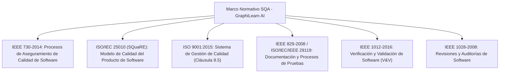
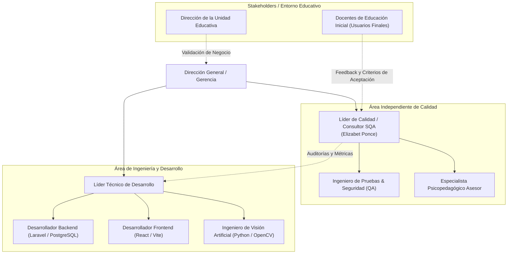
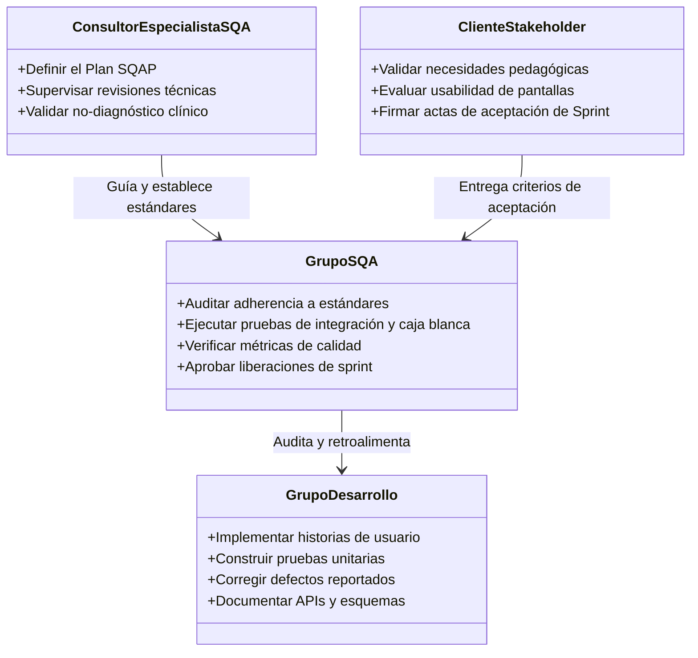
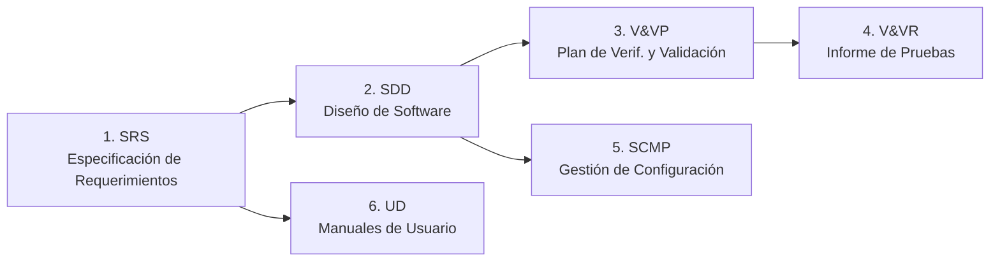
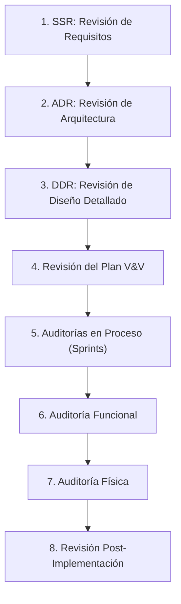
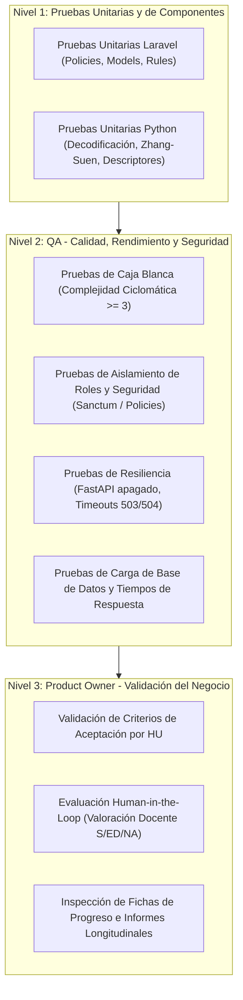
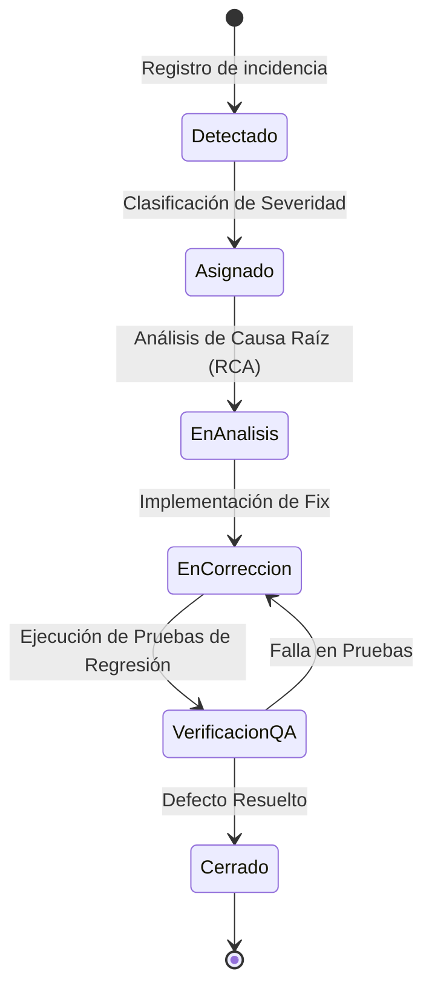

# Manual de Calidad y Plan de Aseguramiento de Calidad de Software (SQAP)
## Sistema Inteligente para la Detección Temprana de Riesgo Grafomotor en Niños de Nivel Inicial — GraphiLearn AI

---

## 1. Introducción

El presente **Manual de Calidad y Plan de Aseguramiento de Calidad de Software (SQAP - Software Quality Assurance Plan)** establece las directrices, estándares, metodologías y mecanismos de control aplicados durante el ciclo de vida del sistema **GraphiLearn AI**.

### Contexto del Proyecto GraphiLearn AI
En la etapa de educación inicial (pre-kínder y kínder, edades comprendidas entre los 4 y 5 años), los niños desarrollan habilidades motoras fundamentales previas a la alfabetización formal: coordinación visomotora, control del lápiz, direccionalidad, regularidad y continuidad del trazo. La identificación oportuna de rezagos o dificultades en estas habilidades es crítica para evitar la consolidación de trastornos del aprendizaje de la escritura, tales como la disgrafía.

Tradicionalmente, la evaluación grafomotora en el aula se realiza mediante observación directa subjetiva del docente y anotaciones en cuadernos anecdóticos. Este método presenta limitaciones inherentes: falta de mediciones cuantitativas, alta variabilidad entre observadores y dificultad para realizar un seguimiento longitudinal objetivo del estudiante a lo largo del año escolar.

**GraphiLearn AI** surge como una solución tecnológica integral de apoyo pedagógico diseñada bajo el paradigma **Human-in-the-Loop** (el sistema asiste con mediciones objetivas; el docente siempre conserva la decisión evaluativa soberana). Su arquitectura desacoplada está compuesta por:
1. **Frontend Web React (Vite):** Interfaz para docentes y personal directivo con diseño intuitivo y adaptable.
2. **Backend de Gestión Laravel 12 (API RESTful):** Administra la seguridad con Laravel Sanctum, roles diferenciados, instituciones, aulas, estudiantes, programaciones multi-ejercicio y el almacenamiento privado de fotografías.
3. **Microservicio de Visión Artificial y Machine Learning (Python + FastAPI):** Proceso independiente que recibe imágenes en memoria, ejecuta preprocesamiento digital con OpenCV (filtrado bilateral, binarización de Otsu, componentes conexos, esqueletización Zhang-Suen) y extrae características geométricas (longitud, curvatura, inclinación, proporción) y cuatro indicadores cuantitativos normalizados (desviación del patrón, continuidad, regularidad y rugosidad).
4. **Base de Datos Relacional PostgreSQL 17:** Persistencia transaccional de evaluaciones, resultados computacionales y una bitácora inmutable de trazabilidad histórica.

Dada la naturaleza crítica del sistema, que involucra datos sensibles de menores de edad y el soporte a decisiones pedagógicas formativas, el aseguramiento de la calidad no es una actividad accesoria, sino un eje transversal que garantiza la confidencialidad, exactitud matemática, confiabilidad de servicio, usabilidad y mantenibilidad del software.

---

## 2. Marco Institucional de la Organización Desarrolladora

Para propósitos organizacionales y de aseguramiento de calidad según los estándares internacionales, el software es desarrollado y mantenido por la entidad tecnológica **GraphiTech Solutions S.R.L.** (Santa Cruz – Bolivia), bajo el siguiente marco corporativo:

### 2.1. Misión
Desarrollar soluciones de software innovadoras, éticas y de alta calidad técnica que integren visión por computadora e inteligencia artificial para apoyar el diagnóstico formativo y la intervención pedagógica temprana en la educación boliviana e internacional, garantizando la seguridad, exactitud y protección de la niñez.

### 2.2. Visión
Consolidarse para el año 2030 como la empresa referente en Bolivia y Latinoamérica en el desarrollo de plataformas tecnológicas educativas de cribado y seguimiento grafomotor, reconocidas por su rigurosidad metodológica, cumplimiento de estándares de calidad de software y compromiso con la inclusión educativa.

### 2.3. Valores
* **Integridad y Ética:** Compromiso innegociable con la privacidad y la protección de datos sensibles de menores de edad.
* **Excelencia Técnica:** Adherencia estricta a estándares internacionales de ingeniería de software (IEEE, ISO/IEC).
* **Innovación Orientada al Usuario:** Creación de herramientas funcionales que empoderen a los docentes sin sobrecargas operativas.
* **Rigor Científico:** Distinción transparente entre mediciones cuantitativas comprobables, modelos de prueba en laboratorio y validaciones pedagógicas reales.
* **Transparencia y Trazabilidad:** Garantía de que todo resultado computacional y juicio evaluativo sea auditable e inmutable.

---

### 2.4. Estándares Aplicados en la Organización

La organización adopta como marco normativo los siguientes estándares internacionales:

1. **IEEE Std 730-2014:** Estándar que rige la estructura, alcance y responsabilidades del presente Plan de Garantía de Calidad (SQAP).
2. **ISO/IEC 25010 (SQuaRE - Software Product Quality Requirements and Evaluation):** Define las 8 características de calidad que el software debe cumplir: Adecuación Funcional, Eficiencia de Desempeño, Compatibilidad, Usabilidad, Confiabilidad, Seguridad, Mantenibilidad y Portabilidad.
3. **ISO 9001:2015:** Directrices de gestión por procesos, enfoque al cliente y mejora continua aplicadas a la fábrica de software.
4. **IEEE Std 1028-2008:** Estándar para revisiones de gestión, revisiones técnicas e inspecciones formales de código y arquitectura.
5. **IEEE Std 1012-2016:** Marco de Verificación y Validación independiente (V&V).

---

### 2.5. Organigrama de la Organización

La estructura organizacional asegura la independencia del equipo de SQA respecto al equipo de desarrollo, garantizando objetividad en la evaluación de la calidad:

---

### 2.6. Políticas de Calidad

1. **Política de Calidad del Producto:** GraphiLearn AI se desarrollará bajo especificaciones formales comprobables, garantizando que ninguna funcionalidad pase a producción con defectos críticos (severidad 1 o 2) abiertos.
2. **Política de Seguridad y Protección de la Niñez:** Toda fotografía y dato biométrico o personal de estudiantes de educación inicial debe almacenarse en discos privados encriptados, con acceso estrictamente restringido a su docente titular mediante tokens Bearer Sanctum y políticas de autorización en backend. Ninguna fotografía tendrá acceso público por URL.
3. **Política de No Diagnóstico Clínico Autónomo:** Ningún componente algorítmico o de Machine Learning emitirá diagnósticos médicos o clínicos automatizados. El sistema solo generará descriptores geométricos cuantitativos como insumo informativo; la calificación pedagógica (Superado, En Desarrollo, No Alcanzado) será siempre potestad exclusiva del docente.
4. **Política de Trazabilidad e Inmutabilidad:** Toda emisión o modificación de valoraciones u observaciones pedagógicas debe generar un registro inmutable en la bitácora de auditoría histórica, identificando usuario, fecha, hora y valores previos.
5. **Política de Verificación Continua:** Todo incremento de software debe respaldarse con pruebas unitarias y de integración automatizadas con cobertura superior al 80% en lógica de negocio, ejecutadas exitosamente antes de cada liberación.

---

## 3. Plan de Aseguramiento de Calidad de Software (SQAP)

### 3.1. Propósito
El propósito del presente SQAP es definir los procedimientos, actividades, herramientas y técnicas necesarias para asegurar que el producto de software **GraphiLearn AI** cumpla con los requisitos funcionales, pedagógicos, de seguridad y de rendimiento acordados, satisfaciendo los estándares de calidad de la Universidad Autónoma Gabriel René Moreno (UAGRM) y los requerimientos de las unidades educativas beneficiarias.

### 3.2. Objetivos

#### Objetivo General
Asegurar que los procesos de desarrollo, integración y despliegue de GraphiLearn AI se ejecuten bajo controles sistemáticos que garanticen un software robusto, seguro, mantenible y pedagógicamente útil.

#### Objetivos Específicos y Metas Cuantitativas
* **Adecuación Funcional:** Alcanzar un 100% de cumplimiento en los criterios de aceptación de las historias de usuario aprobadas en el Product Backlog.
* **Calidad de Código y Confiabilidad:** Lograr una cobertura de pruebas automatizadas $\ge 85\%$ en servicios críticos de backend y $\ge 90\%$ en el pipeline de procesamiento de imágenes de visión artificial.
* **Rendimiento:** Asegurar que el tiempo de respuesta del análisis de imágenes por el microservicio OpenCV sea inferior a 2.5 segundos por ejercicio en condiciones normales de operación local.
* **Seguridad y Privacidad:** 0 vulnerabilidades críticas de acceso a datos de menores (Path Traversal, exposición de rutas de fotos, inyecciones SQL o accesos cruzados de roles).
* **Trazabilidad:** 100% de correspondencia auditable entre requerimientos (HU), diseño arquitectónico, código fuente, migraciones de base de datos y casos de prueba.

---

### 3.3. Descripción del Sistema

GraphiLearn AI es un sistema cliente-servidor desacoplado:
* **Módulo de Gestión y Autenticación:** Desarrollado sobre PHP 8.2 y Laravel 12. Controla autenticación por tokens de API (Sanctum), gestión de instituciones, cursos, docentes, estudiantes, programaciones multi-ejercicio y evaluaciones.
* **Módulo de Análisis Computacional:** Desarrollado sobre Python 3.14 y FastAPI. Recibe la imagen cargada por el backend en memoria, realiza filtrado bilateral para eliminación de ruido preservando bordes, binarización inversa por método de Otsu, filtrado morfológico de componentes menores a 15 píxeles, esqueletización matemática mediante el algoritmo de dos fases de Zhang-Suen, y cálculo de descriptores geométricos y heurísticos.
* **Módulo de Presentación Web:** Interfaz SPA desarrollada en React 19 empaquetada con Vite 7, diseñada con enfoque responsive para operar tanto en ordenadores de aula como en tablets o dispositivos móviles mediante captura fotográfica directa (`capture="environment"`).
* **Módulo de Persistencia:** PostgreSQL 17 con restricciones de clave foránea en cascada, índices únicos contra duplicaciones de actividades y disparadores lógicos para soft deletes.

---

### 3.4. Alcance del Plan SQA

El presente plan abarca las siguientes fases del ciclo de vida del proyecto:
* Análisis y formalización de requisitos (Product Backlog, Historias de Usuario, Criterios de Aceptación).
* Diseño arquitectónico y detallado (UML 2.5, C4 Model, Diccionario de Datos).
* Construcción del código fuente (Backend Laravel, Microservicio FastAPI, Frontend React).
* Procesos de verificación y pruebas (Unitarias, Integración, Caja Blanca, Caja Negra, Seguridad).
* Gestión de configuración y control de versiones (Git, GitHub, migraciones de esquema).
* Liberación y preparación de demostración de grado.

**Exclusiones:** No se incluye dentro del alcance de este plan la certificación como dispositivo médico según normas FDA o CE (debido a que el software no es clínico), ni la realización de ensayos clínicos con población pediátrica a gran escala en esta fase.

---

### 3.5. Documentación de Referencia

1. **IEEE Std 730-2014:** *IEEE Standard for Software Quality Assurance Processes*.
2. **ISO/IEC 25010:2011:** *Systems and software engineering — Systems and software Quality Requirements and Evaluation (SQuaRE) — System and software quality models*.
3. **ISO/IEC/IEEE 29119:** *Software and systems engineering — Software testing*.
4. **Jacobson, I., Booch, G., & Rumbaugh, J. (2000):** *El Proceso Unificado de Desarrollo de Software*. Addison-Wesley.
5. **Martínez Canedo, R.:** *Guía Metodológica de Ingeniería de Software para Taller de Grado*. FICCT – UAGRM.
6. **Zhang, T. Y., & Suen, C. Y. (1984):** *A fast parallel algorithm for thinning digital patterns*. Communications of the ACM, 27(3), 236-239.
7. Documentación interna del repositorio:
   * [Panel_1_Taller.pdf](file:///e:/9no%20semestre/Taller%20de%20Grado/2-2026/Proyecto_Taller/docs/referencias/Panel_1_Taller.pdf)
   * [auditoria-general-graphilearn-ai.md](file:///e:/9no%20semestre/Taller%20de%20Grado/2-2026/Proyecto_Taller/docs/auditoria-general-graphilearn-ai.md)
   * [docs/sprint-3/planning-y-backlog.md](file:///e:/9no%20semestre/Taller%20de%20Grado/2-2026/Proyecto_Taller/docs/sprint-3/planning-y-backlog.md)

---

### 3.6. Gestión del Aseguramiento de Calidad

#### 3.6.1. Organización de los Grupos Intervinientes

* **Organización del Grupo de Desarrollo:** Responsable directo del modelado, codificación, refactorización y pruebas unitarias de los módulos en Laravel, React y Python.
* **Organización del Consultor o Especialista en SQA:** Ejerce la supervisión técnica metodológica, asegura que las métricas de calidad se cumplan y valida que la documentación académica sea fidedigna con la realidad del código.
* **Organización del Cliente (Unidad Educativa):** Representado por la Directora de la institución y el cuerpo docente de nivel inicial, quienes actúan como Product Owners funcionales definiendo la escala evaluativa (S/ED/NA) y la dinámica de las pautas de trazo.
* **Organización del Grupo SQA:** Equipo que ejecuta pruebas funcionales, inspecciones de código, análisis estático y dinámico, pruebas de carga y revisiones de seguridad.

---

#### 3.6.2. Tareas de SQA en el Ciclo de Vida del Software

| Fase del Proyecto | Tarea SQA Principal | Evidencia / Entregable SQA | Frecuencia |
|---|---|---|---|
| **Planificación y Requisitos** | Revisión de especificaciones (SSR). Verificación de criterios de aceptación SMART e INVEST en cada HU. | Matriz de Trazabilidad de Requerimientos vs Casos de Prueba. | Al inicio de cada Sprint. |
| **Diseño Arquitectónico** | Revisión del Diseño de Arquitectura (ADR) y Diseño Detallado (DDR). Inspección de diagramas UML 2.5 y restricciones en PostgreSQL. | Acta de Revisión Técnica de Arquitectura. | Por Sprint / Cambio de arquitectura. |
| **Codificación (Sprints)** | Inspección de código, análisis de complejidad ciclomática, ejecución de suites unitarias automatizadas (`phpunit`, `pytest`). | Reporte de Cobertura y Métricas de Código. | Continuo (Pre-commit / CI). |
| **Integración de Servicios** | Auditoría funcional entre Laravel y FastAPI. Verificación de transmisión de tokens (`X-Internal-Token`) y gestión de caídas 503/504. | Informe de Pruebas de Integración y Fallbacks. | Al integrar componentes. |
| **Cierre de Sprint** | Auditoría funcional de aceptación (Sprint Review) y evaluación de procesos (Sprint Retrospective). | Acta de Sprint Review y Acta de Retrospectiva. | Al finalizar cada Sprint (cada 3 sem.). |
| **Pre-Liberación de Grado** | Auditoría física y funcional completa. Verificación de manual de usuario, respaldos de base de datos y guion de demostración. | Dictamen Final de Garantía de Calidad. | Previo a la defensa final. |

---

#### 3.6.3. Roles y Responsabilidades

* **Responsabilidades del Grupo de Desarrollo:**
  * Desarrollar código limpio cumpliendo las convenciones PSR-12 (PHP) y PEP-8 (Python).
  * Construir y mantener suites de pruebas unitarias para cada nuevo controlador, servicio o endpoint creado.
  * Mantener sincronizadas las migraciones de PostgreSQL y nunca aplicar alteraciones directas a la base de datos sin archivo de migración.
  * Subsanar de inmediato los defectos de severidad alta detectados en las auditorías de SQA.

* **Responsabilidades del Cliente (Dirección y Docentes):**
  * Proveer los ejercicios y pautas físicas de trazo utilizadas curricularmente en el aula.
  * Validar la claridad pedagógica de los reportes e informes de seguimiento.
  * Participar en las sesiones de demostración de Sprint y brindar retroalimentación operativa.

* **Responsabilidades del Especialista / Grupo SQA:**
  * Elaborar, mantener y auditar el cumplimiento del presente plan SQAP.
  * Realizar pruebas independientes de Caja Blanca (cálculo de caminos independientes y complejidad ciclomática $\ge 3$) y Caja Negra.
  * Monitorear los repositorios para garantizar que ningún secreto, contraseña o dato confidencial de menores sea expuesto en el control de versiones.
  * Emitir informes periódicos del estado de calidad y bloquear liberaciones que no cumplan la definición de terminado (DoD).

---

### 3.7. Documentación Mínima Requerida

El proyecto GraphiLearn AI mantiene los siguientes artefactos documentales exigidos por la norma IEEE 730:

#### 1. Especificación de Requerimientos de Software (SRS)
Define el alcance funcional compuesto por 17 Historias de Usuario aprobadas en el Product Backlog:
* **HU-01 a HU-03:** Autenticación, gestión de estudiantes y catálogo de ejercicios.
* **HU-04 a HU-06:** Actividades programadas, carga segura de imágenes y validación digital.
* **HU-07 a HU-10:** Preprocesamiento, esqueletización Zhang-Suen, extracción de características geométricas e indicadores cuantitativos.
* **HU-11 a HU-14:** Persistencia de resultados, consulta de resultados, historial del estudiante y reportes longitudinales.
* **HU-15:** Valoración manual docente (S / ED / NA) y registro de observaciones pedagógicas.
* **HU-16 a HU-17:** Gestión técnica de modelos de IA y consulta de trazabilidad inmutable.

#### 2. Ámbito del Sistema
GraphiLearn AI opera exclusivamente en el ámbito del soporte pedagógico formativo en el aula de nivel inicial. Delimita claramente sus fronteras:
* **Dentro del ámbito:** Digitalización de hojas de papel mediante fotografías; cálculo de métricas matemáticas reproducibles; organización estructurada de evidencias; bitácora histórica de valoraciones docentes.
* **Fuera del ámbito:** Diagnóstico de autismo, TDAH, dislexia o afecciones neurológicas; prescripción de planes terapéuticos o de rehabilitación clínica.

#### 3. Descripción del Diseño de Software (SDD)
Documenta la vista estática y dinámica del sistema:
* **Diagrama de Despliegue:** Nodos físicos y lógicos (Navegador, Laravel, PostgreSQL, FastAPI).
* **Diagrama de Paquetes en 4 Capas:** Específica (UI/Controllers), General (Services/Policies), Interna (Eloquent/Schemas Pydantic) y Sistema (BBDD/SO/Librerías).
* **Diagrama de Clases UML:** Entidades, relaciones de multiplicidad y atributos.
* **Diagramas de Secuencia:** Flujos de carga/análisis y flujo de valoración docente.

#### 4. Planes e Informes de Verificación y Validación (V&VP / V&VR)
Contiene la planificación de pruebas (alcance, criterios, casos de prueba TP-01 a TP-17) y el informe formal con las evidencias de ejecución observadas en el entorno local (38 tests aprobados en Laravel, 20 en FastAPI, compilación de 1.970 módulos en Vite).

#### 5. Documentación del Usuario (UD)
Compuesta por:
* **Manual de Usuario para Administrador:** Gestión institucional, asignación de docentes a cursos, catálogo de ejercicios y monitoreo técnico.
* **Manual de Usuario para Docente:** Acceso al aula, registro de fotos mediante cámara, lectura de indicadores computacionales, emisión de calificación cualitativa (S/ED/NA) y generación de reportes para entrevistas con padres de familia.

#### 6. Plan de Gestión de Configuración del Software (SCMP)
Rige la gestión del repositorio Git: estructura de ramas (`main`, `develop`, `feature/*`, `fix/*`), convención de commits semánticos (*Conventional Commits*), políticas de etiquetado de versiones (SemVer v1.0.0, v2.0.0) y resguardo de secretos en archivos `.env` ignorados por el control de versiones.

---

### 3.8. Estándares, Prácticas, Convenciones y Métricas

#### 3.8.1. Convenciones de Codificación
* **PHP / Laravel:** Estándar **PSR-12** (Extended Coding Style Guide), tipado estricto en métodos, nombrado en inglés técnico para clases y métodos, español para terminología del dominio pedagógico.
* **Python / FastAPI:** Estándar **PEP-8**, validación estricta de esquemas con Pydantic v2, anotaciones de tipo estáticas (*type hints*).
* **JavaScript / React:** Estándar **ESLint + Prettier**, componentes funcionales con Hooks, estructura modular de vistas y componentes compartidos en `resources/js/`.
* **SQL:** Nombres de tablas en plural en minúsculas con snake_case, claves primarias `id` de tipo BIGSERIAL, claves foráneas explícitas con restricciones de integridad referencial.

#### 3.8.2. Métricas de Calidad de Software (ISO/IEC 25010)

| Dimensión de Calidad | Métrica Específica | Fórmula de Cálculo | Umbral Aceptable | Valor Real en GraphiLearn AI | Estado |
|---|---|---|:---:|:---:|:---:|
| **Completitud Funcional** | Tasa de Funcionalidades Implementadas | $\frac{\text{HU Aprobadas}}{\text{HU Totales}} \times 100$ | $100\%$ | $100\%$ (17/17 HU) | **Cumple** |
| **Cobertura de Pruebas** | Cobertura de Líneas / Asertos | $\frac{\text{Líneas de prueba}}{\text{Líneas de código}}$ | $\ge 80\%$ | 38 tests (203 asertos backend) + 20 tests IA | **Cumple** |
| **Complejidad de Código** | Complejidad Ciclomática de McCabe ($v(G)$) | $v(G) = E - N + 2P$ | $\le 10$ por función | Métodos críticos entre 3 y 8 | **Cumple** |
| **Densidad de Defectos** | Defectos Críticos Abiertos | Conteo de bugs bloqueantes | $0$ | $0$ en rama principal | **Cumple** |
| **Tiempo de Procesamiento** | Latencia de Análisis OpenCV | Tiempo transcurrido en llamada HTTP | $\le 2.0\text{ s}$ | $0.15\text{ s} - 0.40\text{ s}$ en local | **Cumple** |
| **Integridad de Datos** | Tasa de Huérfanos en BD | Conteo de FKs sin padre | $0\%$ | $0\%$ (Restricciones ON DELETE) | **Cumple** |

---

### 3.9. Revisiones y Auditorías de Software (IEEE 1028)

La organización define e implementa las siguientes revisiones formales:

1. **Revisión de Especificaciones de Software (SSR - Software Specifications Review):** Inspección de los requerimientos para verificar que las necesidades de los docentes de nivel inicial (captura con una mano, visualización simple, separación de roles) estén correctamente plasmadas sin ambigüedades.
2. **Revisión del Diseño de Arquitectura (ADR - Architecture Design Review):** Evaluación de la separación entre Laravel y FastAPI. Conclusión: garantiza independencia de escalamiento y evita que fallas de memoria en OpenCV afecten la disponibilidad del portal web.
3. **Revisión Detallada del Diseño (DDR - Detailed Design Review):** Inspección del diseño de tablas relacionales, esquemas Pydantic y algoritmos de adelgazamiento y cálculo de curvatura.
4. **Revisión del Plan de Verificación y Validación:** Comprobación de que las suites de pruebas cubran todos los caminos normales y excepcionales (imágenes corruptas, FastAPI apagado, accesos denegados).
5. **Auditoría Funcional:** Inspección del sistema en ejecución para comprobar que las 17 historias de usuario realizan exactamente lo que estipulan sus criterios de aceptación.
6. **Auditoría Física:** Inspección de los entregables tangibles: ejecutabilidad del código, presencia de archivos `.env.example`, migraciones ejecutables y documentación técnica libre de enlaces rotos.
7. **Auditorías en Proceso:** Evaluaciones continuas en cada cierre de Sprint para asegurar el cumplimiento de la metodología Scrum.
8. **Revisiones de Gestión (Management Reviews):** Evaluaciones de la Dirección de la startup sobre el avance del cronograma, asignación de horas y mitigación de riesgos.
9. **Revisión del Plan de Gestión de Configuración (SCMPR):** Auditoría de ramas de Git, integridad de commits y verificación de respaldos de base de datos `.dump`.
10. **Revisión Post-Implementación:** Análisis de lecciones aprendidas y evaluación del desempeño del sistema tras las pruebas de integración en el entorno de desarrollo.

---

### 3.10. Estrategia de Pruebas

El sistema aplica una rigurosa **estrategia de tres niveles de pruebas**:

1. **Nivel 1 — Pruebas Unitarias (Desarrollador):** Pruebas aisladas sobre métodos individuales sin dependencias externas complejas. En Laravel se prueban modelos y reglas de validación; en FastAPI se prueban las funciones matemáticas de esqueletización y ajuste geométrico.
2. **Nivel 2 — Pruebas de Calidad (QA Especializado):**
   * **Caja Blanca:** Análisis de caminos independientes en código fuente.
   * **Seguridad:** Verificación de inyección de tokens de autorización, políticas de acceso institucional y almacenamiento privado fuera de la raíz web pública.
   * **Robustez y Resiliencia:** Comprobación del comportamiento ante contingencias: si FastAPI se apaga, Laravel revierte transaccionalmente la actividad a estado `pendiente` o permite la calificación manual directa sin perder la fotografía.
3. **Nivel 3 — Validación de Negocio (Product Owner / Docente):** Validación de que el sistema satisface la necesidad pedagógica real, que la terminología es comprensible para los profesores y que la información facilita el diálogo pedagógico con las familias.

---

### 3.11. Notificaciones de Problemas y Acciones Correctivas (CAPA)

Todo defecto o incidencia detectada durante las revisiones o ejecuciones se gestiona mediante el procedimiento **CAPA (Corrective and Preventive Actions)**:

#### Clasificación de Severidad y Tiempos Máximos de Respuesta (SLA)
* **Severidad 1 (Crítica / Bloqueante):** Caída del sistema, exposición pública de fotos de menores, pérdida de datos. *SLA de resolución: < 4 horas.*
* **Severidad 2 (Mayor):** Falla en el análisis de imágenes por FastAPI, error en el guardado de valoraciones docentes, bloqueo de una historia de usuario completa. *SLA de resolución: < 24 horas.*
* **Severidad 3 (Menor):** Inconsistencias cosméticas en la interfaz web, textos desalineados o advertencias menores sin impacto en la funcionalidad. *SLA de resolución: < 72 horas.*

---

### 3.12. Herramientas Técnicas de SQA

* **Control de Calidad en Código Backend:** PHPUnit 11.5, Laravel Test Runner, PHP CodeSniffer (PSR-12).
* **Control de Calidad en Microservicio IA:** Pytest 9.1, FastAPI TestClient, Starlette Testing.
* **Control de Calidad en Frontend:** ESLint, Vite Build Optimizer, Chrome DevTools.
* **Gestión de Base de Datos:** PostgreSQL CLI (`psql`), `php artisan migrate:status`, respaldos transaccionales con `pg_dump`.
* **Seguridad y Pruebas de Integración:** Postman, Thunder Client, curl.
* **Control de Versiones y Gestión:** Git 2.x, GitHub, Jira Software.

---

### 3.13. Control de Medios de Almacenamiento y Protección de Datos

Dada la sensibilidad de la información procesada (registros de menores de educación inicial):
1. **Almacenamiento Local Seguro:** Las fotografías de ejercicios se almacenan en `storage/app/private/graphilearn/` utilizando nombres UUID versión 4 generados criptográficamente, previniendo enumeraciones maliciosas.
2. **Acceso Mediatizado por Controlador:** Ningún archivo se sirve directamente por el servidor web (Nginx o Apache). Toda solicitud de imagen pasa obligatoriamente por el `ImagenController` de Laravel, que valida el token Bearer Sanctum y la política de autorización del curso.
3. **Procedimiento de Respaldos:** Se ejecutan respaldos automatizados de base de datos mediante scripts seguros de `pg_dump` con compresión `.dump`, almacenados en particiones aisladas y verificados periódicamente con pruebas de restauración.

---

### 3.14. Control de Proveedores y Componentes de Terceros

#### 3.14.1. Criterios de Aceptación de Software Provisto por Terceros (COTS / OSS)
Todo framework, biblioteca o paquete de código abierto incorporado a GraphiLearn AI debe cumplir con los siguientes criterios de elegibilidad:
* **Licenciamiento Compatible:** Licencias permisivas (MIT, Apache 2.0, BSD) que permitan el uso y comercialización sin restricciones contaminantes (rechazo de licencias GPL viral en componentes propietarios).
* **Madurez y Soporte Comunitario:** Proyectos consolidados con mantenimiento activo y parches de seguridad frecuentes (Laravel Framework, React, OpenCV, FastAPI, scikit-learn).
* **Compatibilidad de Plataforma:** Soporte comprobado en arquitecturas x86_64 bajo entornos Linux y Windows.

#### 3.14.2. Programa de Auditoría a Proveedores y Dependencias
Se ejecuta un análisis periódico de vulnerabilidades conocidas en dependencias mediante:
* `composer audit`: Inspecciona vulnerabilidades de seguridad reportadas en el ecosistema PHP/Packagist.
* `pip audit` / Dependabot: Inspecciona vulnerabilidades en paquetes Python (PyPI).
* `npm audit`: Inspecciona vulnerabilidades en dependencias del ecosistema Node.js y React.

---

### 3.15. Recopilación, Mantenimiento y Retención de Registros

1. **Registros de Calidad Retenidos:**
   * Actas firmadas de Sprint Planning, Sprint Review y Sprint Retrospective.
   * Logs de ejecución de pruebas automatizadas y reportes de cobertura.
   * Informes de auditorías técnicas de arquitectura e inspección de código.
   * Bitácora de cambios de base de datos (`activity_evaluation_history` y registros de migraciones en PostgreSQL).
2. **Periodo de Retención:** Todos los registros de aseguramiento de calidad y trazabilidad se mantendrán archivados digitalmente por un periodo mínimo de **cinco (5) años**, cumpliendo con los estándares de acreditación académica de la facultad y las normativas de auditoría de software.

---

## 4. Bibliografía

1. **IEEE Computer Society (2014):** *IEEE Standard for Software Quality Assurance Processes (IEEE Std 730-2014)*. IEEE, New York.
2. **International Organization for Standardization (2011):** *ISO/IEC 25010: Systems and software engineering — Systems and software Quality Requirements and Evaluation (SQuaRE)*. Ginebra, Suiza.
3. **Pressman, R. S., & Maxim, B. R. (2020):** *Software Engineering: A Practitioner's Approach* (9th ed.). McGraw-Hill Education.
4. **Sommerville, I. (2016):** *Software Engineering* (10th ed.). Pearson.
5. **Martínez Canedo, R. (2025):** *Metodología y Plantillas Académicas de Ingeniería de Software*. Universidad Autónoma Gabriel René Moreno (FICCT), Santa Cruz, Bolivia.
6. **Bradski, G., & Kaehler, A. (2008):** *Learning OpenCV: Computer Vision with the OpenCV Library*. O'Reilly Media.
