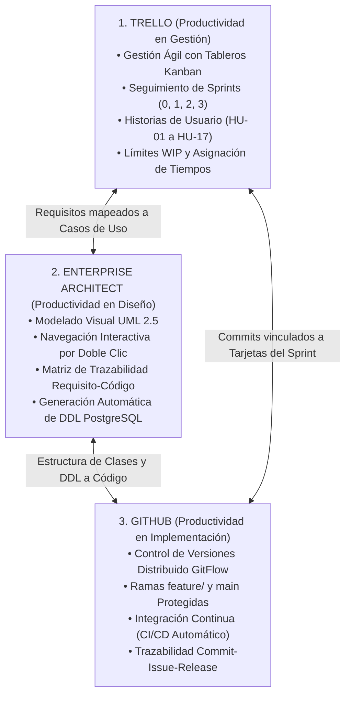
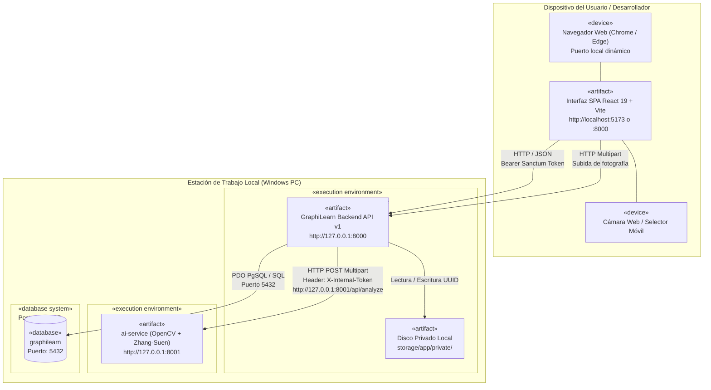

# Proceso de Desarrollo de Software Basado en Herramienta CASE
## Modelado, Navegabilidad y Trazabilidad con Enterprise Architect en GraphiLearn AI

---

## 1. Concepto de Herramienta CASE e Ingeniería de Software Asistida

Una herramienta **CASE (Computer-Aided Software Engineering - Ingeniería de Software Asistida por Computadora)** es un conjunto de aplicaciones y entornos de software diseñados para automatizar, asistir y mejorar las actividades de ingeniería a lo largo de todo el ciclo de vida del software, desde la captura inicial de requerimientos hasta el diseño, generación de código, pruebas y mantenimiento.

### 1.1. Clasificación de las Herramientas CASE
* **Upper CASE (CASE Superior o Front-End):** Herramientas enfocadas en las etapas iniciales de planificación, análisis de requerimientos, modelado conceptual del negocio y diseño general de arquitectura.
* **Lower CASE (CASE Inferior o Back-End):** Herramientas enfocadas en la implementación, generación automática de código, compilación, pruebas y generación de esquemas de bases de datos DDL.
* **Integrated CASE (I-CASE - CASE Integrado):** Entornos integrales que cubren la totalidad del ciclo de vida, permitiendo una trazabilidad bidireccional continua entre los requisitos, los diagramas de análisis, los diagramas de diseño detallado y el código fuente.

**Enterprise Architect (Sparx Systems)** se clasifica como una herramienta **I-CASE completa**, basada en los estándares **UML 2.5**, SysML, BPMN y el modelo relacional de datos.

---

## 2. Justificación de Enterprise Architect en GraphiLearn AI

En el proyecto **GraphiLearn AI**, Enterprise Architect se utilizó como el núcleo formal de ingeniería para garantizar:
1. **Navegabilidad Interactiva entre Modelos:** Capacidad de navegar jerárquicamente desde el modelo de contexto hasta el detalle de interacción de mensajes en milisegundos.
2. **Trazabilidad Completa:** Vinculación estricta entre Historias de Usuario, Casos de Uso, Diagramas de Secuencia, Diagramas de Clases y tablas de PostgreSQL.
3. **Productividad en el Diseño de Datos:** Modelado visual del esquema relacional y generación directa de sentencias SQL (DDL) para PostgreSQL 17.

```mermaid
flowchart TD
    Req["1. Requerimientos / HU<br/>(Product Backlog)"] -->|Se descompone en| UC["2. Modelo de Casos de Uso<br/>(Contexto del Sistema)"]
    UC -->|Navegación Interactiva (Doble Clic)| Seq["3. Diagramas de Secuencia<br/>(Lógica Dinámica de Mensajes)"]
    Seq -->|Mapea a métodos y atributos de| ClassD["4. Diagrama de Clases<br/>(Modelo Estático de Datos)"]
    ClassD -->|Ingeniería Directa DDL| DB["5. Base de Datos Relacional<br/>(PostgreSQL 17)"]
```

---

## 3. Estructura del Proyecto en el Project Browser de Enterprise Architect

El repositorio del proyecto (`GraphiLearn_AI.eapx`) se organiza en paquetes lógicos que reflejan la metodología de desarrollo:

```text
📁 GraphiLearn AI (Modelo Raíz)
 ├── 📦 01_Gestion_Requerimientos
 │    ├── 📋 Product_Backlog (17 Historias de Usuario)
 │    └── 📊 Matriz_Trazabilidad_Requerimientos
 ├── 📦 02_Modelo_Contexto_Casos_Uso
 │    ├── 👤 Actores: Docente, Administrador, Dirección, Sistema_IA
 │    └── 🔷 Diagrama_General_Casos_Uso_UML2.5
 ├── 📦 03_Modelo_Dinamico_Secuencia
 │    ├── 🔄 Secuencia_01_Autenticacion_Sanctum
 │    ├── 🔄 Secuencia_02_Carga_Foto_Procesamiento_IA (Vinculado a HU-05 y HU-07)
 │    ├── 🔄 Secuencia_03_Valoracion_Docente_Historial (Vinculado a HU-15)
 │    └── 🔄 Secuencia_04_Consulta_Seguimiento_Longitudinal (Vinculado a HU-14)
 ├── 📦 04_Modelo_Estatico_Diseno
 │    ├── 📦 Diagrama_Paquetes_4_Capas (Especifica, General, Interna, Sistema)
 │    └── 📊 Diagrama_Clases_Diseno_Software
 ├── 📦 05_Modelo_Datos_Relacional
 │    ├── 🗄️ Esquema_Relacional_PostgreSQL
 │    └── 📄 Script_DDL_Generado
 └── 📦 06_Modelo_Despliegue_Fisico
      └── 🖥️ Diagrama_Despliegue_Nodos
```

---

## 4. Navegabilidad y Trazabilidad Interactiva en Enterprise Architect

Uno de los requerimientos metodológicos fundamentales de la cátedra de Ingeniería de Software es la **navegación fluida y jerárquica entre modelos**:

> *«Al hacer doble clic sobre un Caso de Uso en el diagrama general, el usuario o evaluador debe ingresar automáticamente al Diagrama de Secuencia o de Comunicación que detalla su comportamiento interno».*

### 4.1. Configuración de Elementos Compuestos (*Composite Elements*)
En Enterprise Architect, esta capacidad se implementa mediante la función nativa de **Elemento Compuesto (Composite Diagram)**:
1. Se selecciona el elemento Caso de Uso (por ejemplo: `CU-07 Procesar Imagen con OpenCV`).
2. Se hace clic derecho $\rightarrow$ **Advanced** $\rightarrow$ **Make Composite** (o atajo de teclado `Ctrl + Shift + G`).
3. Se asocia como hijo el **Diagrama de Secuencia** `Secuencia_02_Carga_Foto_Procesamiento_IA`.
4. **Comportamiento en la herramienta:** Al hacer doble clic sobre el Caso de Uso en la pantalla de Enterprise Architect, la vista cambia inmediatamente al diagrama de secuencia que ilustra el intercambio de mensajes entre la Docente, Laravel, el Almacenamiento Privado y FastAPI.

---

### 4.2. Casos de Navegación Implementados en GraphiLearn AI

#### Flujo 1: Caso de Uso `CU-05 Cargar Imagen` $\rightarrow$ Diagrama de Secuencia de Procesamiento
* **Origen:** Diagrama de Casos de Uso del Sprint 1 / Sprint 2.
* **Acción:** Doble clic sobre `CU-05 / CU-07`.
* **Destino:** Diagrama de Secuencia `Secuencia_Carga_y_Analisis_FastAPI`.
* **Detalle Observable:** Muestra la subida multipart, validación MIME, almacenamiento seguro UUID en `storage/app/private/`, llamada con `X-Internal-Token` a FastAPI, procesamiento Zhang-Suen y persistencia en `analysis_results`.

#### Flujo 2: Caso de Uso `CU-15 Registrar Valoración` $\rightarrow$ Diagrama de Secuencia de Auditoría
* **Origen:** Diagrama de Casos de Uso del Sprint 3.
* **Acción:** Doble clic sobre `CU-15`.
* **Destino:** Diagrama de Secuencia `Secuencia_Valoracion_Docente_Historial`.
* **Detalle Observable:** Muestra la emisión de calificación cualitativa manual (S / ED / NA), la creación del snapshot inmutable en `activity_evaluation_history` y la actualización del estado a `valorado`.

---

### 4.3. Matriz de Trazabilidad en Enterprise Architect (*Relationship Matrix*)

Enterprise Architect permite generar y auditar la **Matriz de Trazabilidad Bidireccional** entre los distintos artefactos del proyecto:

| Requerimiento / HU | Caso de Uso UML | Diagrama de Secuencia | Clase de Dominio | Tabla PostgreSQL |
|---|---|---|---|---|
| **HU-01** (Iniciar Sesión) | `CU-01 Iniciar Sesión` | `Secuencia_Autenticacion` | `User`, `SanctumToken` | `users`, `personal_access_tokens` |
| **HU-02** (Gestionar Estudiantes) | `CU-02 Gestionar Estudiantes` | `Secuencia_Gestion_Estudiante` | `Student`, `Course` | `students`, `courses` |
| **HU-04** (Programar Ejercicios) | `CU-04 Programar Actividad` | `Secuencia_Programacion` | `ScheduledActivity`, `Exercise` | `scheduled_activities`, `scheduled_activity_exercises` |
| **HU-05 / HU-07** (Procesar Imagen) | `CU-07 Procesar Imagen` | `Secuencia_Carga_Analisis` | `FotoEjercicio`, `FastApiClient` | `actividades/fotos_ejercicio`, `imagenes` |
| **HU-08 / HU-09** (Extraer Indicadores)| `CU-09 Generar Indicadores` | `Secuencia_Extraccion_IA` | `AnalysisResult`, `AnalysisService` | `analysis_results` |
| **HU-15** (Valoración S/ED/NA) | `CU-15 Registrar Valoración` | `Secuencia_Valoracion_Auditoria`| `ActivityEvaluationHistory` | `activity_evaluation_history`, `observaciones` |

---

## 5. Aspectos Relacionados con la Productividad

El triángulo de productividad de GraphiLearn AI se fundamenta en la integración sinérgica de tres herramientas líderes: **Enterprise Architect**, **Trello** y **GitHub**:



### 5.1. Productividad con Enterprise Architect (Sparx Systems)
* **Ingeniería Directa (Forward Engineering):** Ahorro del 80% del tiempo de codificación de base de datos generando automáticamente las tablas, tipos `ENUM`, claves foráneas e índices de PostgreSQL 17 desde el modelo de datos visual.
* **Navegabilidad Bidireccional (Composite Diagrams):** Facilita la auditoría del proyecto al permitir que cualquier evaluador haga doble clic en un caso de uso y acceda de inmediato a su lógica de mensajes (secuencia) y clases de dominio asociadas.
* **Generación Automatizada de Reportes Técnicos:** Exportación instantánea del diccionario de datos y especificaciones de software en formatos PDF y RTF mediante plantillas oficiales.

### 5.2. Productividad con Trello
* **Control Visual del Flujo de Trabajo (Kanban):** Organización de las 17 Historias de Usuario en listas ordenadas por estado (*Product Backlog*, *Sprint Backlog*, *En Desarrollo*, *Pruebas QA*, *Completado*).
* **Gestión de Tiempos y Estimaciones:** Seguimiento de las 80 horas de cada Sprint, asignación de responsables y fechas de entrega estrictas cada 3 semanas.
* **Prevención de Cuellos de Botella:** Aplicación de límites de trabajo en progreso (WIP - *Work In Progress*) para evitar acumulación de tareas a medio terminar.

### 5.3. Productividad con GitHub
* **Desarrollo Paralelo Seguro (GitFlow):** Trabajo aislado en ramas específicas (`feature/crud-roles-evaluacion`, `feature/pipeline-ia-opencv`) protegiendo la rama `main` contra roturas accidentales.
* **Validación Automatizada (CI/CD con GitHub Actions):** Ejecución inmediata de las 38 pruebas de Laravel y 20 pruebas de FastAPI en la nube tras cada `push`, garantizando que ningún código defectuoso llegue a producción.
* **Respaldo y Auditoría Transparente:** Historial inmutable de commits con autor, fecha, hora y descripción exacta de los cambios realizados.

---

## 6. Diagramas de Despliegue (UML 2.5)

El Diagrama de Despliegue modela la topología física y lógica de los nodos de hardware, los artefactos de software ejecutables y los protocolos de comunicación que componen **GraphiLearn AI**:

### 6.1. Diagrama de Despliegue: Entorno de Desarrollo Local
Muestra la configuración en la estación de trabajo de la desarrolladora:



---

### 6.2. Diagrama de Despliegue: Entorno de Producción en la Nube
Muestra la arquitectura escalable de alta disponibilidad para colegios en Santa Cruz:

```mermaid
flowchart TD
    subgraph ClientesColegio["Unidad Educativa (Aulas de Kínder)"]
        CelularDocente["«device»<br/>Smartphone / Tablet Android/iOS<br/>Cámara Integrada + Navegador"]
        PCDireccion["«device»<br/>Ordenador de Dirección / Administración"]
    end

    subgraph InternetCloud["Nube Pública (Cloud VPS / Datacenter)"]
        subgraph ProxyInverso["«node» Servidor Perimetral (Ingress / Nginx)"]
            Nginx["«software»<br/>Nginx Web Server + Let's Encrypt SSL<br/>Puertos: 80 (HTTP) -> 443 (HTTPS)"]
        end

        subgraph RedPrivada["Red Virtual Privada (VPC Interna)"]
            subgraph NodoBackend["«node» Servidor de Aplicación (Docker Container)"]
                LaravelProd["«artifact»<br/>Laravel 12 + PHP-FPM 8.2<br/>API RESTful + Autenticación"]
                StoragePrivado["«storage»<br/>Volumen Privado Cifrado<br/>(Fotografías de trazos infantiles)"]
            end

            subgraph NodoIA["«node» Servidor de IA (Docker Container)"]
                FastAPIProd["«artifact»<br/>FastAPI + Uvicorn Worker<br/>OpenCV 5 + NumPy (Pipeline Geométrico)"]
            end

            subgraph NodoBD["«node» Servidor de Base de Datos"]
                PostgresProd[("«database»<br/>PostgreSQL 17 Administrado<br/>Backups Automáticos Diarios")]
            end
        end
    end

    CelularDocente -->|HTTPS / TLS 1.3<br/>https://app.graphilearn.bo| Nginx
    PCDireccion -->|HTTPS / TLS 1.3<br/>https://app.graphilearn.bo| Nginx

    Nginx -->|Proxy Pass Interno| LaravelProd
    LaravelProd -->|Persistencia Transaccional| PostgresProd
    LaravelProd -->|Almacenamiento Criptográfico UUID| StoragePrivado
    LaravelProd -->|HTTP Interno Privado<br/>Header: X-Internal-Token (VPC)| FastAPIProd
```

---

## 7. Conclusión

La combinación de **Enterprise Architect** para el modelado riguroso, **Trello** para la gestión visual del tiempo y **GitHub** para el control de versiones y CI/CD garantiza la máxima productividad de ingeniería de software. Asimismo, los **Diagramas de Despliegue** sustentan tanto la viabilidad de la demostración local en la defensa de grado como la puesta en marcha escalable en producción en la nube.

Enterprise Architect potencia la productividad técnica mediante la automatización de tareas repetitivas:

### 5.1. Generación de Esquemas de Base de Datos (Forward Engineering DDL)
1. A partir del **Diagrama de Clases / Modelo de Datos** diseñado en UML, se configuró el perfil de persistencia para **PostgreSQL**.
2. Mediante la opción **Database Engineering** $\rightarrow$ **Generate DDL**, Enterprise Architect genera automáticamente el script SQL con la sintaxis exacta de PostgreSQL 17:
   * Declaración de claves primarias `BIGSERIAL`.
   * Creación de claves foráneas con restricciones `ON DELETE CASCADE` y `ON DELETE SET NULL`.
   * Restricciones de verificación `CHECK (pedagogical_rating IN ('S', 'ED', 'NA'))`.
   * Índices de unicidad `UNIQUE (scheduled_activity_id, id_estudiante, id_ejercicio)`.

### 5.2. Generación Automática de Documentación Técnica
A través de las plantillas de reporte de Enterprise Architect (**Document Generation - F8**), se compilaron automáticamente los diagramas y diccionarios de datos en formato PDF y RTF para anexar al documento final de grado, eliminando errores de transcripción manual.

---

## 6. Conclusión

La utilización de **Enterprise Architect** en el proyecto GraphiLearn AI consolida un proceso de ingeniería de software formal y riguroso:
1. **Cumplimiento Académico Total:** Implementa la navegación interactiva por doble clic exigida por Martínez Canedo entre Casos de Uso y Secuencias.
2. **Consistencia Metodológica:** Garantiza que no existan clases o tablas huérfanas sin respaldo en un requerimiento del Product Backlog.
3. **Agilidad en la Auditoría:** Permite al tribunal de defensa navegar visualmente desde cualquier pantalla o botón del software hacia su lógica de interacción interna en la herramienta CASE.
