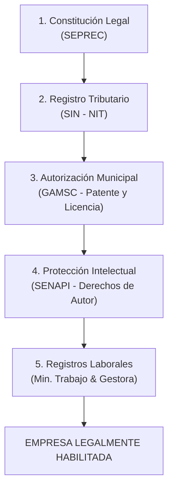
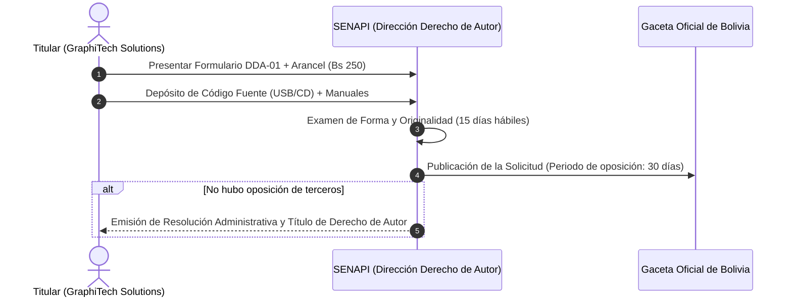

# Aspectos Legales para la Apertura y Operación de una Empresa de Software en Santa Cruz – Bolivia
## Registro, Licencias, Tributos y Propiedad Intelectual aplicados a GraphiLearn AI

---

## 1. Introducción y Marco General

Para que el proyecto **GraphiLearn AI** trascienda el ámbito académico de Taller de Grado y se constituya como un producto de software comercializable en el mercado boliviano, debe enmarcarse estrictamente dentro del ordenamiento jurídico, tributario, municipal y de propiedad intelectual vigente en el Estado Plurinacional de Bolivia y en el Municipio de Santa Cruz de la Sierra.

El presente documento detalla la ruta legal completa para la constitución de la empresa desarrolladora (**GraphiTech Solutions S.R.L.**), la obtención del Número de Identificación Tributaria (NIT), la Licencia de Funcionamiento y Patente Municipal ante la Alcaldía de Santa Cruz, el registro de Derechos de Autor sobre el software ante el **SENAPI** (Ley 1322) y el marco de protección de datos de menores de edad (Ley 548).

---

## 2. Constitución de la Empresa en el Registro de Comercio (SEPREC)

Para operar en el rubro del desarrollo de software y servicios tecnológicos, la figura societaria recomendada es la **Sociedad de Responsabilidad Limitada (S.R.L.)**, ya que separa y protege el patrimonio personal de los socios frente a responsabilidades comerciales.

### 2.1. Pasos ante el SEPREC (Servicio Plurinacional de Registro de Comercio)

1. **Control de Homonimia y Reserva de Nombre (Trámite Virtual):**
   * Verificación en la plataforma del SEPREC (`www.seprec.gob.bo`) de la disponibilidad de la razón social: *GraphiTech Solutions S.R.L.*
   * Pago del arancel de reserva de nombre (Bs 136). La reserva tiene una vigencia de 10 días hábiles.
2. **Elaboración de Minuta y Escritura Pública de Constitución:**
   * Redacción de la Minuta de Constitución y Estatutos por parte de un abogado colegiado.
   * La minuta debe detallar el objeto social: *"Desarrollo, comercialización, soporte, licenciamiento e implementación de software, plataformas web, inteligencia artificial, visión computacional y consultoría informática"*.
   * Protocolización de la Minuta ante un Notario de Fe Pública de Santa Cruz de la Sierra para la emisión del Testimonio de Escritura Pública de Constitución.
3. **Publicación en la Gaceta Electrónica del Registro de Comercio:**
   * Publicación del extracto de la escritura de constitución en la Gaceta oficial del SEPREC.
4. **Inscripción y Emisión de la Matrícula de Comercio:**
   * Llenado del Formulario Virtual de Inscripción.
   * Adjuntar Testimonio de Constitución escaneado y Cédula de Identidad del Representante Legal.
   * Pago del arancel de inscripción para S.R.L. (Bs 455).
   * **Resultado:** Obtención de la **Matrícula de Comercio Digital con código QR**.

---

## 3. Obtención del Número de Identificación Tributaria (NIT) ante el SIN

Toda actividad económica en territorio boliviano requiere su registro ante el **Servicio de Impuestos Nacionales (SIN)** para la emisión de facturas y cumplimiento de deberes tributarios.

### 3.1. Procedimiento de Obtención del NIT (Gerencia Distrital Santa Cruz I o II)

El trámite se inicia en el portal oficial del SIN (**SIAT en Línea** - `www.impuestos.gob.bo`) y concluye con la verificación presencial y enrolamiento biométrico del Representante Legal.

#### Requisitos Obligatorios:
* Testimonio de Poder del Representante Legal y Cédula de Identidad original vigente.
* Testimonio de Escritura de Constitución de la Sociedad.
* Matrícula de Comercio vigente otorgada por el SEPREC.
* Factura original de servicio básico de energía eléctrica (CRE) del domicilio fiscal (con antigüedad no mayor a 60 días), que acredite la dirección en Santa Cruz de la Sierra.
* Croquis de ubicación del domicilio fiscal y del domicilio habitual del Representante Legal.

#### Clasificación Tributaria y Código de Actividad Económica:
* **Régimen:** General.
* **Gran Actividad:** Servicios.
* **Código de Actividad Económica (Clasificador CAEB):**
  * **62010 - Actividades de programación informática:** Diseño de la estructura y contenido y/o escritura del código informático necesario para crear y mantener aplicaciones de software (GraphiLearn AI).
  * **62020 - Consultoría informática y gestión de instalaciones informáticas.**

#### Obligaciones Tributarias Periódicas:
1. **IVA (Impuesto al Valor Agregado):** Alícuota del **13%** sobre ventas brutas del software o suscripciones (Declaración mensual en Formulario 200).
2. **IT (Impuesto a las Transacciones):** Alícuota del **3%** sobre el ingreso bruto percibido (Declaración mensual en Formulario 400).
3. **IUE (Impuesto sobre las Utilidades de las Empresas):** Alícuota del **25%** sobre la utilidad neta anual al cierre de gestión fiscal (Declaración anual en Formulario 500).
4. **Modalidad de Facturación:** Facturación Electrónica en Línea o Computarizada a través del aplicativo SIAT.

---

## 4. Licencia de Funcionamiento y Patente Municipal (GAMSC)

Para el funcionamiento físico y legal de la oficina de desarrollo en el Municipio de Santa Cruz de la Sierra, se debe tramitar la **Licencia de Funcionamiento y la Patente Municipal de Actividades Económicas** ante la Secretaría Municipal de Administración Tributaria (SAT - Quinta Municipal / SER).

### 4.1. Requisitos ante el Gobierno Autónomo Municipal de Santa Cruz (GAMSC)
* Formulario Único de Solicitud de Licencia de Funcionamiento debidamente firmado.
* Fotocopia del NIT y certificado de inscripción del SIN.
* Fotocopia de la Cédula de Identidad del Representante Legal.
* Fotocopia del Testimonio de Constitución y Matrícula del SEPREC.
* Fotocopia del aviso de cobranza de luz (CRE) o agua (Saguapac) del inmueble donde funcionará la empresa.
* Croquis de ubicación exacta (Uv., Mza., Lote y calle/avenida).
* Plano de uso de suelo y contrato de arrendamiento o derecho propietario.

### 4.2. Inspección y Pago de la Patente Municipal
1. **Inspección Técnica Municipal:** Inspectores de la Dirección de Medio Ambiente y Urbanismo verifican que el inmueble cumpla con normas de seguridad (extintor, botiquín, señalética) y zonificación comercial compatible.
2. **Liquidación y Cobro de la Patente:** La patente municipal es un tributo anual municipal calculado en función a:
   $$\text{Patente} = f(\text{Superficie en } m^2, \text{Ubicación/Zona}, \text{Tipo de Actividad Económica})$$
   Para oficinas de desarrollo de software y servicios profesionales, se aplica la alícuota de servicios sin impacto ambiental severo.
3. **Emisión del Cartón de Licencia:** La Alcaldía entrega el certificado oficial con código de empadronamiento municipal, el cual debe exhibirse obligatoriamente en el establecimiento.

---

## 5. Registro de Derechos de Autor y Propiedad Intelectual (SENAPI)

El software no se patenta como una invención industrial tradicional; en la legislación boliviana y en los tratados internacionales de la OMPI, **el software está protegido como una obra literaria bajo el régimen de Derechos de Autor**.

### 5.1. Marco Legal Aplicable: Ley Nº 1322 de Derecho de Autor
Promulgada el 13 de abril de 1992 y reglamentada por el Decreto Supremo Nº 23907:
* **Artículo 6, Inciso k):** Establece taxativamente que quedan protegidos por derecho de autor:  
  > *«Los programas de ordenador (software), tanto en su código fuente como en su código objeto, cualquiera sea su forma o modo de expresión, así como su documentación técnica y manuales de usuario».*
* **Tratados Internacionales:** Bolivia es signataria del **Convenio de Berna para la Protección de las Obras Literarias y Artísticas** y de la **Decisión 351 de la Comunidad Andina** (Régimen Común sobre Derecho de Autor y Derechos Conexos). Esto significa que el registro en Bolivia otorga protección jurídica automática en más de 170 países.

---

### 5.2. Procedimiento de Registro de Software ante el SENAPI (Dirección de Derecho de Autor)

El trámite se realiza ante la oficina regional del **SENAPI Santa Cruz** (o mediante la plataforma virtual del SENAPI):

#### Requisitos Documentales:
1. **Formulario Oficial DDA-01 de Soporte Lógico (Software):** Llenado con datos del autor/desarrollador (Elizabet Luzia Ponce Yepez) y del titular patrimonial (GraphiTech Solutions S.R.L.).
2. **Ejemplar del Software para Depósito Legal:**
   * Copia digital completa del código fuente (repositorio backend Laravel, microservicio FastAPI y vistas React) en soporte magnético (CD/DVD o Memoria USB protegida).
   * Para proteger secretos industriales algorítmicos, el SENAPI permite depositar las primeras y últimas 25 páginas del código fuente impreso o cifrado.
3. **Memoria Técnica Descriptiva del Programa:**
   * Descripción de la arquitectura, diagrama de clases, diagrama de flujo del pipeline de visión artificial (algoritmo Zhang-Suen y cálculo de descriptores).
4. **Manual de Usuario y Manual Técnico del Sistema.**
5. **Comprobante de Pago de Tasas Oficiales:** Pago de la tasa administrativa oficial del SENAPI para registro de software (aproximadamente Bs 250 para personas jurídicas).

#### Derechos Obtenidos con el Certificado del SENAPI:
* **Derecho Moral (Inalienable e imprescriptible):** Reconocimiento perpetuo de la autoría de Elizabet Ponce sobre el código y los algoritmos creados.
* **Derecho Patrimonial (Exclusivo y transferible):** Facultad exclusiva de autorizar o prohibir la reproducción, distribución, comercialización, modificación o arrendamiento de GraphiLearn AI por un plazo de **toda la vida del autor más 50 años después de su muerte**.

---

## 6. Registros Laborales y de Seguridad Social

Una vez contratado personal de desarrollo, soporte o ventas, la empresa debe cumplir con:
1. **Ministerio de Trabajo, Empleo y Previsión Social:**
   * Inscripción en el **Registro Obligatorio de Empleadores (ROE)** a través de la plataforma OVT (Oficina Virtual de Trámites).
   * Presentación mensual obligatoria de planillas de sueldos y salarios.
2. **Seguridad Social de Corto Plazo (Salud):**
   * Afiliación de la empresa y los trabajadores a la **Caja Nacional de Salud (CNS)** o caja sectorial (aporte patronal del **10%** del total ganado).
3. **Seguridad Social de Largo Plazo (Pensiones):**
   * Registro ante la **Gestora Pública de la Seguridad Social de Largo Plazo** (aporte patronal del **1.71%** por riesgo profesional, **2%** provivienda y **3%** solidario).

---

## 7. Aspectos Legales Especiales: Protección de Datos de Menores (Ley Nº 548)

Debido a que GraphiLearn AI procesa fotografías de trazos y datos personales (nombre, fecha de nacimiento, aula) de niños de 4 a 5 años de edad:

### 7.1. Código Niña, Niño y Adolescente (Ley Nº 548 del Estado Plurinacional de Bolivia)
* **Artículo 144 (Derecho a la Intimidad y Protección de la Imagen):** Prohíbe expresamente la publicación o difusión de imágenes o datos personales de niñas, niños o adolescentes que permitan su identificación pública o lesionen su dignidad y privacidad.
* **Aplicación Técnica Obligatoria en GraphiLearn AI:**
  1. **Consentimiento Informado Escrito:** Las unidades educativas deben recabar obligatoriamente la firma de los padres de familia o tutores legales antes de registrar las actividades del niño en la plataforma.
  2. **Anonimización Criptográfica:** Las fotografías se guardan con identificadores únicos UUID en discos privados sin acceso público directo (`storage/app/private/`).
  3. **No Cesión de Datos a Terceros:** Queda prohibida la venta, cesión o transferencia de los trazos o datos infantiles para fines publicitarios o de reentrenamiento de modelos comerciales de terceros sin autorización expresa.

---

## 8. Resumen de Costos y Plazos de Tramitación en Santa Cruz

| Entidad / Trámite | Arancel Oficial Estimado | Tiempo de Tramitación | Documento Obtenido |
|---|:---:|:---:|---|
| **SEPREC** (Matrícula S.R.L.) | Bs 591 (Reserva + Matrícula) | 2 a 3 días hábiles | Matrícula de Comercio Digital |
| **Notaría de Fe Pública** | Bs 800 - Bs 1.500 | 3 a 5 días | Testimonio de Escritura Pública |
| **Impuestos Nacionales (SIN)** | Gratuito | 24 a 48 horas | Certificado de Inscripción y NIT |
| **Alcaldía (GAMSC)** | Bs 300 - Bs 600 (Patente inicial) | 5 a 10 días hábiles | Licencia de Funcionamiento |
| **SENAPI** (Derechos de Autor) | Bs 250 - Bs 350 | 20 a 30 días | Certificado de Derecho de Autor de Software |
| **Ministerio de Trabajo (ROE)** | Bs 135 | 24 horas | Certificado R.O.E. |
| **Total Estimado Inicial** | **$\approx$ Bs 2.076 - Bs 3.176** | **$\approx$ 3 a 4 semanas** | **Operatividad Legal Completa** |

---

## 9. Conclusión

El cumplimiento de este marco legal garantiza que **GraphiLearn AI** sea un producto tecnológico con respaldo jurídico sólido en Bolivia:
* La titularidad de los derechos patrimoniales y morales está blindada contra plagios o copias no autorizadas mediante el registro ante el **SENAPI** bajo la Ley 1322.
* La empresa puede emitir facturas legales válidas para contratos con colegios privados, convenios y licitaciones públicas con municipios y el Ministerio de Educación.
* El manejo de las fotografías y registros infantiles respeta los mandatos constitucionales y del Código Niña, Niño y Adolescente, blindando a la institución educativa y a la empresa ante contingencias legales.
