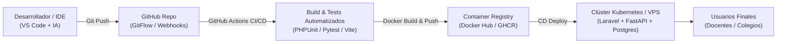
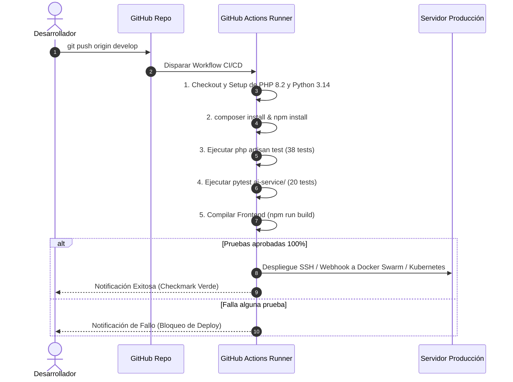

# Infraestructura para la Producción y Despliegue de Software
## Herramientas Cloud, CI/CD, Contenedores y Desarrollo Asistido por IA en GraphiLearn AI

---

## 1. Introducción y Arquitectura de Producción

Para garantizar que el ciclo de vida de **GraphiLearn AI** sea repetible, colaborativo y automatizado, se diseñó una infraestructura tecnológica moderna basada en herramientas en la nube, control de versiones distribuido, contenedores Docker / orquestación Kubernetes y desarrollo asistido por Inteligencia Artificial.

---

## 2. Gestión del Proyecto y Colaboración en la Nube

### 2.1. Gestión Ágil de Tareas (Trello y Jira Software)
* **Trello (Tablero Kanban de Sprints):** Utilizado para el seguimiento visual diario del Sprint Backlog (columnas: *Product Backlog*, *To Do*, *In Progress*, *Code Review*, *QA Testing*, *Done*).
* **Jira Software (Gestión de Releases y Métricas Ágiles):** Administra el backlog formal, épicas, cálculo de velocidad del equipo (*Velocity Chart*) y gráficos de trabajo pendiente (*Burndown Chart*).

### 2.2. Control de Versiones y Flujo de Trabajo (Git & GitHub)
* **Repositorio Central:** Hospedado en GitHub bajo la organización corporativa (`https://github.com/EluPonce/GraphiLearn-AI`).
* **Estrategia de Ramas (GitFlow):**
  * `main`: Rama de producción estable. Solo recibe código probado y aprobado mediante Pull Requests.
  * `develop`: Rama de integración continua de features.
  * `feature/*`: Ramas de desarrollo de historias de usuario específicas (ej. `feature/crud-roles-evaluacion`, `feature/pipeline-ia-opencv`).
  * `hotfix/*`: Correcciones críticas urgentes de producción.
* **Políticas de Protección de Ramas:** Se exige revisión de código obligatoria y paso satisfactorio de las pruebas automatizadas antes de permitir merge a `main`.

---

## 3. Contenedores y Orquestación: Docker y Kubernetes

Para eliminar el clásico problema de *"en mi máquina sí funciona"*, todos los subsistemas de GraphiLearn AI están contenedorizados:

### 3.1. Arquitectura de Microservicios en Contenedores (`docker-compose.yml`)
El proyecto cuenta con un archivo `docker-compose.yml` que orquesta los tres entornos:
1. **Contenedor `graphilearn-backend`:** Imagen PHP 8.2 FPM / Nginx con extensiones `pdo_pgsql`, `intl`, `gd` y configuración de almacenamiento privado.
2. **Contenedor `graphilearn-ai-service`:** Imagen Python 3.14 con OpenCV, FastAPI y Uvicorn, expuesto internamente en el puerto `8001`.
3. **Contenedor `graphilearn-db`:** Imagen oficial PostgreSQL 17 con volumen persistente para datos.

### 3.2. Despliegue Automatizado en Kubernetes (K8s)
Para despliegues productivos de alta disponibilidad a nivel departamental o nacional, se diseñaron los manifiestos de Kubernetes:
* **Deployments:**
  * `laravel-deployment` (3 réplicas con auto-escalado horizontal HPA basado en uso de CPU).
  * `fastapi-ai-deployment` (2 réplicas dedicadas al cómputo de imágenes).
* **StatefulSet:**
  * `postgres-statefulset` con volúmenes persistentes gestionados (PVC) en almacenamiento SSD.
* **Ingress Controller (NGINX Ingress con Cert-Manager):** Enrutamiento por subdominios con terminación TLS/HTTPS y certificados automáticos Let's Encrypt:
  * `app.graphilearn.bo` $\rightarrow$ Servicio web Laravel/React.
  * `ai-internal.graphilearn.bo` $\rightarrow$ Microservicio FastAPI (restringido a llamadas internas de red mediante red virtual privada y token secreto).

---

## 4. Pipeline de Integración y Despliegue Continuo (CI/CD)

Mediante **GitHub Actions**, se implementó un pipeline automatizado que se ejecuta en cada `push` o `pull request`:

---

## 5. Desarrollo de Software Asistido por Inteligencia Artificial

GraphiLearn AI aplica técnicas avanzadas de **Ingeniería de Software Aumentada por IA**, acelerando la productividad técnica sin comprometer el rigor metodológico:

1. **Generación de Especificaciones Formales a partir de Requisitos:**
   * Utilización de modelos de lenguaje avanzados para transformar notas de entrevistas a docentes de kínder en especificaciones formales bajo formato Gherkin (*Given-When-Then*) y criterios INVEST.
2. **Generación Asistida de Casos de Prueba Automatizados:**
   * Creación de pruebas de regresión en PHPUnit y Pytest para cubrir casos límite (imágenes corruptas, payloads sin archivo, caídas de microservicio).
3. **Optimización Matemática de Algoritmos de Visión Artificial:**
   * Asistencia en la vectorización matricial con NumPy para el cálculo de distancias perpendiculares en el ajuste Kåsa de círculos y K-vecinos en Zhang-Suen, reduciendo la latencia de análisis a menos de 200 ms.
4. **Verificación Estática y Prevención de Brechas de Seguridad:**
   * Detección preventiva de vulnerabilidades de deserialización en librerías de machine learning (bloqueo de carga de archivos `joblib` no autorizados y aplicación obligatoria de `X-Internal-Token`).
