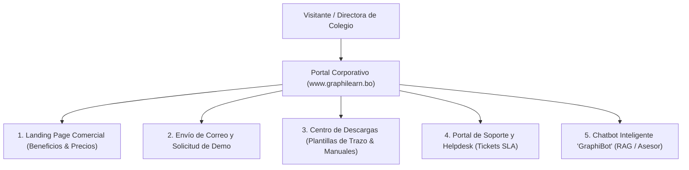
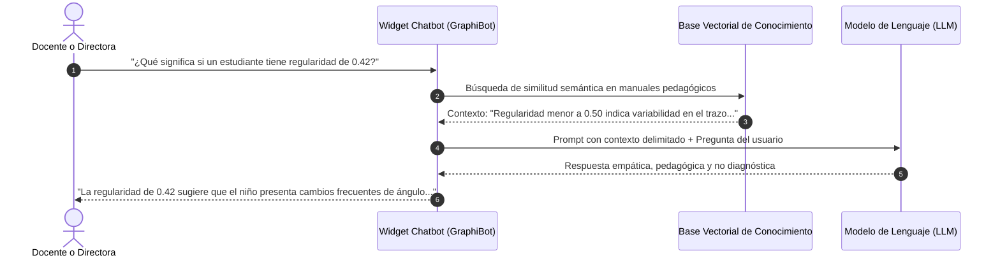

# Sitio Web Corporativo, Soporte al Cliente y Agente Conversacional (Chatbot)
## Presencia Digital, Canales de Atención y Soporte Técnico de GraphiLearn AI

---

## 1. Introducción y Arquitectura del Sitio Web Corporativo

Para la comercialización, atención al cliente y soporte técnico de **GraphiLearn AI**, la empresa **GraphiTech Solutions S.R.L.** dispone de una presencia web corporativa integral accesible en `www.graphilearn.bo`.

El sitio web está diseñado como una plataforma de captación B2B para colegios y jardines de infantes, ofreciendo recursos descargables, demostraciones interactivas, canales de tickets de soporte y un asistente conversacional con inteligencia artificial disponible 24/7.

---

## 2. Componentes del Sitio Web Corporativo

### 2.1. Landing Page y Presentación Comercial
* **Propuesta de Valor:** Explicación clara del problema del cuaderno anecdótico y cómo GraphiLearn AI ahorra más de 40 horas al trimestre por docente mediante mediciones objetivas del trazo.
* **Demostración Interactiva:** Simulador web donde los directores pueden arrastrar una imagen de trazo de prueba y observar en vivo la extracción de las 4 métricas (desviación, regularidad, continuidad, rugosidad).
* **Planes de Suscripción:** Tabla comparativa de precios (Plan Semillero \$180 USD, Plan Kínder Estándar \$380 USD, Plan Colegial \$650 USD).

### 2.2. Sistema Automatizado de Envío de Correos Electrónicos (Email Marketing & Transaccional)
* **Proveedor de Envíos:** Integración con **Resend / Amazon SES** mediante el driver oficial de Laravel Mail.
* **Flujos de Correo Automatizados:**
  1. *Bienvenida a la Institución:* Envío de credenciales de acceso inicial a la Directora y enlaces a los manuales.
  2. *Notificación de Fin de Periodo:* Aviso automático a las docentes recordando el cierre del trimestre y la generación de reportes.
  3. *Confirmación de Soporte:* Envío de acuse de recibo con número de ticket ante consultas técnicas.

### 2.3. Centro de Descargas de Recursos Pedagógicos
El portal ofrece descargas gratuitas y con registro:
* **Hojas de Actividades Pautadas Oficiales (PDF):** Plantillas estandarizadas para imprimir en hojas bond tamaño carta (líneas rectas, curvas sinusoidales, círculos, espirales concéntricas y zigzag) con las dimensiones y guías optimizadas para el procesamiento con OpenCV.
* **Manuales de Usuario y Buenas Prácticas:** Guías ilustradas en PDF sobre iluminación óptima al tomar la fotografía con el teléfono y cómo interpretar las métricas matemáticas.

---

## 3. Centro de Soporte y Mesa de Ayuda (Helpdesk)

* **Canal de Tickets:** Formulario web integrado que categoriza incidencias en:
  * Consultas pedagógicas sobre interpretación de indicadores.
  * Problemas de inicio de sesión o reseteo de contraseñas.
  * Solicitudes de facturación y renovación de licencias anuales.
* **Garantía de Tiempo de Respuesta (SLA):**
  * Incidencias críticas (bloqueo total de aula): Respuesta en menos de 2 horas.
  * Consultas generales: Respuesta en menos de 24 horas laborables.

---

## 4. Agente Conversacional Inteligente (Chatbot «GraphiBot»)

El portal incorpora a **GraphiBot**, un chatbot entrenado sobre la base de conocimiento exclusiva de GraphiLearn AI, desarrollado con arquitectura **RAG (Retrieval-Augmented Generation)**:

### 4.1. Reglas y Límites del Chatbot (Prompt de Seguridad del Sistema)
* **Regla 1 (Ética de No Diagnóstico):** El chatbot tiene prohibido bajo cualquier circunstancia emitir diagnósticos médicos de disgrafía, autismo o trastornos neurológicos. Ante preguntas sobre diagnósticos clínicos, responde:  
  > *«GraphiLearn AI es una herramienta de apoyo pedagógico. Para evaluaciones clínicas o diagnósticos especializados, se recomienda derivar al estudiante con el gabinete psicopedagógico o neuropediatra de la institución».*
* **Regla 2 (Soporte Técnico):** Asiste paso a paso en la toma correcta de fotos (evitar sombras fuertes, encuadrar la hoja en posición vertical, verificar que no haya reflejos de luz).
* **Regla 3 (Horarios y Contacto Humano):** Si el usuario solicita atención comercial personalizada, el chatbot solicita nombre, colegio y número de WhatsApp para transferir el lead al equipo de ventas de Santa Cruz.
