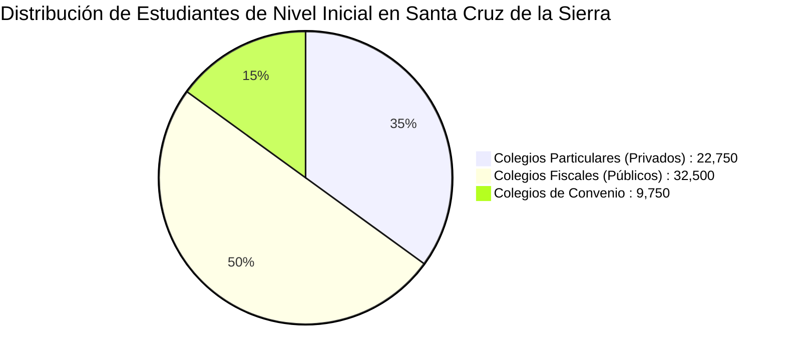
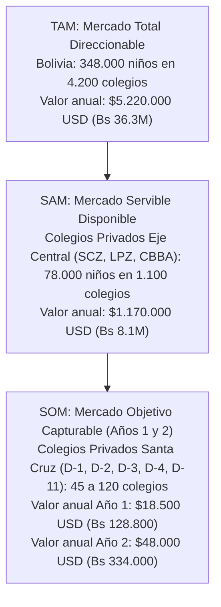
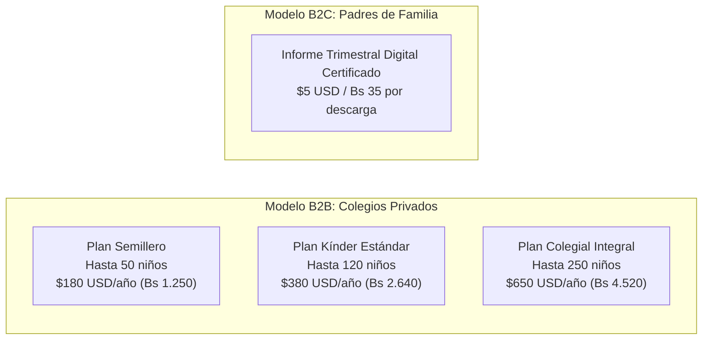

# Estudio de Mercado Cuantificado y Modelo de Monetización
## Sistema Inteligente para la Detección Temprana de Riesgo Grafomotor en Niños de Nivel Inicial — GraphiLearn AI

---

## 1. Introducción y Definición del Negocio

El presente estudio cuantifica el mercado objetivo, estratifica la demanda y define el modelo de negocio y monetización para la introducción de **GraphiLearn AI** en el sistema educativo escolar.

El proyecto se estructura comercialmente como un modelo **B2B SaaS (Software as a Service)** para instituciones educativas (colegios particulares y jardines de infantes), complementado con un componente **B2C** para padres de familia que deseen acceder a informes detallados de la evolución grafomotora de sus hijos.

---

## 2. Cuantificación del Mercado con Datos Oficiales

Los datos demográficos y escolares se basan en estadísticas del **Instituto Nacional de Estadística (INE)**, el **Ministerio de Educación de Bolivia** y la **Dirección Departamental de Educación de Santa Cruz (SEDUCA)**:

### 2.1. Cifras Demográficas y Población Estudiantil
* **Población en Educación Inicial en Bolivia:** Aproximadamente **348.000 niños** inscritos en los dos años del subsistema de educación regular (Pre-Kínder / 1er año y Kínder / 2do año), con edades de 4 y 5 años.
* **Población en el Departamento de Santa Cruz:** Concentra el **31.5%** de la matrícula escolar nacional, con aproximadamente **109.600 niños** en educación inicial.
* **Población en el Municipio de Santa Cruz de la Sierra (Área Urbana):**
  * Total de niños en nivel inicial: **65.000 estudiantes**.
  * Niños en unidades educativas particulares (privadas): **22.750 estudiantes** (35%).
  * Niños en unidades educativas fiscales y de convenio: **42.250 estudiantes** (65%).

### 2.2. Unidades Educativas en Santa Cruz de la Sierra
* **Colegios y Centros Infantiles Particulares:** **385 unidades educativas** registradas legalmente ante la Dirección Distrital de Educación.
* **Colegios Fiscales y de Convenio:** **640 unidades educativas**.
* **Promedio de aulas de nivel inicial por colegio privado:** Entre 2 y 4 paralelos (50 a 120 alumnos por colegio en edad inicial).

---

## 3. Estratificación del Mercado (Modelo TAM, SAM, SOM)

La estratificación permite dimensionar el mercado total, el mercado alcanzable y la meta operativa realista para los primeros 3 años:

### 3.1. TAM (Total Addressable Market - Mercado Total Direccionable)
* **Alcance:** La totalidad de niños de 4 y 5 años matriculados en unidades educativas de Bolivia (fiscales, privadas y de convenio).
* **Volumen:** 348.000 niños en 4.200 unidades educativas.
* **Valor Financiero del TAM:** Considerando un costo de suscripción base de **\$15 USD al año por alumno**:
  $$\text{TAM} = 348.000 \text{ niños} \times \$15 \text{ USD} = \mathbf{\$5.220.000 \text{ USD / año}}$$

### 3.2. SAM (Serviceable Available Market - Mercado Servible Disponible)
* **Alcance:** Unidades educativas particulares y de convenio del eje central de Bolivia (Santa Cruz, La Paz y Cochabamba) que cuentan con infraestructura tecnológica, conectividad a internet en aulas y directores con presupuesto para innovación educativa.
* **Volumen:** 1.100 colegios privados y 78.000 niños de nivel inicial.
* **Valor Financiero del SAM:**
  $$\text{SAM} = 78.000 \text{ niños} \times \$15 \text{ USD} = \mathbf{\$1.170.000 \text{ USD / año}}$$

### 3.3. SOM (Serviceable Obtainable Market - Mercado Objetivo Capturable en 24 meses)
* **Alcance:** Colegios particulares de los distritos urbanos de mayor nivel socioeconómico de Santa Cruz de la Sierra (Distritos 1, 2, 3, 4 y 11: Zonas Norte, Equipetrol, Urubó, Las Palmas y Centro):
  * **Año 1 (Penetración inicial):** **45 colegios particulares** ($\approx 4.500$ niños).
  * **Año 2 (Consolidación local):** **120 colegios particulares** ($\approx 12.000$ niños).
  * **Año 3 (Expansión nacional Cochabamba/La Paz):** **250 colegios** ($\approx 25.000$ niños).

---

## 4. Análisis de la Competencia

| Solución / Competidor | Tipo de Soporte | Costo de Adquisición | Ventajas | Desventajas / Limitaciones |
|---|---|:---:|---|---|
| **Evaluación Tradicional (Cuaderno Anecdótico)** | Observación humana en papel | Bs 0 (Tiempo docente) | Fácil de iniciar en cualquier aula | 100% subjetivo, sin datos cuantitativos, consume 40+ horas al trimestre por docente, sin trazabilidad. |
| **Play-Draw-Write / Apps de Tablet (EE.UU. / Italia)** | App en iPad con lápiz digital (Apple Pencil) | Muy Alto ($> \$800 \text{ USD}$ por alumno por equipo) | Análisis en tiempo real de presión y velocidad | Inviable para el 98% de colegios bolivianos; los niños no aprenden con lápiz y papel tradicional. |
| **Sistemas Académicos Generales (WebColegios / SIE)** | Plataformas web de notas | Medio (\$500/año) | Centraliza notas administrativas | No evalúa grafomotricidad, no procesa imágenes, no tiene visión artificial. |
| **GraphiLearn AI (Nuestra Solución)** | **Web + Visión Artificial sobre Papel Real** | **Accesible (\$150 a \$450 USD/año por colegio)** | **Opera sobre el papel y lápiz escolar común, usa cualquier celular para la foto, brinda 4 métricas matemáticas y valoración manual docente.** | Requiere conectividad a internet para el microservicio de análisis. |

---

## 5. Modelo de Negocio y Estructura de Monetización

GraphiLearn AI opera bajo un esquema de suscripción anual escalonada (SaaS B2B):

### 5.1. Planes Institucionales B2B (Anuales)
1. **Plan Semillero (Jardines infantiles independientes):**
   * Hasta 50 estudiantes y 3 docentes.
   * Carga de fotos ilimitada, análisis de 4 ejercicios (línea, círculo, espiral, zigzag), bitácora y reportes.
   * **Precio:** **\$180 USD / año (Bs 1.250)**.
2. **Plan Kínder Estándar (Colegios medianos):**
   * Hasta 120 estudiantes y 6 docentes.
   * Incluye comparativa longitudinal entre trimestres, ficha individual y panel administrativo.
   * **Precio:** **\$380 USD / año (Bs 2.640)**.
3. **Plan Colegial Integral (Colegios grandes con múltiples paralelos):**
   * Hasta 250 estudiantes y docentes ilimitados.
   * Soporte prioritario, capacitaciones en aula y exportación masiva.
   * **Precio:** **\$650 USD / año (Bs 4.520)**.

### 5.2. Canal B2C Complementario (Padres de Familia)
* **Descarga de Informe Grafomotor Evolutivo en PDF:** Los padres pueden acceder a un informe visual de alta resolución con las fotografías comparativas y el progreso del niño por **Bs 35 (\$5 USD)** por trimestre, generando un canal de ingresos compartidos con la unidad educativa (30% de comisión para el colegio).

---

## 6. Proyecciones Financieras a Tres Años (En Dólares Americanos USD)

### 6.1. Ingresos Proyectados

| Concepto | Año 1 | Año 2 | Año 3 |
|---|:---:|:---:|:---:|
| **Colegios Plan Semillero (\$180/año)** | 15 colegios (\$2.700) | 35 colegios (\$6.300) | 60 colegios (\$10.800) |
| **Colegios Plan Estándar (\$380/año)** | 25 colegios (\$9.500) | 65 colegios (\$24.700) | 130 colegios (\$49.400) |
| **Colegios Plan Integral (\$650/año)** | 5 colegios (\$3.250) | 20 colegios (\$13.000) | 60 colegios (\$39.000) |
| **Ingresos B2C Informes a Padres** | 600 informes (\$3.000) | 2.500 informes (\$12.500) | 6.000 informes (\$30.000) |
| **TOTAL INGRESOS BRUTOS** | **\$18.450 USD** | **\$56.500 USD** | **\$129.200 USD** |
| *Equivalente en Bolivianos (TC: 6.96)* | *Bs 128.412* | *Bs 393.240* | *Bs 899.232* |

---

### 6.2. Costos Operativos y Egresos (Servidores, Mantenimiento e Impuestos)

| Rubro de Egreso | Año 1 (USD) | Año 2 (USD) | Año 3 (USD) |
|---|:---:|:---:|:---:|
| **Infraestructura Cloud (VPS + PostgreSQL + FastAPI)** | \$720 (\$60/mes) | \$1.440 (\$120/mes) | \$2.880 (\$240/mes) |
| **Dominio, Certificados SSL y Storage S3** | \$180 | \$350 | \$600 |
| **Soporte Técnico y Capacitación en Aula** | \$3.600 | \$9.600 | \$18.000 |
| **Marketing, Material Publicitario y Visitas a Colegios** | \$2.400 | \$4.500 | \$8.000 |
| **Impuestos Tributarios (IVA 13% + IT 3% = 16% efectivo)** | \$2.952 | \$9.040 | \$20.672 |
| **Gastos Administrativos, Patente Municipal y SEPREC** | \$800 | \$1.200 | \$1.800 |
| **TOTAL EGRESOS** | **\$10.652 USD** | **\$26.130 USD** | **\$51.952 USD** |

---

### 6.3. Utilidad Neta y Punto de Equilibrio (Break-Even)

| Indicador Financiero | Año 1 | Año 2 | Año 3 |
|---|:---:|:---:|:---:|
| **Ingresos Totales** | \$18.450 USD | \$56.500 USD | \$129.200 USD |
| **Egresos Totales** | \$10.652 USD | \$26.130 USD | \$51.952 USD |
| **Utilidad Antes de IUE** | **\$7.798 USD** | **\$30.370 USD** | **\$77.248 USD** |
| **IUE (25%)** | \$1.949 USD | \$7.592 USD | \$19.312 USD |
| **UTILIDAD NETA FINAL** | **\$5.849 USD** (Bs 40.700) | **\$22.778 USD** (Bs 158.500) | **\$57.936 USD** (Bs 403.200) |
| **Margen Neto** | **31.7%** | **40.3%** | **44.8%** |

#### Cálculo del Punto de Equilibrio (Break-Even Point en Año 1):
Con costos fijos anuales de **\$7.700 USD** y un precio promedio ponderado de suscripción por colegio de **\$340 USD**:
$$\text{Punto de Equilibrio} = \frac{\text{Costos Fijos}}{\text{Precio Promedio}} = \frac{\$7.700}{\$340} \approx \mathbf{23 \text{ colegios}}$$

**Conclusión:** Con solo **23 colegios suscritos** en Santa Cruz de la Sierra (de los 385 colegios privados disponibles), el proyecto cubre la totalidad de sus costos operativos y servidores, comenzando a generar ganancias netas a partir del colegio número 24.

---

## 7. Conclusión del Estudio de Mercado

1. **Mercado Altamente Favorable:** Existe un mercado cautivo de más de 22.000 niños en 385 colegios particulares solo en Santa Cruz de la Sierra, con directores y docentes que buscan herramientas para optimizar la carga del cuaderno anecdótico.
2. **Factibilidad Financiera Demostrada:** El punto de equilibrio se alcanza en el mes 7 del primer año requiriendo únicamente el 6% de penetración del mercado local.
3. **Escalabilidad del Modelo:** Al ser una plataforma web desacoplada en la nube, el costo marginal de añadir un nuevo colegio es prácticamente cero (únicamente almacenamiento de fotos y consumo CPU en milisegundos de FastAPI).
