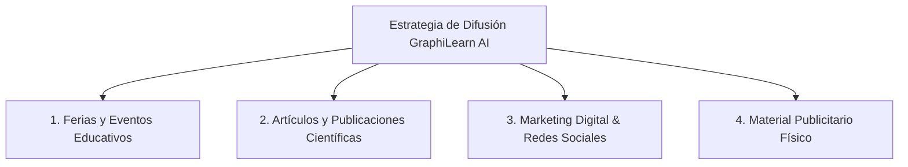

# Plan Estratégico de Marketing, Difusión y Posicionamiento
## Estrategias de Entrada al Mercado, Eventos, Divulgación y Material Publicitario de GraphiLearn AI

---

## 1. Introducción y Enfoque de Marketing

El presente plan define las estrategias y mecanismos de difusión para dar a conocer **GraphiLearn AI** ante sus públicos clave: directoras de colegios, coordinadoras de nivel inicial, maestras de kínder y gabinetes psicopedagógicos en Santa Cruz de la Sierra y el resto de Bolivia.

La estrategia se basa en un enfoque de **Marketing B2B Consultivo y Educativo**: en lugar de vender software como un producto frío, se posiciona a la empresa como un aliado pedagógico que capacita a las maestras y moderniza el seguimiento de la primera infancia.

---

## 2. Participación en Ferias y Eventos del Sector

1. **Feria Internacional de Santa Cruz (EXPOCRUZ):**
   * Presencia en el **Pabellón de Innovación, Tecnología y Educación**.
   * Demostración en vivo en stand interactivo: los visitantes dibujan trazos sobre hojas pautadas y ven cómo la pantalla proyecta en tiempo real la esqueletización digital y los 4 indicadores matemáticos.
2. **Feria Internacional del Libro de Santa Cruz de la Sierra (FIL):**
   * Participación en el área de literatura infantil y pedagogía temprana, organizando talleres gratuitos sobre *"Detección oportuna de dificultades en el desarrollo grafomotor previo a la escritura"*.
3. **Congresos y Jornadas de Educación Inicial (UAGRM / Escuelas de Maestros):**
   * Ponencias magistrales dictadas por el equipo de GraphiTech Solutions en colaboración con docentes de la FICCT sobre visión computacional aplicada a la educación inicial boliviana.

---

## 3. Divulgación Científica y Artículos Académicos

Para dotar al producto de un sólido prestigio académico y diferenciación frente a aplicaciones comerciales genéricas, se establecen dos líneas de publicación:

### 3.1. Artículos Académicos e Investigaciones Técnicas
* **Artículo 1 (Ingeniería de Software):** *"Arquitectura de microservicios desacoplada para la extracción en tiempo real de características geométricas en trazos infantiles mediante OpenCV y FastAPI"* (para presentación en conferencias nacionales de computación de Bolivia, como CCBOL).
* **Artículo 2 (Pedagógico):** *"Impacto de la medición cuantitativa de regularidad y continuidad del trazo en la toma de decisiones docentes en kínder: Un estudio exploratorio en colegios de Santa Cruz"*.

### 3.2. Publicaciones de Divulgación en Medios Locales
* Notas de prensa y artículos de opinión en periódicos locales (*El Deber*, *Los Tiempos*) sobre la importancia de atender la grafomotricidad antes de los 6 años para evitar el fracaso escolar en primaria.

---

## 4. Material Publicitario y Kit de Difusión

### 4.1. Material Digital
* **Brochure Corporativo Digital (PDF interactivo):** Documento descargable con testimonios de docentes, comparativa entre el cuaderno tradicional y GraphiLearn AI, y detalle de los planes de precios.
* **Campaña en Redes Sociales (LinkedIn y Facebook):**
  * Campañas dirigidas por segmentación a Directores de Colegio, Psicopedagogos y Maestras de Kínder de Santa Cruz.
  * Videos cortos tipo *Reels / TikTok* mostrando el proceso de tomar la foto con el celular y ver los resultados en menos de 2 segundos.

### 4.2. Material Impreso para Visitas a Colegios
* **Trípticos Informativos:** Entregados en las visitas comerciales a colegios privados, destacando los beneficios para la institución y la tranquilidad que brinda a los padres.
* **Block de Pruebas Gratuito:** Obsequio de 50 hojas pautadas impresas para que las maestras prueben el sistema durante 15 días sin costo en su aula (*Estrategia Product-Led Growth*).
