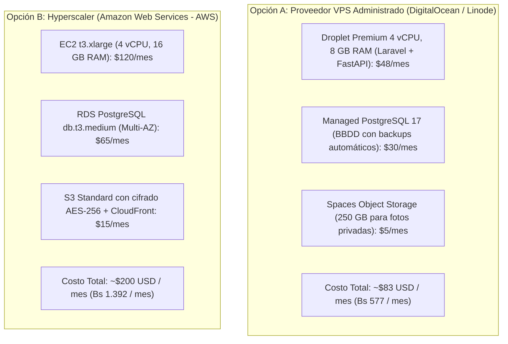

# Aspectos para la Puesta en Marcha en Producción
## Costeo Cloud, Licenciamiento, Términos y Condiciones, Privacidad y Manual de Usuario de GraphiLearn AI

---

## 1. Estimación y Costeo de Recursos Cloud (AWS / DigitalOcean / GCP)

Para el despliegue comercial de **GraphiLearn AI** atendiendo a una meta inicial de **45 a 120 colegios en Santa Cruz**, se compararon dos alternativas de infraestructura cloud:

### Decisión de Infraestructura Inicial Recomendada
* **Fase de Despegue (Año 1):** Se selecciona **DigitalOcean / Hetzner Cloud** por su excelente relación costo/rendimiento y latencia de red hacia Bolivia ($\approx \$85 \text{ USD/mes}$).
* **Fase de Escalamiento Nacional (Año 2 y 3):** Migración a **AWS (Región São Paulo - sa-east-1)** mediante contenedores en Elastic Kubernetes Service (EKS) para garantizar disponibilidad del 99.9% y cumplimiento de estándares internacionales de almacenamiento cifrado.

---

## 2. Esquema de Licenciamiento del Software

GraphiLearn AI aplica un modelo de **Licenciamiento Híbrido**:
* **Componentes Propietarios de la Empresa:** La lógica de negocio de Laravel, el pipeline de extracción de indicadores y el código del frontend React están protegidos bajo **Licencia Comercial Propietaria Cerrada**. Queda prohibida la descompilación, redistribución o reventa del software sin autorización expresa de GraphiTech Solutions S.R.L.
* **Componentes de Código Abierto (OSS) Utilizados:**
  * Laravel Framework: Licencia MIT.
  * FastAPI: Licencia MIT.
  * OpenCV: Licencia Apache 2.0.
  * PostgreSQL: Licencia PostgreSQL (similar a MIT/BSD).
  * React: Licencia MIT.
  * *Cumplimiento legal:* Todas las licencias OSS utilizadas son permisivas y permiten su incorporación en software comercial sin obligación de liberar el código fuente propio.

---

## 3. Términos y Condiciones de Uso del Servicio (SaaS)

El contrato de adhesión digital entre la institución educativa y GraphiLearn AI estipula:
1. **Licencia de Uso Limitada y no Transferible:** Se concede a la unidad educativa una licencia temporal anual revocable para el acceso de sus directores, docentes y alumnos registrados.
2. **Propósito Pedagógico y no Clínico:**  
   > *«El cliente reconoce y acepta expresamente que GraphiLearn AI es una herramienta tecnológica de soporte y observación cuantitativa para la práctica pedagógica en aula. Los indicadores, métricas y sugerencias computacionales emitidos por el sistema no constituyen ni sustituyen diagnósticos médicos, psicológicos, neurológicos ni clínicos formales».*
3. **Disponibilidad del Servicio (SLA):** Compromiso de disponibilidad mensual del **99.5%**, excluyendo periodos de mantenimiento preventivo previamente programados y notificados con 48 horas de anticipación.
4. **Propiedad de los Datos:** La institución educativa conserva en todo momento la propiedad exclusiva de los datos de sus estudiantes; la empresa actúa únicamente como custodio y procesador tecnológico seguro.

---

## 4. Política de Privacidad y Protección de Datos de Menores de Edad

En estricta observancia del **Código Niña, Niño y Adolescente de Bolivia (Ley 548)**:
1. **Consentimiento Previo y Expreso:** Ningún estudiante podrá ser registrado en la plataforma sin que el colegio cuente con el consentimiento informado firmado por el padre, madre o tutor legal.
2. **Principio de Minimización de Datos:** Únicamente se recopilan los datos estrictamente necesarios para el seguimiento escolar: nombre, fecha de nacimiento, curso y las fotografías de las hojas de ejercicios pautados. No se solicitan direcciones domiciliarias, teléfonos ni datos económicos familiares.
3. **Cifrado y Almacenamiento Aislado:**
   * Todas las comunicaciones web se ejecutan bajo protocolo seguro cifrado con TLS 1.3 / HTTPS.
   * Las imágenes de los trazos se almacenan en repositorios privados con nombres aleatorios UUID v4 y no pueden ser descargadas por internet sin token de autenticación docente.
4. **Derecho al Olvido y Supresión de Datos:** A la conclusión del ciclo escolar o a solicitud formal de la familia, la institución educativa puede solicitar la eliminación definitiva de las fotografías de su base de datos.

---

## 5. Manuales de Usuario del Sistema

### 5.1. Guía Rápida para el Docente de Aula
1. **Ingreso:** Acceda a `https://app.graphilearn.bo`, ingrese su correo institucional y contraseña.
2. **Selección del Aula:** En el menú principal, seleccione su curso (ej. *Kínder A*).
3. **Registro de Evaluación:**
   * Seleccione al estudiante de la lista.
   * Seleccione el ejercicio realizado (Línea, Círculo, Espiral o Zigzag).
   * Presione el botón **"Tomar / Cargar Fotografía"**.
   * Apunte con la cámara en posición perpendicular a la hoja, asegurando buena iluminación y evitando sombras de la mano sobre el trazo.
4. **Análisis Computacional:** Presione **"Procesar con IA"**. En 2 segundos verá en pantalla las métricas de longitud, regularidad y continuidad.
5. **Valoración Docente (Human-in-the-Loop):**
   * Seleccione la calificación cualitativa que corresponda:
     * **S:** Superado (trazo firme, regular y continuo acorde a su edad).
     * **ED:** En Desarrollo (trazo en proceso de maduración, leves oscilaciones).
     * **NA:** No Alcanzado (dificultad evidente de control del lápiz o desvío pronunciado).
   * Escriba su observación pedagógica en el campo de texto y presione **"Guardar Evaluación"**.

---

## 6. Agente Conversacional de Soporte (Chatbot)

Como parte del despliegue, el software incorpora un botón de ayuda flotante con el agente virtual **GraphiBot**, disponible tanto en la web administrativa como en la vista del docente, capaz de responder dudas comunes sobre la posición correcta del lápiz, recomendaciones de iluminación para la captura de fotos y resolución de problemas técnicos frecuentes en tiempo real.
