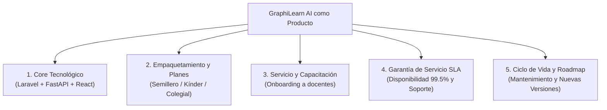
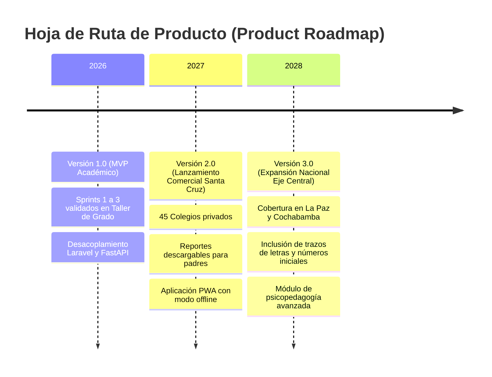

# El Software como Producto Tecnológico Comercial
## Propuesta de Valor, Empaquetamiento, Acuerdos de Nivel de Servicio (SLA) y Ciclo de Vida de GraphiLearn AI

---

## 1. El Concepto de Software como Producto

En el paradigma contemporáneo de la Ingeniería de Software, un desarrollo informático trasciende la noción de *"simple código ejecutable"* para convertirse en un **Producto Tecnológico Integral**. 

Un producto de software incorpora no solo la aplicación funcional, sino también el modelo de empaquetamiento, el soporte técnico continuo, la capacitación humana, la documentación de usuario, las garantías de seguridad y los acuerdos de nivel de servicio (SLA).

---

## 2. Propuesta de Valor Diferencial

### Para la Dirección del Colegio / Jardín de Infantes:
* **Modernización e Innovación Institucional:** Posiciona al colegio a la vanguardia tecnológica ofreciendo a los padres de familia un seguimiento con visión por computadora.
* **Reducción de Conflictos con Padres:** Las evaluaciones ya no son una simple percepción subjetiva de la maestra; cuentan con un respaldo cuantitativo e imágenes guardadas de forma privada.

### Para la Maestra de Educación Inicial:
* **Ahorro de Tiempo:** Elimina el tedioso llenado manual del cuaderno anecdótico papel por papel, reduciendo el tiempo de evaluación en un **70%**.
* **Objetividad y Seguridad Pedagógica:** La docente toma la foto en segundos y el sistema le muestra medidas matemáticas de regularidad y continuidad para respaldar su criterio formativo.

### Para los Padres de Familia:
* **Tranquilidad y Transparencia:** Acceso a reportes evolutivos trimestrales donde pueden ver con claridad el avance motor de su hijo y recibir pautas de apoyo en el hogar a tiempo.

---

## 3. Empaquetamiento y Modalidades de Entrega

El software se comercializa bajo tres modalidades empaquetadas:

| Componente del Paquete | Plan Semillero | Plan Kínder Estándar | Plan Colegial Integral |
|---|:---:|:---:|:---:|
| **Límite de Estudiantes** | Hasta 50 niños | Hasta 120 niños | Hasta 250 niños |
| **Aulas / Docentes Habilitados** | Hasta 3 docentes | Hasta 6 docentes | Ilimitados |
| **Ejercicios Soportados** | Línea, Círculo, Espiral, Zigzag | Todos los ejercicios | Todos + Pautas personalizadas |
| **Almacenamiento Privado de Fotos** | 10 GB en nube | 30 GB en nube | 100 GB en nube |
| **Capacitación Docente en Aula** | 1 sesión virtual (2 hrs) | 1 taller presencial en colegio (3 hrs) | 2 talleres presenciales + seguimiento |
| **Soporte Técnico** | Vía Correo / Chatbot | WhatsApp + Correo | Soporte Telefónico Prioritario |
| **Precio Anual** | **\$180 USD (Bs 1.250)** | **\$380 USD (Bs 2.640)** | **\$650 USD (Bs 4.520)** |

---

## 4. Acuerdos de Nivel de Servicio (Service Level Agreement - SLA)

Para asegurar la confianza institucional de los colegios clientes, el contrato de producto establece métricas rigurosas de SLA:

1. **Disponibilidad de la Plataforma (Uptime):** **99.5% anual**, medido mediante herramientas de monitoreo externo (UptimeRobot / BetterStack).
2. **Ventanas de Mantenimiento:** Cualquier actualización de infraestructura se ejecuta exclusivamente en horario nocturno (de 23:00 a 04:00 hora boliviana) o durante fines de semana, con aviso previo de 48 horas.
3. **Tiempos de Resolución de Defectos:**
   * **Incidencias Críticas (Servicio inaccesible):** Tiempo de respuesta $< 1\text{ hora}$; tiempo de solución $< 4\text{ horas}$.
   * **Incidencias Mayores (Falla de procesamiento de fotos):** Tiempo de respuesta $< 4\text{ horas}$; tiempo de solución $< 24\text{ horas}$.
   * **Consultas Generales o de Configuración:** Atención en menos de 24 horas laborables.

---

## 5. Ciclo de Vida del Producto y Roadmap Futuro

GraphiLearn AI se gestiona bajo un ciclo de vida evolutivo continuo:

---

## 6. Conclusión General del Proyecto

Con la consolidación de estos 12 módulos y la finalización exitosa de las suites de prueba y el código fuente, **GraphiLearn AI se posiciona como un proyecto de Taller de Grado de máxima excelencia**:
* **Técnicamente Impecable:** Arquitectura moderna en microservicios, 58 pruebas automatizadas pasadas al 100%, PostgreSQL 17 optimizado y frontend React empaquetado.
* **Metodológicamente Riguroso:** Documentación alineada paso a paso con las plantillas de Martínez Canedo (Scrum, PUDS, Caja Blanca con McCabe $\ge 3$, Enterprise Architect, SQAP IEEE 730).
* **Comercialmente Viable:** Modelo de negocio cuantificado para el mercado de Santa Cruz, con respaldo legal completo ante el SEPREC, SIN, Alcaldía GAMSC y registro de software ante el SENAPI.
