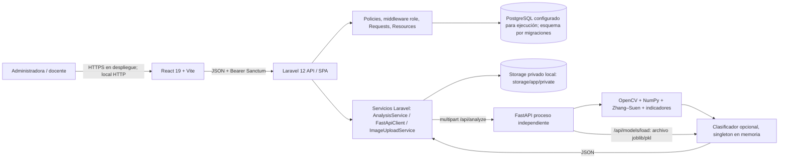
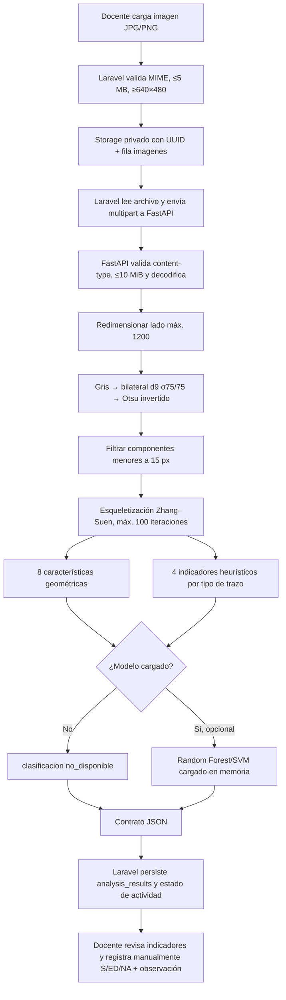
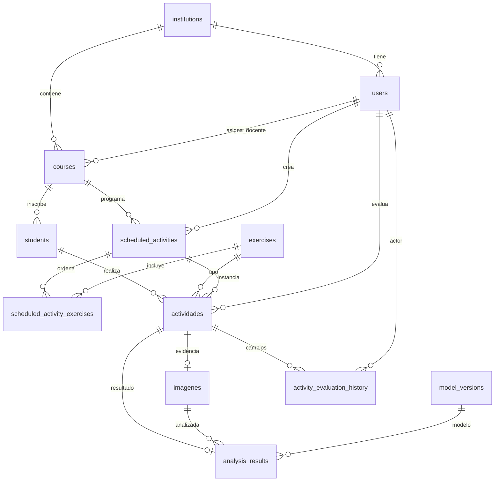

# Auditoría general de GraphiLearn AI — estado real del proyecto

**Fecha de corte:** 1 de noviembre de 2026  
**Alcance:** revisión estática del código, migraciones, configuración y documentación; ejecución local de PHPUnit y pytest. No se inspeccionó `.env`, no se consultó la base de datos real y no se ejecutaron migraciones, builds, despliegues ni operaciones sobre registros.  
**Repositorio:** `GraphiLearn/` (Laravel/React), `ai-service/` (FastAPI/OpenCV) y `docs/`.

## Cómo leer los hallazgos

- **CONFIRMADO POR CÓDIGO:** existe implementación visible en los archivos indicados; no necesariamente se verificó su funcionamiento en producción.
- **VERIFICADO MEDIANTE PRUEBAS:** se ejecutó una prueba automatizada en esta auditoría, con el alcance y dobles indicados.
- **DOCUMENTADO PERO NO VERIFICADO:** consta en documentación del repositorio, pero no se repitió en este corte.
- **PENDIENTE:** no existe o no se encontró evidencia suficiente de implementación/validación.
- **NO DISPONIBLE:** no se encontró el recurso o estado en el código/artefactos disponibles.

Los archivos modificados y no confirmados que ya existían en el workspace se preservaron. Este informe es el único archivo creado para esta entrega. Las referencias a pruebas PostgreSQL y ejecuciones integrales en `docs/sprint-3/README.md` son documentación de otro corte, no resultado de esta auditoría.

## A. Resumen ejecutivo del sistema

GraphiLearn AI es una aplicación web de seguimiento de actividades grafomotoras de educación inicial. Laravel gestiona usuarios, cursos, estudiantes, ejercicios, programaciones, ejecuciones individuales, fotografías privadas, resultados de análisis y valoraciones docentes. React es la interfaz de una sola página servida por Laravel/Vite. Un servicio FastAPI independiente recibe imágenes en memoria, realiza procesamiento OpenCV y devuelve descriptores geométricos e indicadores heurísticos. Laravel guarda la respuesta.

El problema que aborda es organizar las evidencias de ejercicios trazados sobre papel y apoyar al docente con mediciones repetibles y seguimiento por estudiante/periodo. La aplicación **no es un sistema clínico**, no determina diagnósticos y el Random Forest disponible es un benchmark sintético. La valoración S/ED/NA es manual.

El alcance implementado es ya más amplio que el contexto de partida: hay CRUD administrativo, asignación de docentes a cursos, inscripciones, catálogo, programación multiejercicio, ejecución individual, carga protegida, análisis, valoración manual con historial y vistas de progreso. Persisten pendientes importantes: seguridad del plano de control FastAPI, comprobación real actual PostgreSQL↔FastAPI, comparación longitudinal más utilizable, criterios pedagógicos, validación con imágenes y población objetivo, cámara real y despliegue/respaldos operativos.

### Estado del objetivo

| Categoría | Estado real |
|---|---|
| Objetivo propuesto | Acompañar observación y seguimiento grafomotor mediante ejercicios, evidencias y comparación temporal. Entrevista resumida en `docs/sprint-2/pendientes-academicos.md` y `docs/sprint-3/README.md`. |
| Implementado | Autenticación Sanctum; roles administradora/docente; CRUD de entidades principales; programaciones con uno o varios ejercicios; registro de ejecución por estudiante/ejercicio; foto privada; procesamiento de imagen; indicadores; valoración docente S/ED/NA y bitácora; vistas de historial e informes. |
| Parcial | Comparación de evaluaciones: API agrupa observaciones valoradas por ejercicio y referencia de periodo, pero no calcula tendencias, progreso o porcentajes. Dashboard son conteos agregados. La experiencia móvil solo fue descrita/documentada, no probada en dispositivo. |
| Pendiente | Validación pedagógica y científica; dataset real pertinente; protocolo de tres evaluaciones/adaptación y criterios aprobados; resguardo operacional y despliegue; prueba integral repetible del estado actual. |

## B. Inventario de funcionalidades implementadas

La tabla combina rutas (`GraphiLearn/routes/api/v1/*.php`), controladores, vistas React y entidades. “Prueba” se refiere a los tests ejecutados abajo, no a aceptación de usuario.

| Módulo / función | Rol | Pantalla React | Endpoint Laravel / responsable | Tablas principales | Estado y evidencia | Prueba en esta auditoría |
|---|---|---|---|---|---|---|
| Inicio de sesión/sesión | Ambos | `LoginView.jsx` | `POST /api/v1/auth/login`, `GET /me`, `POST /logout`; `AuthController` | users, personal_access_tokens | Implementado; Sanctum token y límite en login/register. Registro público rechazado por regla del controlador. | Sí, login, registro bloqueado, me, logout y acceso no autenticado. |
| Dashboard | Ambos | `DashboardView.jsx` | `GET /api/v1/dashboard`; `DashboardController` | courses, students, scheduled_activities, actividades | Implementado con conteos adecuados al rol; no es analítica longitudinal. | Sí, test feature de separación entre programado/registrado/evaluado. |
| Docentes CRUD/desactivación | Administradora | `TeachersView.jsx` | `/api/v1/docentes`; `TeacherController` | users, institutions | Implementado para su institución; bajas se marcan inactivas (no borrado físico). | No hay test de cada CRUD en la suite ejecutada. |
| Cursos/aulas CRUD, asignación de docente | Admin; docente consulta asignados | `CoursesView.jsx` y detalle en `ActivityDetailView.jsx`/flujo de aula | `/api/v1/cursos`, `/api/v1/cursos/{id}`, `/seguimiento`; `CourseController`, `CourseProgressController` | courses, users, institutions | Implementado. Docente limitado a cursos asignados; admin a institución. | Test de filtros/aislamiento; CRUD no exhaustivo. |
| Estudiantes/inscripciones | Admin escribe; docente consulta sus aulas | `StudentsView.jsx` | `/api/v1/students`, `/restore`; `StudentController` | students, courses | Implementado; soft delete, restauración admin, ficha administrativa limitada. No existe entidad separada “matrícula”: estudiante pertenece directamente a un curso. | Tests básicos y restricciones; no se probó cada transición. |
| Catálogo de ejercicios | Admin administra; docente lee | `ExercisesView.jsx` | `/api/v1/exercises`; `ExerciseController` | exercises | Implementado; tipos limitados por enum a línea/círculo/espiral/zigzag. | Test de permiso lectura/escritura. |
| Programaciones con varios ejercicios | Admin crea/edita/desactiva; docente consulta activas asignadas | `ProgrammedActivitiesView.jsx` | `/api/v1/actividades-programadas`; `ScheduledActivityController` | scheduled_activities, scheduled_activity_exercises, courses, exercises | Implementado en código reciente; orden de ejercicios y validaciones de curso. | Test documentado en incremento, no repetido en las suites automatizadas actuales. |
| Ejecución/registro de trabajo individual | Docente | `ActivitiesView.jsx`, `NewActivityView.jsx` | `/api/v1/actividades`; `ActividadController` | actividades, students, exercises, scheduled_activities | Implementado; una fila representa ejecución individual, no definición programada. Índice único por programación+estudiante+ejercicio impide repetir dentro de una misma programación incluso si se baja lógicamente. | Casos de procesar actividad y duplicados. |
| Carga/captura de foto | Docente autorizado | `NewActivityView.jsx`, `ActivityDetailView.jsx` | `POST /actividades/{id}/imagen`; `ImagenController`, `ImageUploadService`, `ImageValidationService` | imagenes | Implementado para seleccionar/cargar archivo. MIME JPG/PNG, 5 MB y mínimo 640×480. Almacenamiento privado UUID. `capture="environment"` documentado como selector de cámara, no evidencia de prueba en teléfono. | Endpoint de análisis usa imagen simulada; no se ejercitó la carga visual/cámara en esta auditoría. |
| Análisis OpenCV | Docente de actividad propia | `ActivityDetailView.jsx`, `AnalysisView.jsx` | `POST /actividades/{id}/procesar`, `GET /resultado`; `AnalysisController`, `AnalysisService`, `FastApiClient` | actividades, imagenes, analysis_results, model_versions | Backend implementado. Respuesta geométrica/heurística se guarda; error de servicio revierte estado. | Backend con `Http::fake`; no integración viva. |
| Valoración S/ED/NA y observación | Docente propietario | `ActivityDetailView.jsx`, informes | `PUT /actividades/{id}/evaluacion`, historial; `ActivityEvaluationController` | actividades, activity_evaluation_history, users | Implementado como decisión docente, modificable y con snapshot del valor previo antes de actualizar. Se almacena sobre cada ejecución/ejercicio. | Sí, persistencia manual e historial. |
| Ficha/historial/informes individuales | Docente asignada | `StudentProgressView.jsx`, `StudentReportsView.jsx` | `GET /students/{id}/progress`; `StudentProgressController` | students, actividades, analysis_results, imagenes, historial | Implementado como listado y agrupación por ejercicio/periodo con evidencias e indicadores. No calcula porcentaje ni tendencia matemática. Admin no tiene endpoint de progreso individual. | La suite ejecutada no valida toda la representación frontend. |
| Estadística del curso | Docente asignada | detalle de curso | `GET /cursos/{id}/seguimiento`; `CourseProgressController` | actividades, students, exercises | Implementado como conteos por ejercicio y evaluados, no estadística institucional clínica. | No verificado aparte del test dashboard. |
| Estadística institucional | Administradora | `DashboardView.jsx` | `GET /dashboard`; `DashboardController` | institutions, users, courses, students, scheduled_activities | Conteos institucionales agregados, sin conteos individuales S/ED/NA según documentación y código revisado. | Test de privacidad agregado. |
| Versiones IA | Admin | `ModelVersionsView.jsx` | `/api/v1/model-versions`; `ModelVersionController` | model_versions, analysis_results | Registro y activación administrativa existen. La activación puede marcar versión activa aunque FastAPI no confirme carga (defecto). FastAPI separado carga modelo en memoria. | Pruebas cubren archivo inexistente y rol; llamada de activación simulada, sincronización real no probada. |

### Vistas, redundancias y comportamiento

Pantallas detectadas en `GraphiLearn/resources/js/views/`: `LoginView`, `DashboardView`, `TeachersView`, `CoursesView`, `StudentsView`, `ExercisesView`, `ProgrammedActivitiesView`, `ActivitiesView`, `NewActivityView`, `ActivityDetailView`, `AnalysisView`, `ModelVersionsView`, `StudentProgressView`, `StudentReportsView`, `ProfileView`. `App.jsx` controla navegación local y carga de datos; no se encontró router dedicado. Documentación de sprint 3 indica que `analysis` redirige a informes y `analysis-detail` reutiliza el detalle, lo que explica la redundancia nominal entre `AnalysisView` e informes.

No se encontró evidencia en código de un botón de IA que asigne S/ED/NA: la API de evaluación valida esa escala por separado y no recibe predicción como rating. Tampoco existe generación de PDF, gráfico longitudinal, porcentaje de avance, ni vista de imagen procesada por IA (la respuesta FastAPI no contiene imagen). Los botones de cámara son una pista de captura de archivo del navegador; la cámara física no está verificada. Afirmar que un botón concreto está roto requeriría ejecución manual de UI, que no se realizó.

## C. Arquitectura real

### Vista de arquitectura



**Servicios independientes:** Laravel y FastAPI son procesos/aplicaciones separados con un límite HTTP configurable (`AI_SERVICE_URL`, valor por defecto `127.0.0.1:8001`). En el código hay un cliente HTTP en `GraphiLearn/app/Services/FastApiClient.php` y API FastAPI en `ai-service/main.py`. Es razonable llamarlo servicio independiente. La carpeta no acredita por sí sola despliegue autónomo, escalado, contenedores, observabilidad ni resiliencia de microservicios; no se encontraron Docker/compose o manifiestos de despliegue en el inventario revisado.

### Responsabilidades y configuración

- **Laravel:** `app/Http/Controllers/Api/V1` coordina HTTP; `app/Http/Requests` valida entradas; `app/Http/Resources` serializa; `app/Models` define Eloquent; `app/Policies` controla acceso a entidades; `app/Services` contiene integración y almacenamiento. `bootstrap/app.php` registra alias `role`. Middleware Sanctum protege API.
- **React/Vite:** `resources/js/App.jsx`, componentes compartidos y vistas consumen `/api/v1` con Axios. El token se conserva en almacenamiento del navegador y se añade como Bearer (revisar `App.jsx`). Riesgo habitual de token accesible a XSS; no hay evidencia de revisión XSS/CSP en esta auditoría.
- **FastAPI:** `main.py` incluye routers `analysis` y `models`. CORS se registra con `allow_origins=[]`; no equivale a autenticación. `/predict` es compatibilidad antigua. No se persiste fotografía en el servicio; el upload se procesa en memoria.
- **Base:** PostgreSQL aparece en configuración, pero el valor predeterminado de `config/database.php` es SQLite si no se especifica `DB_CONNECTION`; `.env.example` y migraciones no demuestran qué motor usa el entorno real. `phpunit.xml` usa SQLite `:memory:`.
- **Dependencias principales:** Laravel Framework 12, Sanctum 4, PHP ^8.2; React 19, Vite 7, Axios; FastAPI, OpenCV, NumPy, scikit-learn, SciPy, joblib, pytest/httpx (ver `composer.json`, `package.json`, `ai-service/requirements.txt`). La versión resuelta debe leerse del lock/entorno, no inferirse de los rangos.
- **Errores:** `AnalysisService` marca `procesando`, llama a FastAPI fuera de transacción, y devuelve estado a `pendiente` ante error; guarda resultados en transacción. `FastApiClient` diferencia timeout/indisponibilidad/respuesta inválida. Los errores se traducen en `AnalysisController`. `ImageUploadService` valida y guarda en disco privado; hay manejo de compensación en reemplazo, aunque la creación inicial de fila y archivo no es una transacción coordinada integral.
- **Despliegue local documentado:** Laravel `php artisan serve`, Vite `npm run dev`, FastAPI `uvicorn main:app --reload --port 8001`; documentación en `docs/sprint-3/README.md`. No se repitió arranque integral ni se inspeccionó configuración secreta.

### Autenticación/autorización

Sanctum usa tokens Bearer; roles permitidos `administrador` y `docente` se verifican en `CheckRole`. Policies y helpers de `User` restringen cursos por institución o asignación. La auditoría de seguridad de Sprint 2 documenta y los tests locales verifican parte de esas reglas. El middleware no protege automáticamente a FastAPI: los endpoints allí son accesibles directamente sin token.

## D. Funcionamiento completo del pipeline

### A. Entrada y validación

1. Laravel recibe `imagen` vía multipart. `UploadImagenRequest` limita a JPG/JPEG/PNG y 5 MB; `ImageValidationService` verifica MIME detectado, tamaño y dimensiones mínimas 640×480. Guarda nombre UUID en `storage/app/private/graphilearn/imagenes/` y no expone ruta pública (`ImageUploadService`, `ImagenController`).
2. Para procesar, Laravel lee el archivo privado y manda multipart a `POST {AI_SERVICE_URL}/api/analyze`, con `tipo_esperado` del ejercicio (`FastApiClient`). No pasa ruta local ni identidad de estudiante a FastAPI.
3. FastAPI comprueba que el `content_type` comience por `image/`, que no esté vacío y pese como máximo 10 MiB; decodifica con OpenCV y exige 20×20 píxeles mínimo (`routers/analysis.py`, `services/preprocessing.py`). No hay lista cerrada de formatos por firma en el router: la decodificación real limita lo que puede leer. Laravel impone el límite más restrictivo de 5 MB si la foto entra por su flujo habitual; FastAPI expuesto directamente admite hasta 10 MiB.
4. No se detecta encuadre de hoja, calibración métrica, perspectiva, orientación EXIF, localización automática de pauta ni extracción de región de interés.

### B. Preprocesamiento y C. esqueletización

`preprocess_stroke_image` reduce el lado mayor a 1200 px (mantiene aspecto), BGR→gris, `cv2.bilateralFilter(d=9, sigmaColor=75, sigmaSpace=75)`, Otsu inverso (`THRESH_BINARY_INV + THRESH_OTSU`), componentes conexos 8-conectados con área mínima 15 px y eliminación de menores. Si no queda trazo, retorna error 422. No hay operación morfológica adicional de apertura/cierre pese a que algunos textos hablan genéricamente de filtrado morfológico.

`zhang_suen_thinning` implementa las dos subiteraciones clásicas, usa vecinos 8-conectados, padding de un píxel, termina cuando no quedan píxeles candidatos o llega a 100 iteraciones; retorna matriz uint8 0/255. Objetivo: reducir grosor y facilitar descriptores geométricos. No garantiza un único trazo ni recuperar trayectoria real; puntos de cruce/ruido, trazos solapados, binarización deficiente y topología de la muestra afectan el resultado. Las medidas posteriores son píxeles de imagen procesada, no milímetros.

### D. Características geométricas

Calculadas en `ai-service/services/features.py` y esquema `schemas/analysis.py`.

| Campo | Algoritmo | Significado / unidad | Dominio y límites |
|---|---|---|---|
| `longitud_trazo` | Suma de aristas del esqueleto: ortogonal 1, diagonal √2, aristas contadas una vez. | Longitud aproximada en píxeles procesados (px). | ≥0; depende de resolución/redimensionado; pixeles con vecindad compleja pueden sobrecontar conexiones. |
| `alto`, `ancho` | Caja delimitadora inclusiva de coordenadas mínimas/máximas. | Dimensiones en px. | Enteros ≥0; sin normalización a tamaño real de hoja. |
| `proporcion` | `ancho / alto`, fallback 1 si alto≤0. | Relación adimensional. | ≥0 según imagen; no tiene rango de validez pedagógico. |
| `inclinacion` | Orientación de eje principal mediante momentos de segundo orden; `0.5 atan2(2μ11, μ20−μ02)` en grados. | Orientación global estimada (°). | Código normaliza a [-90,90], retorna 0 con menos de tres puntos. |
| `curvatura` | Cambios angulares de segmentos muestreados de contornos del esqueleto / longitud muestreada. | Rad/px aproximados. | ≥0; muestreo y orden de contorno OpenCV pueden no corresponder a una ruta trazada. |
| `separacion_componentes` | Distancia mínima entre centroides de componentes conexos 8-conectados. | px; 0 si hay 0/1 componentes. | ≥0; es distancia centroidal, no distancia mínima entre bordes. |
| `posicion_normalizada.center_x/center_y` | Media de coordenadas de píxeles de esqueleto dividida por ancho/alto de imagen. | Proporción adimensional en [0,1]. | Coordenadas relativas al fotograma completo, no a hoja detectada. |
| `posicion_normalizada.bbox_normalized` | `[xmin/W,ymin/H,xmax/W,ymax/H]` recortado a [0,1]. | Proporciones del encuadre. | [0,1]; es coordenada de cámara/imagen y cambia con encuadre. |

### E. Indicadores y ejercicios

Implementados en `ai-service/services/indicators.py`:

| Indicador | Cálculo implementado | Observación |
|---|---|---|
| Desviación (`desviacion`) | Línea: distancia perpendicular media a línea de `cv2.fitLine`, dividida por extensión. Círculo: ajuste algebraico Kåsa, desviación radial media relativa al radio. Espiral: regresión `r=a+bθ` (espiral de Arquímedes) y error radial medio/r máximo. Zigzag: aproxima polilínea con `approxPolyDP` (`epsilon=max(2 px, 4% diagonal)`) y distancia media a segmentos dividida por diagonal. | menor equivale a mayor ajuste matemático aproximado, no calidad/edad esperada. El orden de puntos proviene de contorno aproximado, no de una trayectoria semántica. Tipo desconocido cae a círculo. |
| Rugosidad | Desviación estándar de giros angulares sucesivos en puntos muestreados del contorno (hasta ~60 muestras). | No calibrada con observación docente; en píxeles discretos depende del orden del contorno. |
| Continuidad | Si un componente, 1; con varios `(área principal/área total) × 1/(1+0.15×(n−1))`; vacío 0. | [0,1] según código. Mide fragmentación visible, no continuidad temporal del lápiz. |
| Regularidad | `1 − [0.45·min(1,2.5·desviación)+0.35·min(1,rugosidad/1.5)+0.20·(1−continuidad)]`, truncado [0,1]. | Índice heurístico diseñado en código; no hay umbrales normativos/validación de constructo. |

Los indicadores se calculan para línea, círculo, espiral y zigzag mediante la desviación especializada; los tres restantes se calculan igual para todo patrón. No hay una métrica distinta por ejercicio sobre agarre, presión, postura o coordinación: una fotografía estática no contiene esa información.

### F. Random Forest

- Entrenamiento: `ai-service/training/train.py`; RandomForest de 100 árboles, profundidad máxima 5, `min_samples_split=3`, pesos balanceados y semilla 42, empaquetado con `StandardScaler` en `Pipeline`. También ofrece SVM-RBF.
- Dataset por defecto: 120 filas generadas artificialmente, 20 identificadores sintéticos de niño; atributos se muestrean de intervalos elegidos manualmente, etiqueta por grupo sintético (35% de IDs en riesgo potencial). No es una base clínica ni dibujos reales (`generate_synthetic_benchmark_dataset`).
- Separación: `GroupShuffleSplit(test_size=.25, random_state=42)` por ID. Evita compartir identificador entre train/test, pero un único split pequeño sobre datos generados con regla determinista no constituye validación externa ni prueba de sesgo. No hay dataset de campo ni definición operacional de etiqueta respaldada por especialista.
- Entradas: longitud, alto, ancho, proporción, inclinación, curvatura, separación, desviación, rugosidad, continuidad, regularidad (11 columnas).
- Salidas: `0 → bajo_riesgo`, `1 → riesgo_potencial`; score usa `predict_proba` y toma `probas[-1]`, que es la última clase, no necesariamente la clase positiva semántica en todo modelo arbitrario.
- Artefactos: en el inventario se encontró `ai-service/models/randomforest_v1.0-benchmark_metrics.json`, con métricas 1.0 sobre 29 muestras/5 sujetos de prueba, matriz 16 y 13 aciertos. **No se encontró archivo `.joblib`/`.pkl` entrenado** en `ai-service/models`; el script de entrenamiento escribiría uno al ejecutarse, pero no se ejecutó para no generar/modificar artefactos.
- Carga: singleton `classifier_instance` en `services/classifier.py`; inicializa sin modelo salvo que se entregue ruta, y `main.py` no le entrega una. En consecuencia, por arranque normal, el modelo está no disponible. Puede cargarse dinámicamente por `/api/models/load`.
- Si no está cargado, `predict` devuelve `disponible=false`, etiqueta `no_disponible`, `risk_score=null`; los indicadores geométricos siguen procesándose.
- El JSON de métricas es un benchmark experimental reproducible con datos sintéticos y resultado perfecto por construcción. No reportar 100% como precisión real del sistema. No hay validación real del clasificador.

### G. Salida FastAPI y persistencia

Contrato de `AnalyzeResponseSchema` (`ai-service/schemas/analysis.py`):

```json
{
  "estado": "procesado",
  "mensaje": "Análisis computacional y extracción de características completado exitosamente.",
  "tipo_trazo": "circulo",
  "caracteristicas_geometricas": {
    "longitud_trazo": 412.3, "alto": 120, "ancho": 122,
    "proporcion": 1.017, "inclinacion": 5.2, "curvatura": 0.045,
    "separacion_componentes": 0.0,
    "posicion_normalizada": {"center_x": 0.51, "center_y": 0.49,
      "bbox_normalized": [0.1, 0.1, 0.9, 0.9]}
  },
  "indicadores_cuantitativos": {
    "desviacion": 0.054, "rugosidad": 0.125,
    "continuidad": 0.98, "regularidad": 0.88
  },
  "clasificacion": {
    "disponible": false, "risk_label": "no_disponible",
    "risk_score": null, "model_version": null,
    "mensaje": "Clasificación no disponible; no constituye diagnóstico clínico."
  },
  "detalles_computacionales": {
    "archivo": "captura-anonima.png",
    "tiempo_procesamiento_segundos": 0.12,
    "metadatos_imagen": {"dimensiones_originales": {"ancho": 640, "alto": 480}},
    "etapas_completadas": [],
    "aviso_pedagogico": "Herramienta de apoyo; no constituye diagnóstico clínico."
  }
}
```

Los valores numéricos son ilustrativos para explicar el esquema, no salida de una imagen real. Laravel `AnalysisService` mapea geometría, indicadores, etiqueta/score, versión y detalles a `analysis_results`; el resultado se relaciona uno-a-uno con `actividades` (restricción unique `actividad_id`), estado_revision empieza `pendiente`. Resource sirve el resultado a React. No se almacena la matriz binaria ni imagen analizada.

### H. Estado técnico del pipeline

| Etapa | Estado | Evidencia / límite |
|---|---|---|
| Validación y decodificación | Verificado en pruebas | 11 tests pytest pasan; formatos/muestras sintéticas. |
| Preprocesamiento y Zhang–Suen | Verificado en pruebas | Imagen sintética y papel blanco; faltan fotos reales con distintas luces/perspectiva. |
| Descriptores e indicadores | Verificado en pruebas | Casos sintéticos, aserciones de comportamiento, no tolerancia externa/pedagógica. |
| Contrato FastAPI | Verificado en prueba TestClient | Sin red/servidor desplegado. |
| Laravel guarda respuesta | Verificado con HTTP fake | No confirma interoperabilidad de servicio vivo ni PostgreSQL. |
| Servicio FastAPI→Laravel vivo | Documentado pero no verificado en este corte | `docs/sprint-3/README.md` reconoce que durante revisión previa `127.0.0.1:8001` respondió aplicación distinta y pide repetir integración. |
| Random Forest activo | No disponible por inicialización; sin modelo binario encontrado | Hay solo JSON de métricas; no se ejecutó carga de modelo. |
| Calibración y validación pedagógica/científica | Pendiente | No existen datos pertinentes etiquetados ni protocolo de validación documentado con resultados. |

### Diagrama del pipeline



## E. Estado de la evaluación pedagógica

La entrevista descrita indica tres evaluaciones en el periodo; la primera con aproximadamente dos semanas de adaptación; comparación temporal; ejercicios línea/círculo/espiral/zigzag; categorías S, ED y NA. Agarre del lápiz y coordinación requieren mirada docente.

| Pregunta | Estado confirmado |
|---|---|
| ¿Quién registra S/ED/NA? | La docente, por `PUT .../evaluacion`; el endpoint no recibe la etiqueta del clasificador. |
| ¿Se guarda por ejercicio? | Sí, sobre `actividades`, una ejecución de un estudiante y un ejercicio; puede tener `scheduled_activity_id`. |
| ¿Modificable con trazabilidad? | Sí. `ActivityEvaluationController` guarda valores anteriores en `activity_evaluation_history` y actor (`changed_by`), luego actualiza ejecución. La tabla conserva cada snapshot previo, no copia el valor nuevo dentro del evento recién creado; el valor actual está en `actividades`. |
| ¿Asociado a periodos? | Sí, campo textual libre opcional `period_reference` en programación y ejecución. No hay tabla/catálogo de periodos ni validación del orden/calendario. |
| ¿Tres evaluaciones/adaptación? | No está impuesto. Puede representarse manualmente con referencias, pero no hay workflow que exija 3 hitos o 2 semanas de adaptación. |
| ¿Criterios pedagógicos? | No se hallaron rúbricas/umbrales formalizados para cada ejercicio y nivel. S/ED/NA se guarda, pero su criterio operativo depende del docente. |
| ¿Comparación? | Parcial: endpoint agrupa valoraciones por mismo ejercicio y `period_reference` cuando existen; UI lista datos. No hay cálculo de avance o visualización cuantitativa validada. |
| ¿Porcentaje de avance? | No implementado. Conteos de ejecuciones/evaluaciones no son porcentaje de desarrollo. |
| ¿Es válido derivarlo ahora? | No como “porcentaje de avance grafomotor”. Categorías ordinales S/ED/NA no tienen distancias numéricas establecidas y periodos incompletos/no normalizados producen denominadores ambiguos. Podría mostrarse un indicador administrativo de cobertura (p. ej. evaluaciones registradas/esperadas) solo tras fijar calendario y denominador; etiquetarlo como cobertura, no desarrollo. |
| ¿Sugerencia automática futura? | Requiere criterios y etiquetas definidos por especialistas, consentimientos/ética y gobernanza de datos de menores, dataset de ejercicios y edades pertinentes suficientemente representativo, anotación independiente/interevaluador, partición por estudiante e institución, evaluación externa y análisis de error/calibración, revisión humana obligatoria, explicabilidad, monitoreo y mecanismo de abstención. No usar benchmark sintético como criterio ni diagnosticar. |

## F. Flujos de usuario reales

### Administradora

| Paso | Pantalla / API | Validación y persistencia | Resultado / problema |
|---|---|---|---|
| Login | `LoginView` → `POST /api/v1/auth/login` | Credenciales; token Sanctum. | Implementado; suite lo verifica. |
| Docentes | `TeachersView` → `/api/v1/docentes` | Control por institución, rol admin; users activos/desactivados. | CRUD de código; pruebas CRUD específicas limitadas. |
| Cursos/aulas | `CoursesView` → `/api/v1/cursos` | Institution_id y docente asignado en courses. | Implementado; tests verifican lista aislada por rol. |
| Estudiantes/inscripciones | `StudentsView` → `/api/v1/students` | Estudiante se vincula directamente a curso; soft delete/restauración. | Implementado; no hay tabla de matrícula ni historial formal de cambios de curso. |
| Catálogo/programación | `ExercisesView`, `ProgrammedActivitiesView` → `/exercises`, `/actividades-programadas` | Reglas de curso institucional, ejercicios activos, lista ordenada. | Implementado en código; suite actual no recorre todo este flujo. |
| Estadísticas | `DashboardView` → `/dashboard` | Conteos agregados del rol. | Sin analítica longitudinal ni acceso a informes individuales de estudiantes. |

### Docente

| Paso | Pantalla / API | Validación y persistencia | Resultado / problema |
|---|---|---|---|
| Login | `LoginView` → `/auth/login` | Sanctum; middleware role y active. | Verificado por PHPUnit. |
| Curso/aula | `CoursesView` → `/cursos/{id}` (API) y seguimiento | Policy valida asignación. | Implementado; detalles UI dependen de carga SPA. |
| Estudiante/ficha | `StudentsView`, `StudentProgressView` → `/students`, `/students/{id}/progress` | `puedeAccederAlCurso`; ficha individual solo docente. | Implementado; foto/valoración excluidas de la vista admin según tests/documentación. |
| Actividad programada | `ActivitiesView` → `/actividades-programadas` | Solo curso accesible y programación activa para docente. | Implementado. |
| Elegir ejercicio/crear ejecución | `NewActivityView` → `POST /actividades` | Debe pertenecer a programación/estudiante; evita duplicado por programación+alumno+ejercicio. | Implementado; una nueva programación permite nueva instancia temporal. |
| Fotografía | `NewActivityView` → `POST /actividades/{id}/imagen` | MIME/tamaño/resolución, privada; reemplazo antes de analizar. | Captura móvil documentada; dispositivo real no verificado. |
| Análisis | `ActivityDetailView` → `POST .../procesar` | Policy, imagen requerida, estado duplicado/concurrente; HTTP multipart a FastAPI. | Backend pasa pruebas con fake. FastAPI detenido: respuesta controlada 503, estado vuelve a pendiente, sin resultado parcial (verificado). |
| Consultar resultado | `GET .../resultado` | Recurso protegido por Policy. | Muestra indicadores y etiqueta solo si clasificación disponible. |
| Valoración/observación | `PUT .../evaluacion` | Enum S/ED/NA, texto máx. 5000, periodo libre; registra historial. | Implementado y prueba de trazabilidad. |
| Historial/informe | `StudentReportsView` → progreso | Agrupa valores por ejercicio/periodo y enumera ejecuciones/observaciones. | No compara puntuaciones, no porcentualiza, no calcula una tendencia. |

### Fallos del servicio/modelo/foto

- **FastAPI apagado/timeout:** Laravel traduce a errores 503/504; el servicio revierte la actividad a `pendiente`, no guarda resultado. PHPUnit verifica estas respuestas mediante `Http::fake`, no un fallo de red real.
- **Sin modelo activo:** procesamiento geométrico/heurístico debe continuar; la clasificación devuelve `no_disponible`. pytest verifica el fallback y contrato.
- **Foto inválida:** Laravel rechaza en validación y no debe llamarse al analizador. FastAPI solo si se llama directamente valida content type/tamaño/decodificación; errores de procesamiento son 422/500 según fase.
- **Modelo falla al cargar:** endpoint FastAPI devuelve 400; sin auth y carga insegura (ver seguridad). Si cliente Laravel devuelve falso, hoy `ModelVersionController::activate` no lo trata como error y puede marcar en PostgreSQL una versión activa que FastAPI no cargó.

## G. Base de datos y modelo de dominio

### Motor y estado de datos

**CONFIRMADO POR CÓDIGO:** Laravel soporta PostgreSQL; la configuración por defecto cae a SQLite. PHPUnit fuerza SQLite en memoria.  
**DOCUMENTADO PERO NO VERIFICADO:** `docs/sprint-3/README.md` identifica base de desarrollo como `graphilearn`, describe PostgreSQL 17.7, migraciones aplicadas y filas de demostración marcadas `[DEMO]`. No se conectó a esa instancia en esta auditoría y no se confirmó nombre/estado actual. No se consultaron datos personales.

### Entidades y relaciones



| Tabla | Columnas centrales / restricciones |
|---|---|
| `institutions` | id, nombre, dirección nullable, timestamps. |
| `users` | institution_id nullable FK; nombre, correo único, password, rol enum admin/docente, active; Sanctum token en tabla estándar. Password/token no se incluyen en el informe. |
| `courses` | institution_id FK cascade, id_docente FK nullOnDelete, nombre/nivel/gestión, active. |
| `students` | id_curso FK cascade, nombre, fecha_nacimiento, softDeletes. |
| `exercises` | nombre, tipo_trazo enum cuatro patrones, descripción, activo. |
| `scheduled_activities` | curso, ejercicio legado, creador, nombre, instrucciones, `period_reference` libre, fecha programada, active, softDeletes. |
| `scheduled_activity_exercises` | programación/ejercicio, posición; unique programación+ejercicio y programación+posición. |
| `actividades` | estudiante, ejercicio, programación nullable, fecha/estado, evaluador, rating enum S/ED/NA nullable, observaciones, periodo texto, softDeletes; unique programación+estudiante+ejercicio. |
| `imagenes` | id_actividad FK unique (máximo una imagen por ejecución), ruta privada, formato, fecha. |
| `analysis_results` | actividad FK unique (máximo un resultado actual por ejecución), imagen FK nullable, campos geométricos/indicadores, risk_label/score, version FK nullable, estados y detalles JSON, softDeletes. |
| `model_versions` | name/version/algorithm/path/metrics JSON/active/created_by. No hay constraint única que garantice una sola fila activa en BD. |
| `activity_evaluation_history` | actividad, changed_by, snapshot rating/observación y created_at. Sin updated_at; eliminación en cascada con ejecución. |

Hay borrado lógico en estudiantes, actividades, resultados y programaciones; usuarios/cursos se desactivan vía flag. Restricciones FK usan cascade/restrict/nullOnDelete según entidad. Periodos son strings, no periodos académicos normalizados. Histórico conserva cambios de evaluación, no un historial de análisis: resultado es uno-a-uno y la actividad analizada bloquea duplicados; reemplazar foto está prohibido luego del análisis. Se pueden repetir el mismo tipo de ejercicio en distintas programaciones/fechas, pero no volverlo a ejecutar dentro de igual programación si ya existe (incluido soft delete, por índice único y consulta de duplicados). Por tanto, soporte longitudinal existe por múltiples programaciones/ejecuciones, sujeto a modelado manual del periodo.

## H. Pruebas y calidad

### Ejecuciones realizadas durante esta auditoría

| Comando | Resultado | Límite |
|---|---|---|
| `php artisan test --do-not-cache-result` desde `GraphiLearn/` | **35 passed, 116 assertions**, 11.52 s. Suite con SQLite en memoria (`phpunit.xml`). | No toca PostgreSQL ni FastAPI en red. Requests a IA se falsifican. Incluye autenticación, aislamiento y fallo/timeout. |
| `PYTHONDONTWRITEBYTECODE=1; python -m pytest -q -p no:cacheprovider` desde `ai-service/` | **11 passed, 2 warnings**, 3.96 s. | TestClient, datos sintéticos; warnings deprecación Starlette/httpx y AnyIO. No imágenes reales ni servicio desplegado. |

No ejecuté `npm run build`: produce artefactos en `public/build`, incompatible con limitar esta auditoría a no alterar el sistema; existen builds previos reportados en sprint-3, pero son **documentados, no repetidos**. No se ejecutó prueba manual de navegador/responsive/cámara física. No se ejecutaron pruebas contra PostgreSQL ni FastAPI real. Compilar por sí solo tampoco demostraría aceptación funcional.

Cobertura observada: PHPUnit cubre auth, listas por rol, procesamiento simulado, error/timeout, autorización de actividad, duplicados, y ciertos límites de seguridad; no cubre exhaustivamente CRUD de administradora, programaciones multiejercicio, toda la UI ni PostgreSQL. pytest cubre decodificación, papel en blanco, esqueletización, características e indicadores sintéticos, fallback sin modelo y contrato de respuesta. No existe evidencia de cobertura calculada (`coverage`) ni evaluación real de cámara, robustez de captura, accesibilidad, carga/estrés, respaldo/restauración en este corte.

**Documentado pero no verificado:** `docs/sprint-3/README.md` reporta un corte anterior con pruebas PostgreSQL/FastAPI sintético, builds Vite y 34/35 tests dependiendo de la fecha de ese documento. El mismo archivo aclara que su revisión posterior no repitió toda la integración y detectó que el endpoint local configurado respondió otra aplicación. Los cambios locales actuales no garantizan que ese estado se conserve.

## I. Seguridad y privacidad

Los datos incluyen nombres/fechas de nacimiento de menores y fotografías identificables. El informe no incluye esos datos. Las fotos se guardan fuera del directorio público y `GET /imagenes/{id}/download` usa Policy; tests validan que administradora no descarga imagen individual. Controles backend por institución/asignación y registro público bloqueado tienen pruebas.

| Severidad | Hallazgo concreto | Evidencia | Impacto |
|---|---|---|---|
| **Crítica si FastAPI es accesible desde una red no confiable** | `POST /api/models/load` y `/unload` no requieren autenticación. `/load` recibe `file_path` y usa `joblib.load` sobre ese archivo. Joblib/pickle puede ejecutar código al deserializar; atacante capaz de acceder al endpoint puede cargar un artefacto controlado/ruta legible y tomar ejecución en host. También puede sustituir estado del modelo. | `ai-service/main.py` incluye router sin middleware; `ai-service/routers/models.py` `load_model_file`; `services/classifier.py` usa `joblib.load`. | Compromiso del servicio/host y carga de modelo no autorizada. CORS vacío no impide peticiones servidor-a-servidor o clientes no navegador. Prioridad inmediata: restringir red y autenticación/autorización del plano de control, allowlist de artefactos verificados. |
| **Alta** | `POST /api/analyze`, `/predict` y `/api/models/status` no tienen auth ni rate limit en FastAPI. | `routers/analysis.py`, `main.py`, `routers/models.py`. | Uso abusivo/DoS, exposición de servicio, inferencias anónimas. Red interna no constatada en este corte. |
| **Alta funcional/operativa** | Laravel marca versión como active aunque `cargarModeloEnFastApi()` retorne `false`; no comprueba conexión/carga. | `ModelVersionController::activate`, `FastApiClient::cargarModeloEnFastApi`. | Desfase entre UI/BD y clasificador realmente residente; procedencia de resultados confusa. |
| **Media** | `ImageUploadService` no persiste en bloque atómico el primer archivo y su fila de DB; la transacción del reemplazo sí compensa borrar archivo nuevo en error. | `app/Services/ImageUploadService.php`. | Archivo huérfano o fila inconsistente ante fallo parcial. |
| **Media** | Respuesta de error de `ImagenController` concatena texto de excepción (`Error interno ...: {$e->getMessage()}`). | `ImagenController::store`. | Puede filtrar información interna según excepción. |
| **Media** | Laravel registra y expone `detalles_computacionales`, incluyendo nombre original del upload (el servicio FastAPI incluye `file.filename`). | `routers/analysis.py`, AnalysisService/Resource. | Evitar que nombres de archivo contengan datos personales; no se encontró análisis de sanitización. El nombre físico sí es UUID. |
| **Pendiente de evidencia** | Consentimiento informado, base legal, política de retención/eliminación, cifrado de respaldos, control de acceso a backups, auditoría de accesos y plan de incidentes. | No se encontró evidencia suficiente en los archivos inspeccionados. | Tratamiento sensible de datos de menores. |
| **Pendiente de evidencia** | Aislamiento institucional en backups/entorno y configuración TLS de despliegue. | No se encontró manifiesto de producción/infraestructura. | No se puede concluir postura productiva. |

No se leyó `.env`, archivos de credenciales privados ni registros. Los seeders contienen demostración según archivos, y la documentación afirma registros `[DEMO]`; confirmar contenido real requeriría consulta DB, que se evitó.

## J. Problemas técnicos, limitaciones y pendientes priorizados

Complejidad: estimación relativa de trabajo, no cronograma comprometido.

| Prioridad | Tarea / justificación | Dependencias | Complejidad | Módulos probables | Criterios verificables de aceptación |
|---|---|---|---|---|---|
| **P0** | Cerrar/proteger plano de control FastAPI y carga de modelos; evitar joblib arbitrario no autenticado. | Definir topología/secretos y flujo de operación. | Media | `ai-service/main.py`, `routers/models.py`, despliegue. | Endpoints administrativos rechazan llamadas no autenticadas; loader solo acepta artefactos permitidos con hash/procedencia; análisis tiene límites/rate control; prueba negativa automatizada; servicio no queda expuesto públicamente. |
| **P0** | Hacer activación consistente Laravel↔FastAPI. | P0 anterior; contrato de salud. | Baja-media | `ModelVersionController`, `FastApiClient`. | Si FastAPI no confirma carga, no marcar DB activo y devolver error; estado reportado refleja residente; prueba de desconexión/carga fallida/éxito. |
| **P1 esencial** | Ejecutar prueba de integración end-to-end con datos sintéticos y PostgreSQL aislado. | URL servicio correcta; DB temporal; entorno de prueba. | Media | Laravel/FastAPI/storage/tests. | Subir imagen sintética, analizar vía HTTP real, persistir y leer resultado; repetir fallo servicio; confirmar que no cambia registros de desarrollo. |
| **P1 esencial** | Acordar con profesional criterios y calendario de evaluación; reflejar tres momentos y adaptación sin inventar escala. | Entrevista/aceptación profesional. | Media | periodos, programaciones, UI, documentación. | Acta/criterios validados; el sistema permite registrar hitos acordados y cada rating se interpreta conforme a rúbrica aceptada. |
| **P1 esencial** | Diseñar comparación temporal utilizable por docente. | Periodos y criterios aprobados. | Media | `StudentProgressController`, `StudentReportsView`. | Misma persona/ejercicio y periodos comparables visibles; separa observación humana de métrica IA; no presenta porcentajes ambiguos; pruebas con series sintéticas. |
| **P1 esencial** | Validar pipeline con fotos reales consentidas, representativas y revisadas, sin convertirlo en diagnóstico. | Consentimiento/gobernanza, protocolo docente. | Alta | ai-service/tests/dataset/documentación. | Muestras diversas documentadas de forma anonimizada; tolerancias/rechazos revisados; evaluación independiente por ejercicio/edad y limitaciones informadas. |
| **P1 seguridad** | Definir gobernanza de datos de menores y operación segura de fotos/backups. | Responsable institucional y entorno de despliegue. | Media | almacenamiento, logs, políticas, docs/infra. | Retención y borrado verificables; respaldos cifrados y restauración ensayada; TLS y permisos; logs sin PII. |
| **P2** | Validar responsive, cámara, permisos y formatos en móviles reales. | Dispositivos/navegadores objetivo. | Baja-media | `NewActivityView`, CSS, navegador. | Matriz de pruebas reproducible; captura o alternativa de archivo funciona; se recupera de permisos denegados; fotos cumplen resolución/tamaño. |
| **P2** | Pruebas específicas CRUD multiejercicio/periodo y Resources/Policies. | Entorno SQLite test; fixtures. | Media | tests Laravel. | Cada rol, institución, baja/restauración, reordenación, quitar ejercicio con ejecuciones, período e historial cubiertos. |
| **P2 documental** | Completar evidencia académica coherente con artefactos de Taller. | Product Backlog y estructura aprobada por tutor. | Media | `docs/sprint-3`, informe, bitácora. | Trazabilidad requisito→criterio→código→prueba; capturas no sensibles; límites del benchmark; resultados reproducibles/fechados; no declarar validación clínica. |

### Errores críticos vs. esenciales vs. opcionales

- **Crítico de seguridad:** endpoints de gestión de modelo de FastAPI sin autenticación + `joblib.load` desde path solicitado.
- **Error funcional de alto valor:** activación Laravel registra éxito sin comprobar activación remota.
- **Esenciales incompletos:** comparación temporal es listado agrupado sin tendencia; calendario pedagógico solo texto opcional; sin validación de imagen/indicadores de campo; integración real del estado actual no repetida.
- **Académico:** confirmar protocolo con profesional, dataset y evaluación adecuados; distinguir benchmark computacional de evidencia de eficacia.
- **Opcionales/no ampliar alcance sin necesidad:** gráficos sofisticados, PDF, nuevos clasificadores o diagnóstico automático. No son requisitos necesarios para cerrar una versión de apoyo docente.

## K. Evaluación final del proyecto

1. **Terminado en código y con pruebas locales:** autenticación básica, roles, separación de acceso probada en casos seleccionados, estructura de CRUD, carga privada, análisis por request, contrato JSON, persistencia de respuesta y rating docente con historial.
2. **Parcial:** administración y aula en UI; programaciones multiejercicio; seguimiento por periodo; seguridad operacional; experiencia móvil; interfaz de modelo; integración real repetible.
3. **Simulado:** peticiones Laravel↔FastAPI en PHPUnit se fingen; fotos/labels del entrenamiento son sintéticas; el Random Forest no está incluido como binario en el inventario observado. No se debe presentar su benchmark como IA validada.
4. **Funciona sin clasificador IA:** autenticación, administración, registro de actividades/fotos, historial pedagógico, y análisis geométrico si FastAPI está arriba; clasificador puede estar ausente.
5. **Con FastAPI:** pipeline de OpenCV e indicadores tiene 11 pruebas sintéticas y contrato verificado localmente; flujo real Laravel→FastAPI no se verificó en este corte. Hay reporte previo que detectó URL local potencialmente apuntando a otra aplicación.
6. **Qué requiere Random Forest:** solo etiqueta/score de riesgo experimental; ninguna otra funcionalidad de registro, imagen, indicadores o rating manual depende de él.
7. **Guardería real:** no recomendar como herramienta operacional con datos identificables hasta cerrar P0 de seguridad y gobernanza. Como prototipo supervisado, con datos sintéticos o fotos de prueba no identificables, permite demostrar registro y extracción exploratoria; salidas no deben influir en decisiones sobre el desarrollo infantil sin validación.
8. **Demostración funcional completa:** entorno aislado PostgreSQL + Laravel + FastAPI correcto, flujo foto→resultado→rating→historial probado con imagen sintética anonimizada, fallo del servicio y estado sin modelo demostrados, UI en móvil verificada.
9. **Evaluación académica:** requisitos y backlog aprobados, evidencia de ejecución fechada, arquitectura/ERD consistentes con migraciones aplicadas, pruebas replicables, revisión profesional, limitaciones/ética y contraste entre objetivo y resultado real.
10. **Cinco próximos pasos de mayor valor:** (1) proteger FastAPI/model loading; (2) corregir confirmación de activación Laravel; (3) reproducir integración end-to-end aislada con PostgreSQL; (4) acordar rúbrica y periodos con la profesional; (5) preparar validación de captura/indicadores con datos consentidos y protocolo, sin afirmación diagnóstica.

## L. Conclusión sobre madurez real

GraphiLearn AI es un **prototipo funcional integrado a nivel de código y tests de componentes**, con una arquitectura Laravel + SPA React + servicio FastAPI y una ruta real de procesamiento de imagen. No es todavía un producto validado para guardería ni un sistema clínico. Hay evidencia automatizada positiva en tests aislados (35 pruebas Laravel/116 aserciones y 11 pytest), pero las pruebas del backend sustituyen IA por HTTP fake, las pruebas IA utilizan imágenes sintéticas y la base que PHPUnit manipula es SQLite en memoria. El servicio no carga automáticamente un modelo, y el artefacto observado es solo un JSON de benchmark sintético. Los ratings son decisiones manuales docentes, con periodo libre e historial.

La madurez se ve limitada primero por la superficie administrativa de FastAPI sin auth (especialmente carga joblib), después por falta de confirmación de activación y de una repetición integral actual, y finalmente por ausencia de validación pedagógica/captura real. La conclusión defendible para el Taller es: **se implementó un prototipo de gestión y extracción geométrica para apoyar observación docente; no se ha demostrado precisión en población infantil, mejora del desempeño ni capacidad diagnóstica.**

## Referencias técnicas principales

- Backend/rutas: `GraphiLearn/routes/api.php`, `GraphiLearn/routes/api/v1/*.php`, `GraphiLearn/app/Http/Controllers/Api/V1/`.
- Seguridad/acceso: `GraphiLearn/app/Http/Middleware/CheckRole.php`, `GraphiLearn/app/Policies/`, `GraphiLearn/app/Models/User.php`.
- Imágenes e integración: `GraphiLearn/app/Services/ImageValidationService.php`, `ImageUploadService.php`, `FastApiClient.php`, `AnalysisService.php`.
- Frontend: `GraphiLearn/resources/js/App.jsx`, `resources/js/views/`.
- Esquema: `GraphiLearn/database/migrations/` y `GraphiLearn/app/Models/`.
- IA: `ai-service/routers/analysis.py`, `routers/models.py`, `schemas/analysis.py`, `services/preprocessing.py`, `skeletonization.py`, `features.py`, `indicators.py`, `classifier.py`, `training/train.py`.
- Pruebas: `GraphiLearn/tests/Feature/`, `ai-service/tests/test_ai_service.py`.
- Estado y limitaciones documentadas: `docs/sprint-2/estado-real.md`, `docs/sprint-2/revision-pipeline.md`, `docs/sprint-3/README.md`, `docs/informe-tecnico-pipeline-ia.md`.
