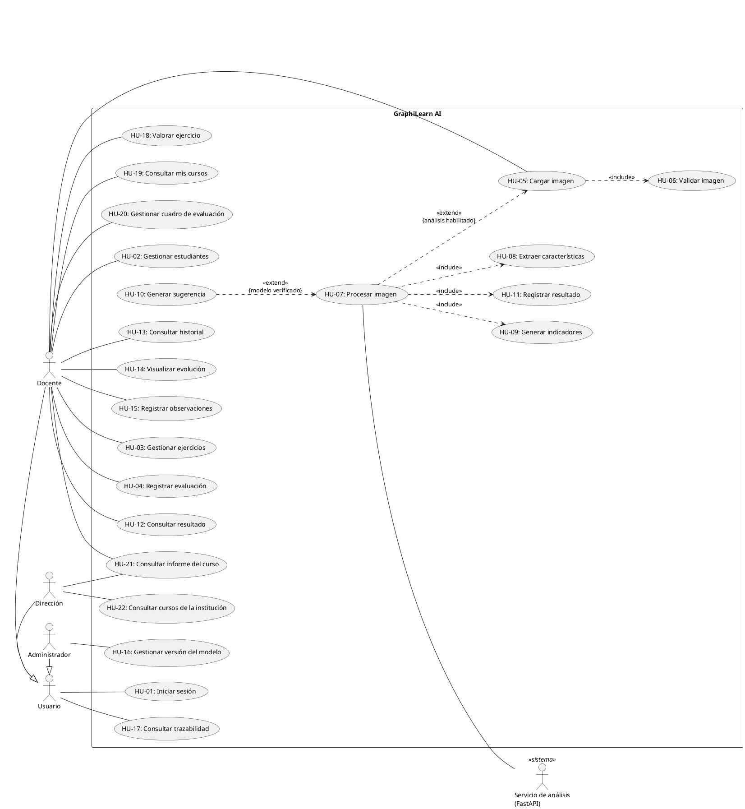
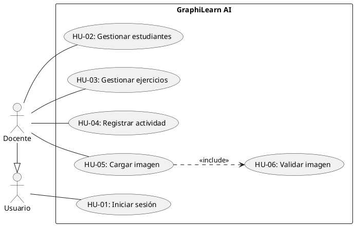
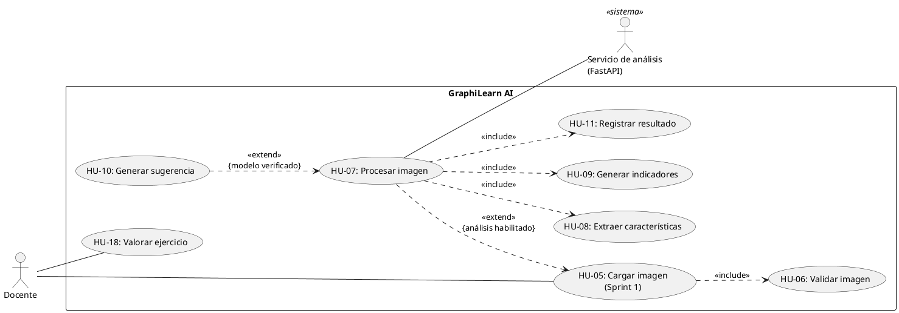
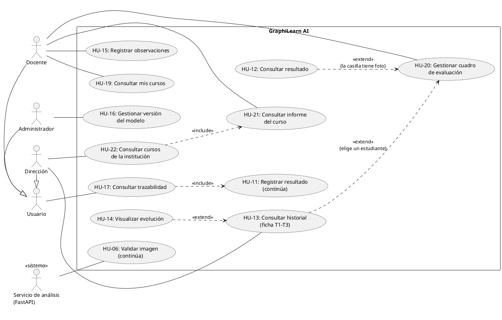

# Diagramas de contexto (casos de uso) — Sprint 0 a Sprint 3

Cada diagrama tiene:

1. **Elementos y relaciones**, en una tabla, para dibujarlo en Enterprise Architect.
2. **Código PlantUML**, por si prefieres generarlo. Se puede ver con la extensión "PlantUML" de VS Code.

**Convenciones**

- **«include»:** flecha punteada desde el caso base hacia el incluido. El incluido ocurre siempre.
- **«extend»:** flecha punteada desde el caso que extiende hacia el caso base. Ocurre solo si se cumple una condición; anótala como `{condición}`.
- **Generalización:** flecha de línea continua con punta triangular hueca, desde el actor hijo hacia el padre.
- **Servicio de análisis (FastAPI):** es un sistema externo, no una persona. En EA usa el estereotipo «system» o «sistema».
- **Ids:** usa el mismo formato que el documento (`HU-07`, no `HU07`).

**Fuentes**

- HU-01 a HU-17: Product Backlog v1.0 (`docs/referencias/Panel_1_Taller.pdf`).
- HU-18 a HU-22: Product Backlog v1.1, según el borrador del Sprint 2.
- **Antes de entregar, confirma la numeración de HU-19 a HU-22.** En el borrador solo aparecen como "mis cursos, cuadro de evaluación, informe del curso y vista de Dirección (HU-19 a HU-22)".

---

## Sprint 0 — Modelo de contexto general (todo el Product Backlog)

**Actores**

- Usuario (abstracto).
- Docente, Dirección y Administrador: los tres heredan de Usuario.
- Servicio de análisis (FastAPI), con estereotipo «sistema».

| Actor | Casos de uso asociados |
|---|---|
| Usuario | HU-01 Iniciar sesión, HU-17 Consultar trazabilidad |
| Docente | HU-02 Gestionar estudiantes, HU-03 Gestionar ejercicios, HU-04 Registrar evaluación, HU-05 Cargar imagen, HU-12 Consultar resultado, HU-13 Consultar historial, HU-14 Visualizar evolución, HU-15 Registrar observaciones, HU-18 Valorar ejercicio, HU-19 Consultar mis cursos, HU-20 Gestionar cuadro de evaluación, HU-21 Consultar informe del curso |
| Dirección | HU-21 Consultar informe del curso, HU-22 Consultar cursos de la institución |
| Administrador | HU-16 Gestionar versión del modelo |
| Servicio de análisis | HU-07 Procesar imagen |

| Relación | Desde → hacia |
|---|---|
| «include» | HU-05 → HU-06 Validar imagen |
| «extend» `{análisis habilitado}` | HU-07 → HU-05 |
| «include» | HU-07 → HU-08 Extraer características |
| «include» | HU-07 → HU-09 Generar indicadores |
| «include» | HU-07 → HU-11 Registrar resultado |
| «extend» `{modelo verificado disponible}` | HU-10 Generar sugerencia → HU-07 |

> **HU-04:** en el Product Backlog v1.0 se llamaba "Registrar actividad". Si el Sprint 0 debe mostrar la versión original del backlog, usa ese nombre y deja "Registrar evaluación" para el Sprint 2, donde se explica el cambio.

---

## Sprint 1 — Base funcional

HU del Sprint 1: HU-01 a HU-06.

**Actores**

- Usuario.
- Docente, que hereda de Usuario.

| Actor | Casos de uso asociados |
|---|---|
| Usuario | HU-01 Iniciar sesión |
| Docente | HU-02 Gestionar estudiantes, HU-03 Gestionar ejercicios, HU-04 Registrar actividad, HU-05 Cargar imagen |

| Relación | Desde → hacia |
|---|---|
| «include» | HU-05 → HU-06 Validar imagen |

> En el Sprint Backlog del Sprint 1, HU-06 figuraba como "Analizar imagen". El nombre correcto es **"Validar imagen"**, y el análisis corresponde a HU-07. El diagrama usa el nombre correcto.

---

## Sprint 2 — Análisis de la foto y valoración (versión corregida)

HU del Sprint 2: HU-06 (continúa del Sprint 1), HU-07, HU-08, HU-09, HU-10, HU-11 y HU-18.

HU-05 se muestra como caso base del Sprint 1, porque HU-06 y HU-07 se relacionan con él. HU-01 se quitó: no es de este Sprint y no se relaciona con ningún caso nuevo.

**Actores**

- Docente.
- Servicio de análisis (FastAPI), con estereotipo «sistema».

| Actor | Casos de uso asociados |
|---|---|
| Docente | HU-05 Cargar imagen *(Sprint 1)*, HU-18 Valorar ejercicio |
| Servicio de análisis | HU-07 Procesar imagen |

| Relación | Desde → hacia |
|---|---|
| «include» | HU-05 → HU-06 Validar imagen |
| «extend» `{análisis habilitado}` | HU-07 → HU-05 |
| «include» | HU-07 → HU-08 |
| «include» | HU-07 → HU-09 |
| «include» | HU-07 → HU-11 |
| «extend» `{modelo verificado disponible}` | HU-10 → HU-07 |

---

## Sprint 3 — Seguimiento, informes, Dirección y trazabilidad

HU del Sprint 3:

- Continúan del Sprint 2: HU-06 (falta detectar foto borrosa, oscura o mal encuadrada) y HU-11 (faltan la versión del modelo y las etapas).
- Nuevas: HU-12 a HU-17 y HU-19 a HU-22.

**Actores**

- Usuario (abstracto).
- Docente, Dirección y Administrador: los tres heredan de Usuario.
- Servicio de análisis (FastAPI), con estereotipo «sistema».

| Actor | Casos de uso asociados |
|---|---|
| Docente | HU-19 Consultar mis cursos, HU-20 Gestionar cuadro de evaluación, HU-15 Registrar observaciones, HU-21 Consultar informe del curso. HU-12 y HU-13 las alcanza desde el cuadro, mediante «extend». |
| Dirección | HU-22 Consultar cursos de la institución, HU-13 Consultar historial (solo lectura) |
| Administrador | HU-16 Gestionar versión del modelo |
| Usuario | HU-17 Consultar trazabilidad |
| Servicio de análisis | HU-06 Validar imagen (la detección de foto borrosa, oscura o mal encuadrada se haría en FastAPI) |

| Relación | Desde → hacia | Por qué |
|---|---|---|
| «extend» `{la casilla tiene foto}` | HU-12 → HU-20 | Desde una celda del cuadro se abre el resultado |
| «extend» `{elige un estudiante}` | HU-13 → HU-20 | Desde el cuadro se abre la ficha T1–T3 |
| «extend» | HU-14 Visualizar evolución → HU-13 | La evolución se consulta desde la ficha |
| «include» | HU-22 → HU-21 | Dirección entra a un curso y ve su informe |
| «include» | HU-17 → HU-11 | La trazabilidad lee el resultado guardado con su versión de modelo |

> Entre HU-11 y HU-16 no se dibuja ninguna línea: en UML los casos de uso no se asocian entre sí. La relación "el resultado guarda la versión del modelo" va en el diagrama de clases (`Analisis → ModelVersion`).

> **Para el ingeniero:** el actor Dirección aparece en el Sprint 3 porque el Product Backlog v1.1 agrega la consulta de solo lectura por curso. Es un actor nuevo respecto del Product Backlog v1.0.
