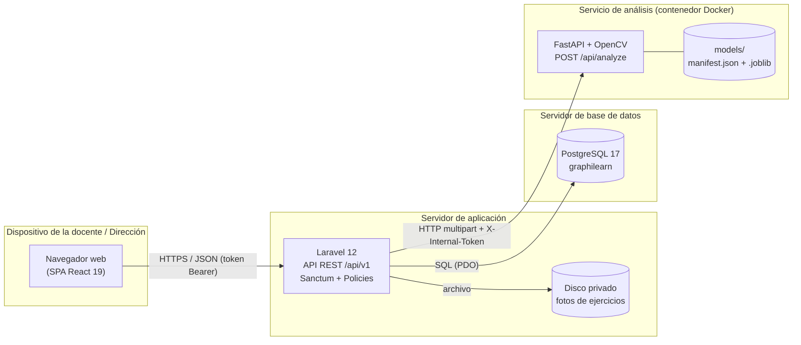
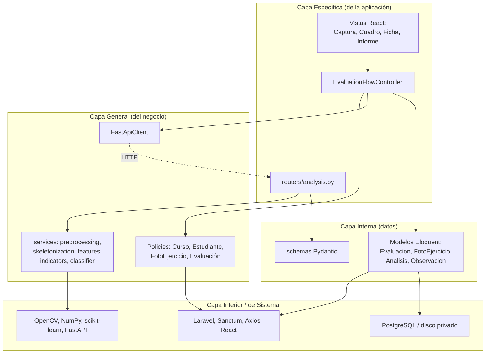
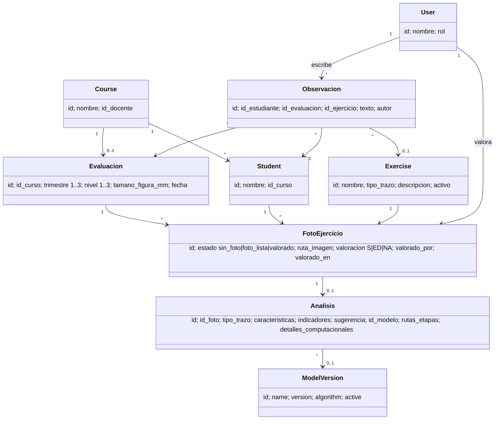

# GraphiLearn AI — Sprint 2

**Proyecto:** GraphiLearn AI, apoyo a la observación grafomotora en el nivel inicial
**Product Owner / Scrum Master / Developer:** Ponce Yepez Elizabet Luzia
**Corte de verificación del repositorio:** 15/11/2026, rama `feature/crud-roles-evaluacion`

> Los estados de este documento salen del código y de pruebas ejecutadas el 15/11/2026: 38 pruebas Laravel y 20 pruebas del servicio de análisis, todas aprobadas, más un recorrido en el navegador. Los campos marcados *por completar* dependen de datos que solo conoce el equipo (fechas, Planning Poker, retroalimentación de la docente) y no se inventaron.

---

## 1. Sprint Planning (R-2)

### a) Historias de Usuario candidatas (3C: Card, Conversation, Confirmation)

El Sprint 2 convierte la **foto del ejercicio** en **medidas del trazo** y permite que la **docente registre su valoración**. Las historias vienen del Product Backlog v1.1. HU-06 llega en proceso desde el Sprint 1.

#### HU-06 — Validar imagen

| Campo | Contenido |
|---|---|
| Id | HU-06 |
| Nombre corto de HU | Validar imagen |
| Prioridad | Media |
| PHU | 5 |
| Estado | En proceso (pasa al Sprint 3) |
| Como: | Sistema |
| Quiero: | validar las condiciones mínimas de la imagen del ejercicio |
| Para: | evitar procesamientos incorrectos |
| Criterios de aceptación | 1. Rechazar archivos que no sean JPG o PNG.<br>2. Rechazar imágenes que superen el tamaño máximo (5 MB).<br>3. Rechazar imágenes que no se puedan decodificar o que midan menos de 20×20 px.<br>4. Advertir cuando la foto esté borrosa, oscura o mal encuadrada.<br>5. Indicar a la docente qué condición no se cumplió. |
| Conversación/Reglas | El formato y el tamaño los valida Laravel; la decodificación y el tamaño mínimo, FastAPI. |
| Prototipo/Mockup | Mensaje de error en el paso 1 "Foto" de la captura. |
| Desarrollador | Elizabet |

#### HU-07 — Procesar imagen

| Campo | Contenido |
|---|---|
| Id | HU-07 |
| Nombre corto de HU | Procesar imagen |
| Prioridad | Alta |
| PHU | 8 |
| Estado | Terminado |
| Como: | Sistema |
| Quiero: | procesar la imagen del ejercicio |
| Para: | identificar y preparar el trazo para su análisis |
| Criterios de aceptación | 1. Convertir la foto a escala de grises y reducir el ruido (filtro bilateral).<br>2. Separar el trazo del fondo con binarización automática (Otsu).<br>3. Eliminar manchas que no sean trazo (filtrado de componentes).<br>4. Obtener el esqueleto del trazo de 1 píxel de ancho (Zhang–Suen).<br>5. Continuar el flujo cuando el análisis esté desactivado o el servicio no responda, informando "Análisis no disponible por ahora". |
| Conversación/Reglas | El análisis se activa con `ANALISIS_HABILITADO`. Laravel es el único que llama al servicio, siempre con el encabezado `X-Internal-Token`. |
| Prototipo/Mockup | Paso 2 "Análisis" de la captura. |
| Desarrollador | Elizabet |

#### HU-08 — Extraer características

| Campo | Contenido |
|---|---|
| Id | HU-08 |
| Nombre corto de HU | Extraer características |
| Prioridad | Alta |
| PHU | 8 |
| Estado | Terminado |
| Como: | Sistema |
| Quiero: | extraer características geométricas del trazo |
| Para: | representar cuantitativamente la información obtenida de la imagen |
| Criterios de aceptación | 1. Calcular las características para los 4 tipos de trazo (línea, círculo, zigzag y espiral).<br>2. Devolver valores numéricos finitos.<br>3. Calcular la posición normalizada del trazo en la hoja.<br>4. Manejar una hoja sin trazo sin caerse, con un error controlado. |
| Conversación/Reglas | Siete características: longitud, alto, ancho, proporción, inclinación, curvatura y separación de componentes, más la posición normalizada. |
| Prototipo/Mockup | No aplica (cálculo interno). |
| Desarrollador | Elizabet |

#### HU-09 — Generar indicadores

| Campo | Contenido |
|---|---|
| Id | HU-09 |
| Nombre corto de HU | Generar indicadores |
| Prioridad | Alta |
| PHU | 8 |
| Estado | Terminado |
| Como: | Sistema |
| Quiero: | calcular indicadores a partir de las características extraídas |
| Para: | obtener medidas cuantificables del ejercicio realizado |
| Criterios de aceptación | 1. Calcular los 4 indicadores por ejercicio.<br>2. Distinguir un trazo regular de uno irregular.<br>3. Guardar los indicadores junto con el análisis. |
| Conversación/Reglas | La docente los ve en una escala de 0 a 1 donde más alto es mejor: **Precisión** = 1 − desviación; **Firmeza** = 1 − rugosidad/1,5; **Fluidez** = continuidad; **Regularidad** = regularidad. Los pesos de la regularidad (0,45; 0,35; 0,20) todavía no están calibrados con datos reales. |
| Prototipo/Mockup | "Lo que midió el sistema" en el paso 2 de la captura: barra y palabra Alto, Medio o Bajo por indicador. |
| Desarrollador | Elizabet |

#### HU-10 — Generar sugerencia

| Campo | Contenido |
|---|---|
| Id | HU-10 |
| Nombre corto de HU | Generar sugerencia |
| Prioridad | Media |
| PHU | 8 |
| Estado | Terminado (el modelo con datos reales queda en el Product Backlog) |
| Como: | Sistema |
| Quiero: | generar una sugerencia a partir de las características obtenidas |
| Para: | apoyar la observación de la docente sin reemplazar su criterio |
| Criterios de aceptación | 1. Cargar únicamente modelos registrados en el manifiesto.<br>2. Rechazar un modelo cuyo SHA-256 no coincida.<br>3. Responder con sugerencia nula cuando no haya modelo, sin fallar.<br>4. Incluir el aviso pedagógico en la respuesta. |
| Conversación/Reglas | La sugerencia nunca es un diagnóstico. El único modelo existente se entrenó con datos sintéticos y no se presenta como validado. |
| Prototipo/Mockup | "Sugerencia del sistema", con el texto "Es solo una ayuda. La valoración final la decides tú." y el aviso pedagógico. |
| Desarrollador | Elizabet |

#### HU-11 — Registrar resultado

| Campo | Contenido |
|---|---|
| Id | HU-11 |
| Nombre corto de HU | Registrar resultado |
| Prioridad | Alta |
| PHU | 5 |
| Estado | En proceso (pasa al Sprint 3) |
| Como: | Sistema |
| Quiero: | almacenar las características, indicadores y sugerencia generados |
| Para: | mantener el historial de cada ejercicio con trazabilidad al modelo |
| Criterios de aceptación | 1. Guardar características, indicadores y sugerencia por foto.<br>2. Guardar la versión del modelo cuando exista.<br>3. Guardar las imágenes de las etapas del procesamiento.<br>4. Impedir dos análisis para la misma foto. |
| Conversación/Reglas | Un análisis pertenece a una foto (`analisis.id_foto`). |
| Prototipo/Mockup | Paso 2 de la captura (resumen del análisis). |
| Desarrollador | Elizabet |

#### HU-18 — Valorar ejercicio

| Campo | Contenido |
|---|---|
| Id | HU-18 |
| Nombre corto de HU | Valorar ejercicio |
| Prioridad | Alta |
| PHU | 5 |
| Estado | Terminado |
| Como: | Docente |
| Quiero: | valorar cada ejercicio como S, ED o NA con una observación |
| Para: | registrar mi criterio profesional sobre el trazo |
| Criterios de aceptación | 1. Elegir S, ED o NA para un ejercicio con foto.<br>2. Registrar una observación junto con la valoración, asociada al ejercicio.<br>3. Guardar quién valoró y cuándo.<br>4. Impedir que Dirección valore.<br>5. Mostrar la leyenda "ED: en proceso de lograrlo, es lo esperable a esta edad". |
| Conversación/Reglas | Solo la docente del curso valora; Dirección solo consulta. La respuesta devuelve del autor solo `id` y `nombre`. La pantalla muestra "Esta herramienta apoya la observación; no emite diagnóstico". |
| Prototipo/Mockup | Paso 3 "Valoración" de la captura: opciones S, ED y NA con rúbrica y campo "Observación (opcional)". |
| Desarrollador | Elizabet |

### b) Objetivo del Sprint

**Que GraphiLearn AI reciba la foto de un ejercicio, mida el trazo de forma automática, guarde el resultado y permita que la docente registre su valoración S, ED o NA con una observación, sin que el sistema emita un diagnóstico.**

Objetivos específicos:
- Completar la validación de la foto antes del análisis (HU-06).
- Procesar la foto hasta obtener el esqueleto del trazo e integrar Laravel con el servicio de análisis (HU-07).
- Calcular 7 características geométricas y la posición del trazo (HU-08).
- Calcular 4 indicadores comprensibles para la docente (HU-09).
- Ofrecer una sugerencia opcional con carga segura del modelo (HU-10).
- Guardar el análisis con su trazabilidad (HU-11).
- Registrar la valoración de la docente con observación por ejercicio (HU-18).

### c) Estimación (Planning Poker)

| HU | PHU propuesto | PHU acordado en Planning Poker |
|---|---|---|
| HU-06 | 5 | *por completar* |
| HU-07 | 8 | *por completar* |
| HU-08 | 8 | *por completar* |
| HU-09 | 8 | *por completar* |
| HU-10 | 8 | *por completar* |
| HU-11 | 5 | *por completar* |
| HU-18 | 5 | *por completar* |
| **Total** | **47** | |

### d) Historias seleccionadas
HU-06, HU-07, HU-08, HU-09, HU-10, HU-11 y HU-18.

### e) Diseño de la solución
Se detalla en la sección 2 (ejecución del Sprint).

### f) Sprint Backlog

**Objetivo del Sprint:** ver el apartado b.
**Sprint número:** 2
**Tiempo programado:** *por completar*
**Fecha de inicio:** *por completar*
**Fecha de finalización:** *por completar*

| Id | HU | Tarea | Estimación | Responsable | Estado |
|---|---|---|---|---|---|
| Sp-1 | HU-06 | Validar formato JPG/PNG y tamaño máximo de 5 MB con mensajes claros (Laravel) | 2 h | Elizabet | Terminado |
| Sp-2 | HU-06 | Validar decodificación y tamaño mínimo de 20×20 px (FastAPI) | 2 h | Elizabet | Terminado |
| Sp-3 | HU-06 | Detectar foto borrosa, oscura o mal encuadrada | 6 h | Elizabet | Pasa al Sprint 3 |
| Sp-4 | HU-07 | Pipeline: grises, filtro bilateral, Otsu, filtrado de componentes y Zhang–Suen | 8 h | Elizabet | Terminado |
| Sp-5 | HU-07 | Cliente Laravel → FastAPI con token interno y bandera `ANALISIS_HABILITADO` | 4 h | Elizabet | Terminado |
| Sp-6 | HU-07 | Continuar sin análisis ("Análisis no disponible por ahora") si el servicio está apagado o caído | 2 h | Elizabet | Terminado |
| Sp-7 | HU-08 | Calcular 7 características y posición normalizada | 8 h | Elizabet | Terminado |
| Sp-8 | HU-08 | Pruebas de características para los 4 tipos de trazo | 2 h | Elizabet | Terminado |
| Sp-9 | HU-09 | Calcular desviación, rugosidad, continuidad y regularidad | 10 h | Elizabet | Terminado |
| Sp-10 | HU-09 | Mostrar Precisión, Firmeza, Fluidez y Regularidad en el paso 2 de la captura | 2 h | Elizabet | Terminado |
| Sp-11 | HU-10 | Carga segura del modelo: lista permitida, manifiesto y SHA-256 | 8 h | Elizabet | Terminado |
| Sp-12 | HU-10 | Sugerencia nula sin modelo, con aviso pedagógico | 2 h | Elizabet | Terminado |
| Sp-13 | HU-10 | Mostrar la sugerencia (si existe) y el aviso en la captura | 2 h | Elizabet | Terminado |
| Sp-14 | HU-11 | Guardar características, indicadores, sugerencia y aviso en `analisis` | 3 h | Elizabet | Terminado |
| Sp-15 | HU-11 | Guardar `id_modelo` y `rutas_etapas`; restricción única en `analisis.id_foto` | 5 h | Elizabet | Pasa al Sprint 3 |
| Sp-16 | HU-18 | Endpoint de valoración S/ED/NA con autor y fecha; solo la docente del curso | 3 h | Elizabet | Terminado |
| Sp-17 | HU-18 | Migración `observaciones.id_ejercicio` y guardado de la observación por ejercicio | 2 h | Elizabet | Terminado |
| Sp-18 | HU-18 | Pantalla de captura en 3 pasos (Foto, Análisis, Valoración) | 6 h | Elizabet | Terminado |

> Las estimaciones en horas son propuestas; ajústalas a tu tiempo real.

---

## 2. Ejecución del Sprint (R-3)

### 2.1 Diseño de la arquitectura de software

#### Diagrama de despliegue



El navegador solo habla con Laravel. Laravel es el único que llama al servicio de análisis. A la fecha de corte, Docker Compose solo levanta el servicio de análisis; Laravel y PostgreSQL corren fuera del contenedor.

#### Diagrama de paquetes en capas



### 2.2 Diseño de datos

#### Diagrama de clases



#### Cambios al diseño de datos respecto del Sprint 1

| Sprint 1 | Sprint 2 | Cambio |
|---|---|---|
| `actividades` | `fotos_ejercicio` | Una casilla por estudiante y ejercicio dentro de una Evaluación; guarda la valoración, quién valoró y cuándo |
| `imagenes` | `fotos_ejercicio.ruta_imagen` | La ruta de la foto pasa a la misma tabla |
| `analysis_results` | `analisis` | Agrega `caracteristicas`, `indicadores` y `rutas_etapas`; el "riesgo" pasa a ser `sugerencia` |
| (no existía) | `evaluaciones` | Evaluación del curso por trimestre, con nivel y tamaño de figura |
| (no existía) | `observaciones` | Observaciones de la docente, con autor y **ejercicio** (`id_ejercicio`, migración del 15/11/2026) |

**Pendientes de diseño:** `analisis.id_foto` sin restricción única y `analisis.id_modelo` siempre nulo (Sp-15).

### 2.3 Lógica de negocio: diagrama de secuencia (captura, análisis y valoración)

```mermaid
sequenceDiagram
    actor D as Docente
    participant R as React (Captura)
    participant L as Laravel
    participant F as FastAPI
    participant B as PostgreSQL
    D->>R: Elige la foto y pulsa "Subir foto"
    R->>L: POST /api/v1/evaluaciones/{e}/estudiantes/{s}/ejercicios/{ej}/foto
    L->>L: Valida JPG/PNG y ≤ 5 MB; verifica permisos (Policy)
    L->>B: Guarda ruta y estado foto_lista
    alt ANALISIS_HABILITADO y servicio disponible
        L->>F: POST /api/analyze (X-Internal-Token)
        F->>F: Grises → bilateral → Otsu → componentes → Zhang–Suen
        F->>F: 7 características + 4 indicadores + sugerencia/aviso
        F-->>L: JSON del análisis
        L->>B: Guarda en analisis
        L-->>R: analisis_disponible = true + análisis
        R-->>D: Paso 2: Precisión, Firmeza, Fluidez, Regularidad
    else Análisis apagado o servicio caído
        L-->>R: analisis_disponible = false
        R-->>D: "Análisis no disponible por ahora"
    end
    D->>R: Elige S, ED o NA y escribe la observación
    R->>L: PUT .../valoracion {valoracion, observacion}
    L->>B: Foto → valorado (autor y fecha) + observación con id_ejercicio
    L-->>R: Valoración guardada (autor: id y nombre)
    R-->>D: "Guardado." y "Siguiente: …"
```

### 2.4 Diseño de interfaces

La captura sigue el prototipo `docs/graphilearn_prototipo.html`. Tiene 3 pasos visibles (1 Foto, 2 Análisis, 3 Valoración) y una confirmación final, "Guardado.". Elementos fijos:
- el aviso "Esta herramienta apoya la observación; no emite diagnóstico";
- el bloque "Qué observa este ejercicio", con la descripción del ejercicio;
- la leyenda "ED: en proceso de lograrlo, es lo esperable a esta edad".

### 2.5 Implementación

| HU | Back-end | Front-end / Servicio |
|---|---|---|
| HU-06 | `app/Http/Requests/FotoEjercicio/StoreFotoEjercicioRequest.php` | `ai-service/services/preprocessing.py` (decodificación y tamaño mínimo) |
| HU-07 | `app/Services/FastApiClient.php`, `EvaluationFlowController@upload` | `ai-service/services/preprocessing.py`, `skeletonization.py`, `routers/analysis.py` |
| HU-08 | — | `ai-service/services/features.py` |
| HU-09 | — | `ai-service/services/indicators.py`; fórmulas visibles en `resources/js/utils/evaluacion.js` |
| HU-10 | — | `ai-service/services/classifier.py`, `routers/models.py`, `models/manifest.json` |
| HU-11 | `EvaluationFlowController@upload` (guarda en `analisis`) | — |
| HU-18 | `EvaluationFlowController@rate`; migración `2026_11_15_000001_add_exercise_to_observaciones.php` | `resources/js/views/EvaluationCaptureView.jsx` |

### 2.6 Pruebas

#### Plan de pruebas

| ID | Historia de usuario | Resultado (pruebas automáticas) | Web (navegador) |
|---|---|---|---|
| HU-06 | Validar imagen | Satisfactorio en los criterios 1, 2, 3 y 5 · Pendiente el 4 | Pendiente: subir un archivo inválido desde la captura y verificar el mensaje |
| HU-07 | Procesar imagen | Satisfactorio | Satisfactorio con el análisis apagado ("Análisis no disponible por ahora") · Pendiente con fotos reales |
| HU-08 | Extraer características | Satisfactorio (4 tipos de trazo) | No aplica |
| HU-09 | Generar indicadores | Satisfactorio | Satisfactorio (indicadores visibles en el paso 2) |
| HU-10 | Generar sugerencia | Satisfactorio | Satisfactorio con un análisis de prueba registrado (sugerencia y aviso visibles) |
| HU-11 | Registrar resultado | Satisfactorio en el criterio 1 · Pendientes los criterios 2, 3 y 4 | No aplica |
| HU-18 | Valorar ejercicio | Satisfactorio | Satisfactorio |

#### Reporte de pruebas

| Nro | Caso de uso | Entrada | Condición | Procedimiento | Resultado esperado | Evidencia | Estado |
|---|---|---|---|---|---|---|---|
| HU06 | Validar imagen | PDF; JPG de 6 MB; JPG de 4 MB | Docente autenticada; casilla de la Evaluación | Subir cada archivo | PDF → 422 "La foto debe estar en formato JPG o PNG."; 6 MB → 422 "La foto no puede superar los 5 MB."; 4 MB → 201 | `test_photo_upload_rejects_wrong_format_and_oversized_files_with_reason` | Satisfactorio |
| HU06 | Validar imagen | Bytes vacíos o corruptos | — | Decodificar en FastAPI | Error controlado | `test_decode_image_empty_raises_error`, `test_decode_image_corrupt_raises_error` | Satisfactorio |
| HU07 | Procesar imagen | Círculo sintético | — | Pipeline completo | Trazo detectado y esqueleto no vacío | `test_preprocessing_detects_stroke_in_valid_image` | Satisfactorio |
| HU07 | Procesar imagen | Barra de 8 px | — | Zhang–Suen | Esqueleto de 1 px | `test_skeletonization_produces_single_pixel_thickness` | Satisfactorio |
| HU07 | Procesar imagen | Foto válida | `ANALISIS_HABILITADO` activo; servicio simulado | Subir la foto | Laravel envía `X-Internal-Token` y guarda el análisis | `test_successful_analysis_is_stored_with_features_indicators_and_notice` | Satisfactorio |
| HU07 | Procesar imagen | Foto válida | Servicio caído | Subir la foto | `foto_lista`, `analisis_disponible = false` | `test_photo_upload_falls_back_to_manual_rating_when_fastapi_is_down` | Satisfactorio |
| HU08 | Extraer características | Línea, círculo, zigzag y espiral | — | `POST /api/analyze` | 7 características finitas y posición entre 0 y 1 | `test_analyze_returns_finite_features_indicators_and_notice_for_each_stroke_type` (4 casos), `test_geometric_features_calculation` | Satisfactorio |
| HU08 | Extraer características | Hoja en blanco | — | Pipeline | Error controlado "no se identificaron trazos" | `test_preprocessing_fails_on_blank_paper` | Satisfactorio |
| HU09 | Generar indicadores | Trazo regular e irregular | — | Calcular indicadores | El regular tiene menor desviación y rugosidad, y mayor regularidad | `test_deviation_regular_vs_irregular_line`, `test_roughness_and_regularity_behavior` | Satisfactorio |
| HU10 | Generar sugerencia | Modelo no registrado; ruta enviada por el cliente; hash alterado | — | `POST /api/models/load` | 404; 422; 409 | `test_model_load_rejects_identifier_outside_allowlist`, `test_model_load_rejects_client_supplied_file_path`, `test_model_load_requires_allowlisted_id_and_matching_hash` | Satisfactorio |
| HU10 | Generar sugerencia | Sin modelo | — | Analizar | `sugerencia = null`, aviso pedagógico presente | `test_classifier_returns_null_suggestion_when_no_model`, prueba de los 4 tipos | Satisfactorio |
| HU11 | Registrar resultado | Respuesta del análisis | Análisis exitoso | Subir la foto | Fila en `analisis` con características, indicadores y aviso | `test_successful_analysis_is_stored_with_features_indicators_and_notice` | Satisfactorio (criterio 1) |
| HU11 | Registrar resultado | — | — | — | `id_modelo`, etapas y restricción única | Sin prueba: no implementado | Pendiente |
| HU18 | Valorar ejercicio | S/ED/NA + observación | Docente del curso; casilla con foto | `PUT .../valoracion` | Estado `valorado`; autor `{id, nombre}`; observación con `id_ejercicio` | `test_rating_response_exposes_only_id_and_name_of_the_rater`, `test_rating_stores_observation_per_exercise_and_sheet_returns_it` | Satisfactorio |
| HU18 | Valorar ejercicio | S | Usuario Dirección | `PUT .../valoracion` | 403 | `test_direction_can_read_course_report_but_cannot_rate` | Satisfactorio |
| HU18 | Valorar ejercicio (web) | Foto + ED + observación | Navegador: foto sin análisis y foto con un análisis de prueba registrado | Captura en 3 pasos | Indicadores visibles, "Guardado.", el cuadro se actualiza y la ficha muestra la observación | Recorrido en Chrome del 15/11/2026, sin errores de consola ni HTTP | Satisfactorio |

**Totales del corte:** `php artisan test` → 38 aprobadas (203 aserciones); `pytest` en `ai-service` → 20 aprobadas; `npx vite build` → sin errores.

### 2.7 Incremento y despliegue

- **Definition of Done aplicada:** criterios de aceptación cumplidos, prueba automática que los verifica, prueba en el navegador cuando la HU tiene pantalla, y build sin errores.
- **Integración:** el trabajo está en la rama `feature/crud-roles-evaluacion`. *Pendiente:* hacer commits por HU y la integración a `main`.
- **Entorno:** el servicio de análisis tiene Dockerfile y Docker Compose; Laravel y PostgreSQL corren localmente.

---

## 3. Scrum Diario (Daily Scrum)

| Fecha | ¿Qué hice? | ¿Qué haré? | Impedimentos |
|---|---|---|---|
| *por completar* | | | |
| 14/11/2026 | Relevamiento del estado real del código y de la base | Conectar React con el flujo de Evaluación | Las pantallas apuntaban a rutas que ya no existían |
| 15/11/2026 | Captura en 3 pasos, observación por ejercicio y pruebas de análisis | Revisión del Sprint con la docente | El análisis no se probó con fotos reales |

---

## 4. Revisión de Sprint (R-4)

**Nombre del proyecto y número de revisión:** GraphiLearn AI — Revisión del Sprint 2
**Objetivo de la revisión:** validar que la foto del ejercicio se procesa y se mide, que el resultado se guarda y que la docente puede valorar sin ayuda.
**Lugar, fecha, hora:** *por completar*

**Participantes**

| Nombre | Rol |
|---|---|
| Ponce Yepez Elizabet Luzia | Product Owner / Scrum Master / Developer |
| *por completar* (docente de nivel inicial) | Interesada |

**Presentación del incremento**

| Función presentada | Retroalimentación |
|---|---|
| Subir la foto desde la captura (paso 1) | ¿Las instrucciones de la hoja con 4 marcas son claras? *por completar* |
| Medición del trazo: Precisión, Firmeza, Fluidez y Regularidad (paso 2) | ¿Los 4 indicadores se entienden sin explicación? *por completar* |
| Sugerencia con aviso pedagógico | ¿Queda claro que no es un diagnóstico? *por completar* |
| Valoración S/ED/NA con observación (paso 3) | ¿La docente puede valorar sin ayuda? ¿La rúbrica de ejemplo le sirve? *por completar* |

**Tareas completadas**

| HU | Estado | Decisión |
|---|---|---|
| HU-07 Procesar imagen | Terminado | — |
| HU-08 Extraer características | Terminado | — |
| HU-09 Generar indicadores | Terminado | — |
| HU-10 Generar sugerencia | Terminado | El modelo con datos reales vuelve al Product Backlog (depende del dataset) |
| HU-18 Valorar ejercicio | Terminado | — |
| HU-06 Validar imagen | No terminado (falta el criterio 4) | Pasa al Sprint 3 (Sp-3) |
| HU-11 Registrar resultado | No terminado (faltan los criterios 2, 3 y 4) | Pasa al Sprint 3 (Sp-15) |

**PHU completados:** 37 de 47 (79 %).

**Para lo que viene**
- Sprint 3: terminar HU-06 y HU-11; seguimiento por trimestres y ficha (HU-12 a HU-15); trazabilidad del modelo (HU-16, HU-17); Mis cursos, cuadro, informe y vista de Dirección (HU-19 a HU-22).
- Probar el análisis con fotos reales tomadas con celular.
- Product Backlog: corrección de perspectiva con las 4 marcas de la hoja, y entrenamiento del modelo con fotos valoradas por docentes (requiere consentimiento y autorización institucional).

---

## 5. Retrospectiva de Sprint (R-5)

**Nombre del proyecto y número de retrospectiva:** GraphiLearn AI — Retrospectiva del Sprint 2
**Objetivos de la retrospectiva:** revisar cómo se trabajó la integración entre la interfaz, Laravel y el servicio de análisis, y definir mejoras para el Sprint 3.
**Lugar, fecha y hora:** *por completar*
**Participantes:** Ponce Yepez Elizabet Luzia

**¿Qué salió bien?**
- El pipeline de procesamiento quedó implementado y cubierto por pruebas automáticas para los 4 tipos de trazo.
- El flujo no se detiene si el análisis está apagado o el servicio falla: la docente igual puede valorar.
- La carga del modelo es segura: lista permitida, manifiesto y verificación SHA-256.
- La captura sigue el prototipo y muestra los textos pedagógicos, incluido el aviso de no diagnóstico.

**¿Qué no salió bien?**
- El cambio de "actividad" a "Evaluación por trimestre" obligó a una migración grande, y la interfaz quedó apuntando a rutas que ya no existían. *Resuelto:* las pantallas se reconstruyeron sobre `/api/v1`.
- La observación no guardaba a qué ejercicio pertenecía. *Resuelto* con la migración `observaciones.id_ejercicio`.
- Al recargar la página se perdía la sesión ("Unauthenticated."). *Resuelto* en `App.jsx`; se detectó al probar en el navegador.
- El trabajo estuvo varios días sin commit. *No resuelto todavía.*
- No hay fotos reales para validar el análisis. *No resuelto:* depende de la institución.

**¿Qué debemos cambiar para mejorar?**
- Hacer un commit al terminar cada HU.
- No dar una HU por terminada sin probarla en el navegador.
- Estimar con más holgura las tareas de integración entre servicios.
- Pedir con anticipación la autorización para tomar fotos reales.
