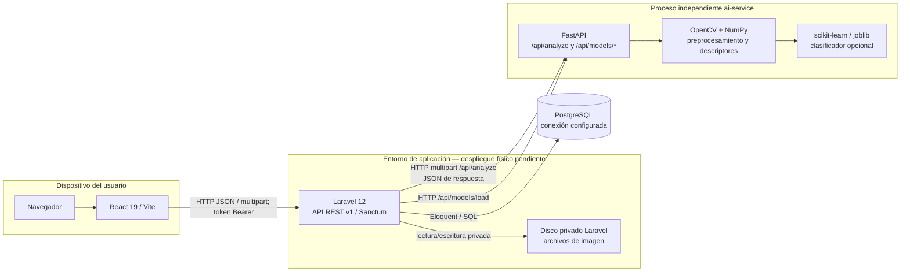
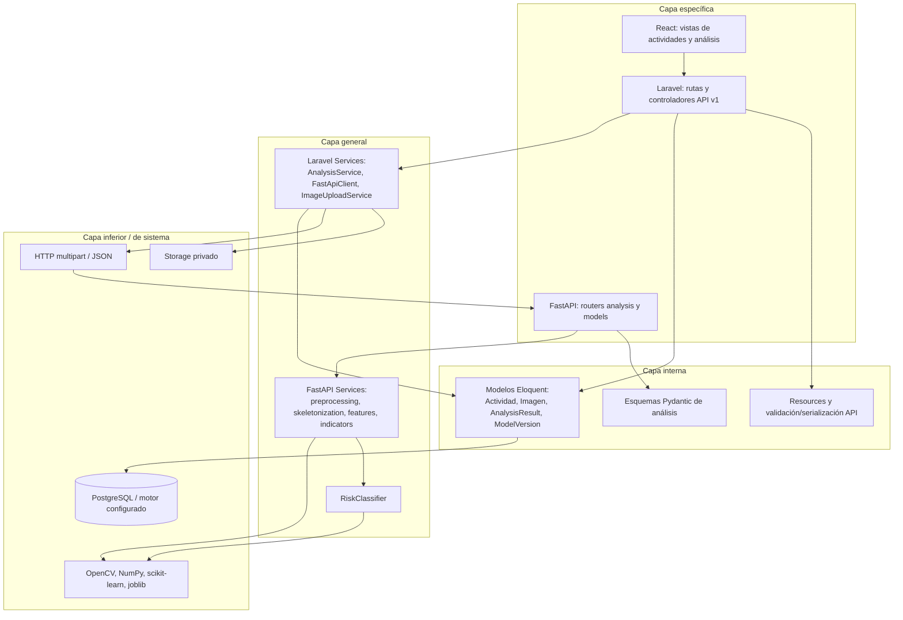
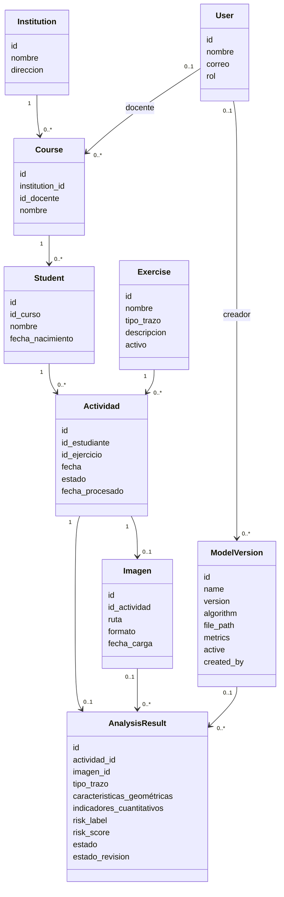

# Sprint 2 — Diseño de arquitectura y datos

## 1.5. Diseño de la Arquitectura

Los diagramas son modelos lógicos del sistema implementado según el código leído. No describen máquinas, direcciones públicas, contenedores ni despliegue de producción verificados; esa información no está en el repositorio.

### 1.5.1. Diagrama de Despliegue



**Protocolos y evidencia:** React usa Axios hacia rutas `/api/v1`; `FastApiClient` envía un archivo multipart a `/api/analyze`; Laravel persiste vía Eloquent; la imagen usa el disco `private`. Las pruebas de integración backend interceptan HTTP con `Http::fake`. La conexión efectiva a PostgreSQL y el despliegue conjunto no se probaron en este corte.

### 1.5.2. Diagrama de Paquetes (Organizado en Capas)

La estructura adapta las cuatro capas de la referencia: específica → general → interna → inferior/de sistema. Las flechas indican dependencias del código lógico y no una arquitectura física desplegada.



El backend aún usa controladores, servicios, modelos Eloquent y recursos. En FastAPI los routers coordinan servicios de cómputo y schemas Pydantic. El código de aplicación mantiene dependencias directas de Laravel/Eloquent y no acredita una inversión de dependencias formal.

## 1.6. Diseño de Datos

### 1.6.1. Diagrama de Clases

El siguiente modelo refleja entidades y asociaciones verificadas en migraciones y modelos. La relación `Actividad`–`Imagen` es cero/uno por la unicidad de `imagenes.id_actividad`; `Actividad`–`AnalysisResult` es cero/uno por unicidad de `analysis_results.actividad_id`.



La entidad `Institution` se relaciona con `Course` y `User` con el rol docente según el esquema general del proyecto; los demás atributos y asociaciones se encuentran en `database/migrations/` y `app/Models/`. El diagrama omite campos de auditoría (`timestamps`, `softDeletes`) para facilitar lectura. La tabla de resultados almacena las medidas en columnas y mantiene posición/detalles como JSON.

### 1.6.2. Mapeo

| Clase / tabla | Clave y campos de negocio principales | Relaciones / restricciones observadas |
|---|---|---|
| `Institution` / `institutions` | `id`, `nombre`, `direccion` | Institución contiene cursos; eliminación y restricciones exactas se definen en migración. |
| `Course` / `courses` | `id`, `institution_id`, `nombre`, `gestion`, `nivel`, `id_docente` | FK a institución y docente (`users`). |
| `Student` / `students` | `id`, `id_curso`, `nombre`, `fecha_nacimiento` | FK a curso; soft delete; tiene muchas actividades. |
| `Exercise` / `exercises` | `id`, `nombre`, `tipo_trazo`, `descripcion`, `activo` | Tiene muchas actividades; actividad restringe borrado físico del ejercicio. |
| `Actividad` / `actividades` | `id`, `id_estudiante`, `id_ejercicio`, `fecha`, `estado`, `fecha_procesado` | FK a estudiante y ejercicio; estado de procesamiento; soft delete. |
| `Imagen` / `imagenes` | `id`, `id_actividad`, `ruta`, `formato`, `fecha_carga` | FK única a actividad (máximo una imagen por actividad); archivo referenciado vive en disco privado. |
| `AnalysisResult` / `analysis_results` | `actividad_id`, `imagen_id`, `tipo_trazo`; `longitud_trazo`, `alto`, `ancho`, `proporcion`, `inclinacion`, `curvatura`, `separacion_componentes`, `posicion_normalizada`; `desviacion`, `rugosidad`, `continuidad`, `regularidad`; `risk_label`, `risk_score`, `model_version_id`, `estado`, `estado_revision`, `error_message`, `detalles_computacionales` | Actividad única; FK a imagen y versión opcionales con `nullOnDelete`; JSON para posición y detalles; soft delete. |
| `ModelVersion` / `model_versions` | `name`, `version`, `algorithm`, `description`, `file_path`, `metrics`, `active`, `created_by` | `created_by` FK opcional a `users`; JSON metrics; uno a muchos resultados. |

**Correspondencia con PostgreSQL:** las migraciones utilizan `foreignId`, `enum`, `json`, índices, claves foráneas, unicidad y borrado en cascada/restricción/nulidad. El código configura conexión PostgreSQL, pero este corte no aplicó/verificó migraciones contra un servidor PostgreSQL. La evidencia de ejecución PHP procede de SQLite en memoria; los tipos/DDL deben contrastarse en una prueba PostgreSQL antes de afirmar compatibilidad operativa completa.

## 2.1. Lógica de negocio — Diagramas de Secuencia

### Procesamiento de una actividad (HU-07 a HU-10)

```mermaid
sequenceDiagram
    actor Docente
    participant UI as React ActivityDetailView
    participant API as Laravel AnalysisController
    participant Service as AnalysisService
    participant Client as FastApiClient
    participant FS as Disco privado
    participant AI as FastAPI /api/analyze
    participant CV as OpenCV + servicios
    participant RF as RiskClassifier

    Docente->>UI: Solicita procesar actividad
    UI->>API: POST /api/v1/actividades/{id}/procesar (Bearer)
    API->>API: Autenticación, rol, autorización y ámbito docente
    API->>Service: procesarActividad(actividad)
    Service->>Service: Verifica imagen y estado/duplicados
    Service->>Service: Marca actividad procesando
    Service->>Client: analizarImagen(ruta, tipo_trazo)
    Client->>FS: Lee imagen privada
    Client->>AI: multipart file + tipo_esperado
    AI->>CV: decodifica, limpia, umbraliza, esqueletiza
    CV->>CV: extrae geometría e indicadores
    CV->>RF: predict(características, indicadores)
    RF-->>CV: etiqueta/score o no_disponible/null
    CV-->>AI: JSON de procesamiento
    AI-->>Client: JSON validado
    Client-->>Service: datos de análisis
    Service-->>API: continúa persistencia (ver secuencia siguiente)
    API-->>UI: 200 con recurso; error controlado si falla
```

### Registro del resultado (HU-11; vínculo opcional HU-16)

```mermaid
sequenceDiagram
    participant Service as AnalysisService
    participant DB as Eloquent / base relacional
    participant Resource as AnalysisResultResource
    participant UI as React

    Service->>DB: Inicia transacción
    Service->>DB: Resuelve model_version_id si hay modelo identificado/activo
    Service->>DB: updateOrCreate por actividad (medidas, indicadores, etiqueta, score)
    Service->>DB: estado resultado=procesado; estado_revision=pendiente
    Service->>DB: actividad=procesado + fecha_procesado
    DB-->>Service: resultado recargado
    Service->>DB: Confirma transacción
    Service-->>Resource: AnalysisResult
    Resource-->>UI: JSON normalizado
```

Si la llamada a FastAPI falla, el código restaura la actividad a `pendiente` antes de lanzar la excepción. Una observación de revisión de código: `AnalysisService` puede asociar la versión activa de Laravel aun cuando la respuesta de FastAPI indique clasificación `no_disponible`; por eso debe comprobarse la trazabilidad “modelo efectivamente usado” antes de interpretar el FK como evidencia de inferencia. Está registrado como divergencia en [pendientes-academicos.md](pendientes-academicos.md).
