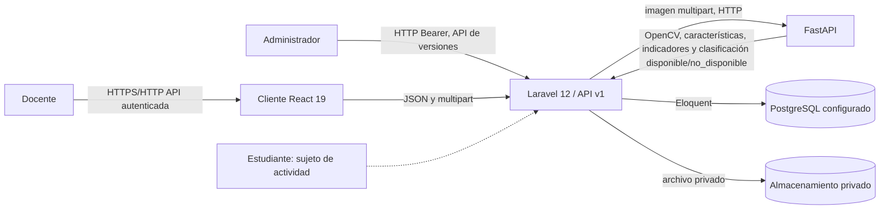

# Sprint 2 — Sprint Planning y Backlog

## 1. Sprint Planning

**Proyecto:** GraphiLearn AI
**Sprint número:** 2
**Product Owner indicado en Panel 1:** Elizabet Ponce
**Versión del Product Backlog indicada en Panel 1:** 1.0
**Fecha, duración, lugar, hora, asistentes y acta del Planning:** Pendiente de completar con evidencia.
**Estimaciones PHU / Planning Poker:** Pendiente de completar; el Product Backlog consultado no registra estimaciones de HU-07 a HU-11 ni HU-16.

El alcance solicitado para este expediente agrupa HU-07 a HU-11 y HU-16. Esta documentación reconstruye el alcance técnico a partir del Product Backlog, el código y las pruebas disponibles. No hay acta, tablero Jira ni registro del Sprint que permita afirmar que hubo una reunión de Planning, que el equipo se comprometió con estas HU o que aprobó las reglas que siguen.

### 1.1. Objetivo del Sprint

**Objetivo técnico reconstruido para Sprint 2:** procesar una imagen de actividad grafomotora en el servicio FastAPI con OpenCV, producir características geométricas e indicadores cuantitativos, devolver el estado explícito `no_disponible` cuando no haya un clasificador cargado y guardar el resultado computacional junto con la referencia de versión cuando corresponda. El código sí permite cargar el benchmark sintético; su posible salida no equivale a evaluación ni validación de riesgo en el contexto real.

Este objetivo expresa el incremento técnico que se observa en el repositorio; no consta como objetivo aprobado en un acta de Sprint. El benchmark Random Forest sintético no satisface validación real de riesgo grafomotor.

## 1.2. Historias de Usuario

Las prioridades y nombres breves se transcriben del Product Backlog de Panel 1. El texto completo de criterios de aceptación no está especificado para todas estas historias en el apartado del backlog. Para hacer verificable este expediente, cada ficha separa la necesidad del backlog de la evidencia técnica observada y de la aceptación académica todavía pendiente.

### Historia de usuario HU-07

| Campo | Contenido |
|---|---|
| Id. | HU-07 |
| Nombre corto | Procesar imagen |
| Prioridad | Alta (Product Backlog) |
| PHU | Pendiente de evidencia |
| Estado | Implementado; pruebas sintéticas ejecutadas; integración real pendiente |
| Como | Sistema |
| Quiero | procesar la imagen del ejercicio para identificar y preparar el trazo |
| Para | habilitar el análisis computacional posterior |
| Descripción / conversación | FastAPI recibe una imagen, la decodifica y ejecuta preprocesamiento OpenCV y esqueletización. El detalle está en `ai-service/routers/analysis.py`, `services/preprocessing.py` y `services/skeletonization.py`. |
| Criterios técnicos observables | La solicitud válida al endpoint `/api/analyze` devuelve el contrato de análisis; una imagen vacía, ilegible, en blanco o no procesable obtiene un error controlado. Son criterios de comprobación derivados del endpoint y sus pruebas, no criterios de aceptación firmados del Product Owner. |
| Evidencia | `ai-service/tests/test_ai_service.py`; `ai-service/routers/analysis.py`; ejecución pytest documentada en [pruebas.md](pruebas.md). |
| Prototipo / mockup | No aplica al procesamiento; no se encontró artefacto del Sprint. |
| Desarrollador | Pendiente de evidencia para Sprint 2. |

### Historia de usuario HU-08

| Campo | Contenido |
|---|---|
| Id. | HU-08 |
| Nombre corto | Extraer características |
| Prioridad | Alta (Product Backlog) |
| PHU | Pendiente de evidencia |
| Estado | Implementado; probado con imágenes sintéticas; validación con capturas reales pendiente |
| Como | Sistema |
| Quiero | extraer características geométricas del trazo |
| Para | representar cuantitativamente la información obtenida de la imagen |
| Descripción / conversación | El servicio calcula longitud, dimensiones de caja, proporción, inclinación, curvatura, separación de componentes y posición normalizada. |
| Criterios técnicos observables | Para una imagen sintética procesable, el endpoint entrega los campos geométricos definidos por `GeometricFeaturesSchema`; las pruebas comprueban presencia/rangos y algunas propiedades sobre trazos artificiales. Las tolerancias y criterios de aceptación académicos quedan pendientes. |
| Evidencia | `ai-service/services/features.py`, `schemas/analysis.py`, `tests/test_ai_service.py`. |
| Prototipo / mockup | No se encontró. |
| Desarrollador | Pendiente de evidencia para Sprint 2. |

### Historia de usuario HU-09

| Campo | Contenido |
|---|---|
| Id. | HU-09 |
| Nombre corto | Generar indicadores |
| Prioridad | Alta (Product Backlog) |
| PHU | Pendiente de evidencia |
| Estado | Implementado; probado con trazos sintéticos; validación con capturas reales pendiente |
| Como | Sistema |
| Quiero | calcular indicadores a partir de las características extraídas |
| Para | obtener medidas cuantificables del ejercicio realizado |
| Descripción / conversación | Se producen desviación frente a patrón, rugosidad, continuidad y regularidad. |
| Criterios técnicos observables | El contrato devuelve los cuatro campos finitos; los casos existentes comparan trazos artificiales regulares e irregulares y comprueban rangos. No se encontraron umbrales pedagógicos aprobados ni validación de medición sobre muestras de campo. |
| Evidencia | `ai-service/services/indicators.py`, `schemas/analysis.py`, `tests/test_ai_service.py`. |
| Prototipo / mockup | No se encontró. |
| Desarrollador | Pendiente de evidencia para Sprint 2. |

### Historia de usuario HU-10

| Campo | Contenido |
|---|---|
| Id. | HU-10 |
| Nombre corto | Clasificar resultado |
| Prioridad | Alta (Product Backlog) |
| PHU | Pendiente de evidencia |
| Estado | Parcial: existe integración de inferencia y benchmark sintético; clasificador predeterminado no cargado; validación real pendiente |
| Como | Sistema |
| Quiero | aplicar el modelo de clasificación a las características obtenidas |
| Para | generar una clasificación orientativa según los patrones considerados |
| Descripción / conversación | `RiskClassifier` puede cargar un artefacto compatible y consultar `predict`; al iniciar sin modelo contesta `no_disponible` y `risk_score: null`. El repositorio incluye un Random Forest `v1.0-benchmark` generado con datos sintéticos. La ruta administrativa de carga no contiene una comprobación de validez clínica: si se carga ese benchmark, el servicio puede producir predicciones, pero estas no acreditan riesgo grafomotor real. |
| Criterios técnicos observables | En ausencia de modelo se devuelve `no_disponible` sin score arbitrario (prueba ejecutada). El modo benchmark solo demuestra que existe un artefacto/canalización técnica; no satisface una aceptación basada en desempeño real o riesgo grafomotor en niños. |
| Evidencia | `ai-service/services/classifier.py`, `training/train.py`, `models/randomforest_v1.0-benchmark_metrics.json`, prueba `test_classifier_returns_safe_not_available_when_no_model`. |
| Prototipo / mockup | `resources/js/views/AnalysisView.jsx` expone estado del clasificador y aviso de revisión pedagógica; no se halló evidencia de aceptación de interfaz. |
| Desarrollador | Pendiente de evidencia para Sprint 2. |

### Historia de usuario HU-11

| Campo | Contenido |
|---|---|
| Id. | HU-11 |
| Nombre corto | Registrar resultado |
| Prioridad | Alta (Product Backlog) |
| PHU | Pendiente de evidencia |
| Estado | Implementado y probado mediante pruebas Laravel con FastAPI simulado; integración entre procesos pendiente |
| Como | Sistema |
| Quiero | almacenar las características, indicadores y resultado generado |
| Para | mantener el historial de cada actividad |
| Descripción / conversación | Laravel persiste una fila de `analysis_results` vinculada a actividad e imagen, cambia el estado de actividad y deja la revisión en `pendiente`. |
| Criterios técnicos observables | Una respuesta válida simulada se transforma en un resultado persistido y la actividad queda procesada; se rechazan errores, duplicados y solicitudes sin imagen. La ejecución en PHPUnit usa SQLite en memoria y `Http::fake`, no PostgreSQL ni transporte real a FastAPI. |
| Evidencia | `app/Services/AnalysisService.php`, `AnalysisController.php`, migración `2026_09_18_130001_create_analysis_results_table.php`, `tests/Feature/GraphiLearnSprint2BackendTest.php`. |
| Prototipo / mockup | `resources/js/views/ActivityDetailView.jsx` consume la respuesta de proceso; pruebas de interfaz no encontradas. |
| Desarrollador | Pendiente de evidencia para Sprint 2. |

### Historia de usuario HU-16

| Campo | Contenido |
|---|---|
| Id. | HU-16 |
| Nombre corto | Gestionar versión del modelo |
| Prioridad | Media (Product Backlog) |
| PHU | Pendiente de evidencia |
| Estado | API implementada; pruebas con archivo y HTTP simulados ejecutadas; operación desplegada y UI de administración pendientes |
| Como | Administrador |
| Quiero | registrar y gestionar la versión del modelo utilizada |
| Para | identificar qué versión produjo cada resultado |
| Descripción / conversación | Rutas administrativas permiten listar, registrar, activar y desactivar versiones; la tabla guarda metadatos y `analysis_results` puede referenciarla. El enunciado exacto de la historia y sus reglas de aprobación deben cotejarse con el original editable porque la extracción del PDF presenta celdas desplazadas. |
| Criterios técnicos observables | La API restringe acceso a administradores; se comprueba registro/listado y rechazo de activación si no existe el archivo. La activación del caso válido se prueba usando un artefacto local y `Http::fake` para FastAPI. No hay evidencia de administración desde React ni de sincronización real del modelo. |
| Evidencia | `routes/api/v1/model_versions.php`, `ModelVersionController.php`, migración `2026_09_18_130000_create_model_versions_table.php`, prueba HU-16 en `GraphiLearnSprint2BackendTest.php`. |
| Prototipo / mockup | No encontrado. |
| Desarrollador | Pendiente de evidencia para Sprint 2. |

## 1.3. Contexto del Sistema

El docente autenticado registra/carga una actividad y solicita su análisis; el administrador gestiona versiones del clasificador. El estudiante es sujeto de las actividades, no un actor autenticado demostrado en los flujos revisados. Laravel conserva actividad, imagen, mediciones, resultado y referencia opcional de modelo. FastAPI recibe la imagen y devuelve el procesamiento. PostgreSQL es el motor configurado para el entorno local en la documentación existente, pero la suite Laravel de este corte prueba contra SQLite en memoria. El navegador React consume parcialmente la API y conserva parte de estudiantes, ejercicios y actividades como estado local.

El diagrama expresa límites e intercambios identificados en el código; no demuestra que estos nodos estuvieran desplegados o conectados en un ambiente de producción.

## 1.4. Sprint Backlog

**Sprint número:** 2
**Tiempo programado, fecha de inicio y fecha de finalización:** Pendiente de evidencia.
**Estimación, responsable individual y aprobación del equipo:** Pendiente de evidencia.

Los estados de abajo son una comprobación técnica al corte indicado, no un tablero original del equipo. “Probado” cita exclusivamente la capa cubierta; véase el reporte de pruebas.

| Id | Tarea | Estimación | Responsable | Estado comprobado |
|---|---|---:|---|---|
| SB2-01 | Implementar recepción, validación, decodificación y preprocesamiento de imagen (HU-07) | Pendiente | Pendiente | **I + P**: código en FastAPI/OpenCV; pytest sintético pasó. Capturas reales e integración de despliegue pendientes. |
| SB2-02 | Esqueletizar y extraer descriptores geométricos (HU-07/08) | Pendiente | Pendiente | **I + P**: funciones y contrato presentes; propiedades probadas con líneas/círculos sintéticos. Validación contra referencia manual pendiente. |
| SB2-03 | Calcular indicadores cuantitativos (HU-09) | Pendiente | Pendiente | **I + P**: cuatro indicadores implementados; pruebas sintéticas pasaron. Umbrales y validez pedagógica pendientes. |
| SB2-04 | Integrar el clasificador y respuesta segura si no hay modelo (HU-10) | Pendiente | Pendiente | **I + P parcial**: inferencia cargable y fallback no disponible; prueba del fallback pasó. Benchmark sintético no es validación real y no se carga automáticamente al iniciar. |
| SB2-05 | Persistir mediciones/resultado, estado y revisión (HU-11) | Pendiente | Pendiente | **I + P simulado**: servicio/transacción y test de persistencia pasan en SQLite; FastAPI sustituido por `Http::fake`. PostgreSQL y E2E pendientes. |
| SB2-06 | Registrar, listar y activar/desactivar versiones del modelo (HU-16) | Pendiente | Pendiente | **I + P simulado**: endpoints y control de rol existen; pruebas pasan. Sin prueba de carga HTTP real/administración UI. |
| SB2-07 | Consultar y presentar resultado desde interfaz conectada al dato persistido (HU-11) | Pendiente | Pendiente | **Parcial**: vista invoca proceso y presenta objeto de respuesta; varias pantallas y datos continúan locales. Prueba UI y persistencia/lectura integrada pendientes. |
| SB2-08 | Revisión funcional con Product Owner/usuarios y aceptación de criterios | Pendiente | Pendiente | **PE**: no se encontró acta, feedback, lista de aceptación ni evidencia de participantes. |
| SB2-09 | Validar clasificador con conjunto de datos pertinente y protocolo aprobado | Pendiente | Pendiente | **PE**: repositorio solo acredita benchmark sintético; validación de riesgo real no realizada/documentada. |

El Product Backlog consultado no brinda PHU para estas historias y no se encontró descomposición original de tareas, horas o asignaciones de Sprint 2. Por ello, los campos se dejan pendientes y no se infieren de la cantidad de código ni de los resultados de pruebas.
