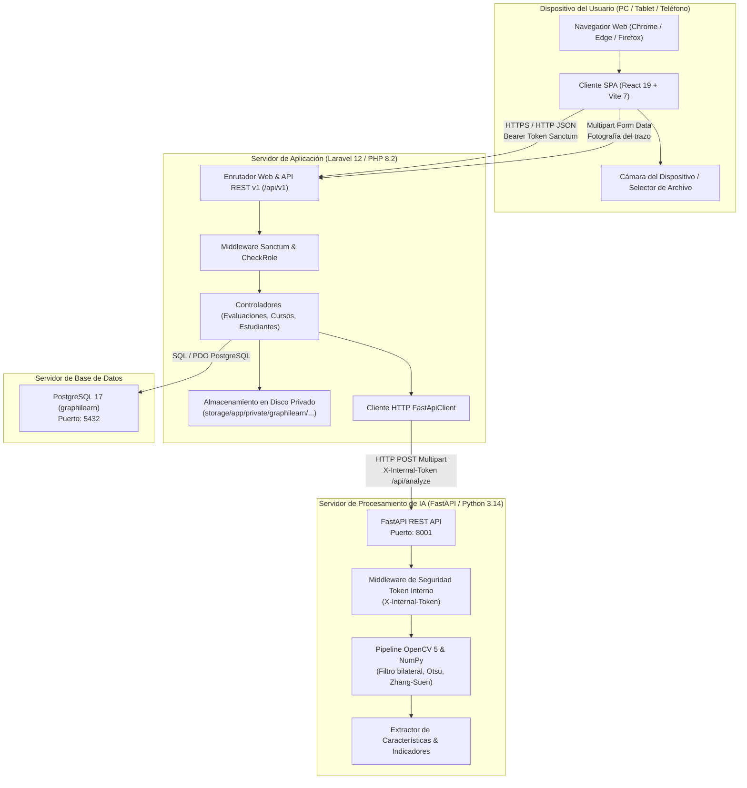
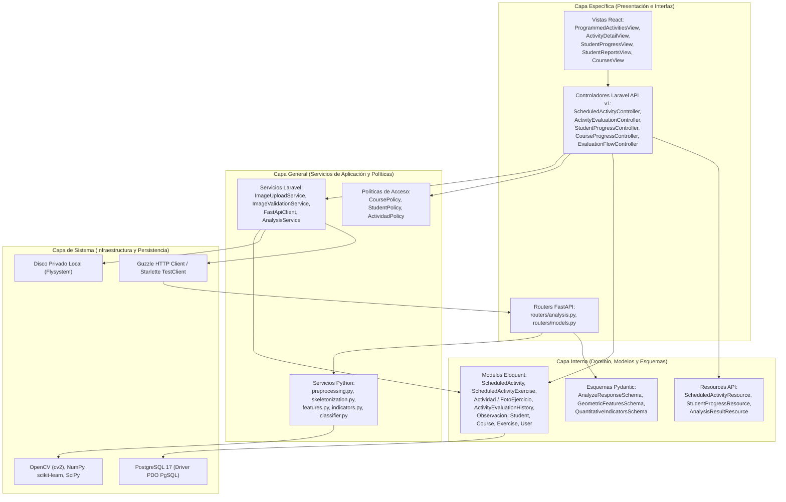
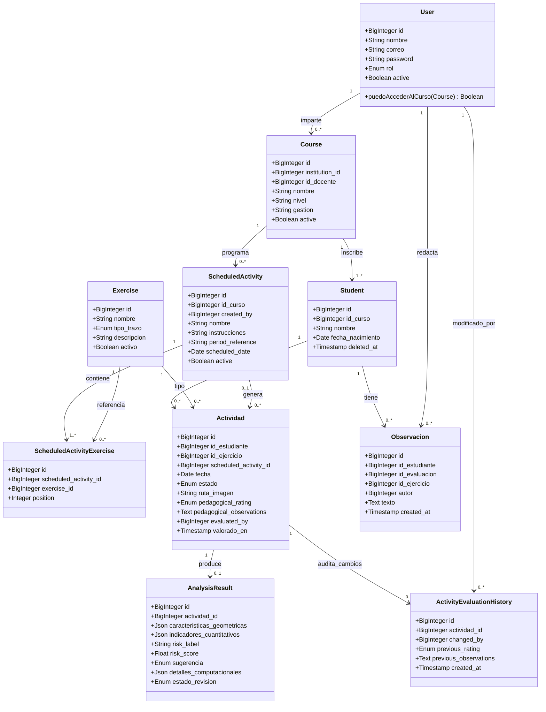
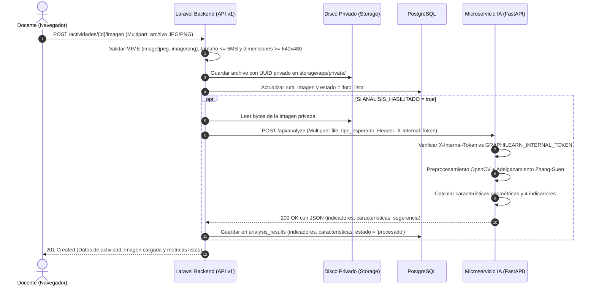
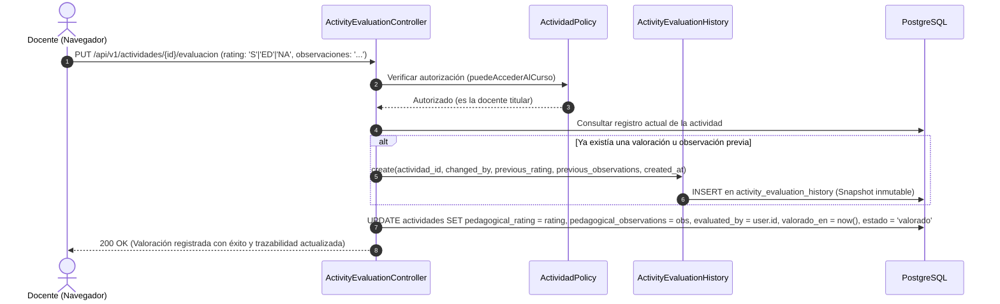

# Sprint 3 — Diseño de Arquitectura y Datos

## 1.5. Diseño de la Arquitectura

La arquitectura de GraphiLearn AI en el Sprint 3 consolida un modelo desacoplado en capas y microservicios, optimizado para la separación entre la gestión académica relacional y el procesamiento intensivo de visión por computadora.

---

### 1.5.1. Diagrama de Despliegue

El diagrama siguiente describe la distribución de los componentes del sistema en sus respectivos entornos de ejecución:

---

### 1.5.2. Diagrama de Paquetes (Organizado en Capas)

Siguiendo la metodología de Martínez Canedo, los componentes de software se organizan en cuatro capas arquitectónicas:

---

## 1.6. Diseño de Datos

### 1.6.1. Diagrama de Clases

El diagrama de clases para el Sprint 3 modela las programaciones multiejercicio, la ejecución individual por estudiante, el almacenamiento de la fotografía privada, los resultados cuantitativos y la auditoría de valoraciones docentes:

---

### 1.6.2. Mapeo Relacional (Diccionario de Datos)

A continuación se presenta el mapeo de las tablas creadas o ampliadas en el Sprint 3:

#### Tabla: `scheduled_activities` (Actividades Programadas)
| Columna | Tipo | Clave | Restricciones / Descripción |
|---|---|---|---|
| `id` | BIGSERIAL | PK | Identificador único de la programación |
| `id_curso` | BIGINT | FK | Referencia a `courses(id)` ON DELETE CASCADE |
| `created_by` | BIGINT | FK | Referencia a `users(id)` ON DELETE SET NULL |
| `nombre` | VARCHAR(255) | | Nombre de la actividad programada |
| `instrucciones`| TEXT | Nullable | Pautas e instrucciones pedagógicas |
| `period_reference` | VARCHAR(100) | Nullable | Periodo lectivo (ej. "1er Trimestre", "Diagnóstico") |
| `scheduled_date` | DATE | Nullable | Fecha programada para la aplicación |
| `active` | BOOLEAN | Default true | Estado activo / desactivado |
| `deleted_at` | TIMESTAMP | Nullable | Borrado lógico (SoftDeletes) |

#### Tabla: `scheduled_activity_exercises` (Pivote Ordenada de Ejercicios)
| Columna | Tipo | Clave | Restricciones / Descripción |
|---|---|---|---|
| `id` | BIGSERIAL | PK | Identificador único del ítem |
| `scheduled_activity_id`| BIGINT | FK | Referencia a `scheduled_activities(id)` ON DELETE CASCADE |
| `exercise_id` | BIGINT | FK | Referencia a `exercises(id)` ON DELETE RESTRICT |
| `position` | INT | Default 1 | Orden del ejercicio dentro de la evaluación |
| *Índice Único* | UNIQUE | | `(scheduled_activity_id, exercise_id)` |
| *Índice Único* | UNIQUE | | `(scheduled_activity_id, position)` |

#### Tabla: `actividades` / `fotos_ejercicio` (Ejecuciones Individuales de Ejercicio)
| Columna | Tipo | Clave | Restricciones / Descripción |
|---|---|---|---|
| `id` | BIGSERIAL | PK | Identificador de la ejecución individual |
| `id_estudiante` | BIGINT | FK | Referencia a `students(id)` ON DELETE CASCADE |
| `id_ejercicio` | BIGINT | FK | Referencia a `exercises(id)` ON DELETE RESTRICT |
| `scheduled_activity_id`| BIGINT | FK | Nullable, referencia a `scheduled_activities(id)` |
| `fecha` | DATE | | Fecha en que se realizó el trazo |
| `estado` | VARCHAR(50) | Check | `'pendiente'`, `'procesando'`, `'procesado'`, `'error'` (o `'sin_foto'`, `'foto_lista'`, `'valorado'`) |
| `ruta_imagen` | VARCHAR(255)| Nullable | Ruta relativa en `storage/app/private/` (nombre UUID) |
| `pedagogical_rating` / `valoracion` | VARCHAR(10) | Check | Nullable: `'S'`, `'ED'`, `'NA'` (Escala oficial) |
| `pedagogical_observations` | TEXT | Nullable | Comentario cualitativo del docente |
| `evaluated_by` / `valorado_por` | BIGINT | FK | Nullable, referencia a `users(id)` |
| `valorado_en` | TIMESTAMP | Nullable | Fecha y hora en que se emitió la valoración |
| *Índice Único* | UNIQUE | | `(scheduled_activity_id, id_estudiante, id_ejercicio)` |

#### Tabla: `activity_evaluation_history` (Historial Inmutable de Auditoría)
| Columna | Tipo | Clave | Restricciones / Descripción |
|---|---|---|---|
| `id` | BIGSERIAL | PK | Identificador del evento de auditoría |
| `actividad_id` | BIGINT | FK | Referencia a `actividades(id)` ON DELETE CASCADE |
| `changed_by` | BIGINT | FK | Referencia a `users(id)` ON DELETE SET NULL |
| `previous_rating` | VARCHAR(10) | Nullable | Calificación anterior (S, ED, NA) |
| `previous_observations`| TEXT | Nullable | Texto de observación anterior |
| `created_at` | TIMESTAMP | | Fecha y hora exacta en que se produjo la modificación |

---

## 2. Actividades a realizar durante la ejecución del sprint (R-3)

### 2.1. Lógica de Negocio

#### 2.1.1. Diagrama de Secuencia 1: Carga de Fotografía y Procesamiento con IA

El siguiente diagrama muestra el flujo desde que la docente selecciona o captura la fotografía de un trazo, pasando por la validación y el envío seguro con token hacia FastAPI, hasta la persistencia del resultado computacional:

---

#### 2.1.2. Diagrama de Secuencia 2: Valoración Pedagógica Manual y Auditoría en Historial

Este diagrama detalla cómo la docente emite su calificación cualitativa (S / ED / NA) respetando el principio *Human-in-the-Loop*, y cómo el sistema garantiza la trazabilidad inmutable:

