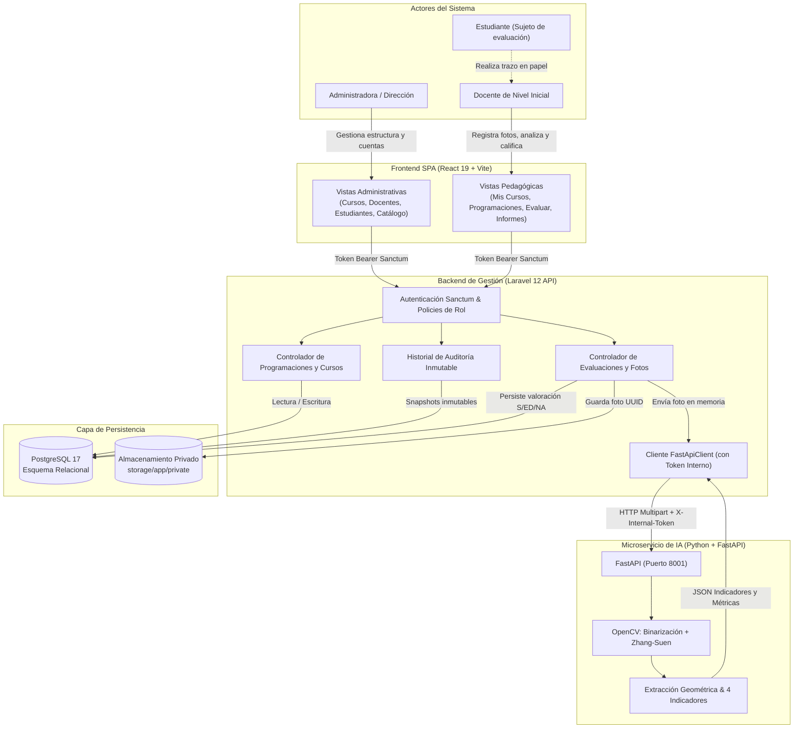

# Sprint 3 — Sprint Planning y Backlog

## 1. Sprint Planning

**Proyecto:** GraphiLearn AI  
**Sprint número:** 3  
**Product Owner:** Elizabet Luzia Ponce Yepez  
**Scrum Master:** Elizabet Luzia Ponce Yepez  
**Equipo de Desarrollo:** Elizabet Luzia Ponce Yepez  
**Versión del Product Backlog de referencia:** 1.0 (definida en Sprint 0 / Panel 1)  
**Tiempo programado del Sprint:** 3 semanas  
**Historias de Usuario abordadas:** HU-04, HU-12, HU-13, HU-14, HU-15, HU-17 (y refuerzo de roles en HU-01 y HU-02).

El Sprint 3 se concentra en cerrar la brecha entre el procesamiento computacional de imágenes (Sprint 2) y el flujo de trabajo pedagógico real en el aula de educación inicial. En este Sprint se implementa la programación de actividades con múltiples ejercicios, el aislamiento estricto de roles (administradora vs. docente), la carga protegida de fotografías, la valoración cualitativa manual por parte del docente (escala S / ED / NA) con historial inmutable de auditoría, y las pantallas de seguimiento y evolución temporal del estudiante.

---

### 1.1. Objetivos del Sprint

Los objetivos específicos del Sprint 3 son:

1. **Gestión de actividades programadas multiejercicio (HU-04):** Permitir a la administración definir actividades vinculadas a un curso que contengan uno o varios ejercicios grafomotores ordenados (líneas, círculos, espirales, zigzag), evitando duplicidades y organizando las evaluaciones del periodo lectivo.
2. **Aislamiento y control de acceso por roles (Seguridad):** Garantizar que el docente únicamente acceda a sus cursos y estudiantes asignados, y que la administradora gestione la infraestructura institucional sin acceso indebido a fotografías privadas ni valoraciones pedagógicas individuales de menores.
3. **Carga y almacenamiento seguro de evidencias (HU-05 / HU-04):** Proveer captura y carga de fotografías de ejercicios con validación de formato (JPG/PNG) y resolución mínima (640×480), almacenándolas en el disco privado del servidor sin exposición pública.
4. **Consulta y presentación de resultados de análisis (HU-12):** Exponer las características geométricas e indicadores cuantitativos extraídos por el microservicio FastAPI, presentando la sugerencia computacional como información de apoyo no diagnóstica.
5. **Valoración pedagógica docente manual y observaciones (HU-15):** Permitir a la docente registrar la calificación en la escala oficial de educación inicial (**S** = Superado, **ED** = En Desarrollo, **NA** = No Alcanzado), ingresar observaciones cualitativas y preservar cada modificación en una bitácora inmutable de auditoría (`activity_evaluation_history` / `observaciones`).
6. **Seguimiento histórico y evolución longitudinal (HU-13, HU-14, HU-17):** Proporcionar fichas de seguimiento por estudiante y reportes agregados por aula, comparando el desempeño del niño entre diferentes fechas o trimestres y asegurando la trazabilidad completa (estudiante, foto, métricas, docente evaluador, historial de cambios).

---

## 1.2. Historias de Usuario

A continuación se detallan las fichas de las Historias de Usuario desarrolladas en el Sprint 3, siguiendo el formato estándar de la metodología de Martínez Canedo:

### Historia de Usuario HU-04

| Campo | Contenido |
|---|---|
| **Id.** | HU-04 |
| **Nombre corto** | Registrar actividad grafomotora / Programación multiejercicio |
| **Prioridad** | Alta |
| **PHU** | 8 |
| **Como** | Docente / Administrador |
| **Quiero** | Registrar y programar actividades grafomotoras asociadas a un curso, estudiante y ejercicios |
| **Para** | Organizar los ejercicios que los estudiantes deben realizar y habilitar el registro de evidencias |
| **Descripción** | Permite crear actividades programadas (`scheduled_activities`) con un conjunto ordenado de ejercicios del catálogo (`scheduled_activity_exercises`). A partir de esta programación, la docente registra la ejecución individual de cada estudiante, generando la ranura de trabajo correspondiente. |
| **Conversación / Reglas** | - Una programación pertenece a un curso institucional. - Puede incluir múltiples ejercicios ordenados por posición. - Un estudiante no puede tener dos ejecuciones del mismo ejercicio dentro de la misma programación (restricción de unicidad para evitar duplicados). - Si se desactiva una programación, se preservan sus datos mediante baja lógica (soft delete). |
| **Criterios de Aceptación** | 1. La administradora puede crear una actividad programada seleccionando curso, fecha, periodo de referencia y lista ordenada de ejercicios. 2. La docente asignada al curso visualiza las actividades programadas activas. 3. El sistema genera los registros individuales de actividad para los estudiantes del curso. 4. Se rechaza con error 409 cualquier intento de duplicar un ejercicio para el mismo estudiante en la misma programación. |
| **Evidencia en Código** | `app/Http/Controllers/Api/V1/ScheduledActivityController.php`, `app/Models/ScheduledActivity.php`, migraciones `2026_10_29_000001` y `2026_10_30_000001`. |
| **Desarrollador** | Elizabet Ponce |

---

### Historia de Usuario HU-12

| Campo | Contenido |
|---|---|
| **Id.** | HU-12 |
| **Nombre corto** | Consultar resultado del análisis |
| **Prioridad** | Alta |
| **PHU** | 5 |
| **Como** | Docente |
| **Quiero** | Consultar los resultados obtenidos del análisis computacional de la imagen |
| **Para** | Conocer las características geométricas y los indicadores cuantitativos del trazo realizado por el niño |
| **Descripción** | La docente accede al detalle de la actividad procesada y visualiza las métricas calculadas por el microservicio FastAPI (longitud, curvatura, inclinación, proporción, desviación, regularidad, continuidad, rugosidad). |
| **Conversación / Reglas** | - Solo la docente asignada al curso del estudiante puede consultar los resultados. - La información se presenta de forma clara, separando las mediciones objetivas de la sugerencia experimental. - Se incluye advertencia explícita: *"Herramienta de apoyo; no constituye diagnóstico clínico ni pedagógico definitivo."* |
| **Criterios de Aceptación** | 1. El endpoint `GET /api/v1/actividades/{id}/resultado` devuelve los datos persistidos en `analysis_results`. 2. Si el análisis aún no se ha ejecutado, indica estado pendiente. 3. Si el microservicio no estuvo disponible o falló, se informa el estado de error sin corromper el registro. 4. La interfaz presenta los indicadores con etiquetas legibles en español. |
| **Evidencia en Código** | `app/Http/Controllers/Api/V1/AnalysisController.php`, `app/Http/Resources/AnalysisResultResource.php`, `resources/js/views/ActivityDetailView.jsx`. |
| **Desarrollador** | Elizabet Ponce |

---

### Historia de Usuario HU-13

| Campo | Contenido |
|---|---|
| **Id.** | HU-13 |
| **Nombre corto** | Consultar historial de actividades del estudiante |
| **Prioridad** | Alta |
| **PHU** | 5 |
| **Como** | Docente |
| **Quiero** | Consultar el historial completo de actividades realizadas por un estudiante |
| **Para** | Revisar las evidencias registradas y las valoraciones otorgadas a lo largo del tiempo |
| **Descripción** | Permite a la docente seleccionar un estudiante de su aula y acceder a una lista cronológica de todos sus ejercicios registrados, fotografías cargadas, estados de análisis y notas pedagógicas. |
| **Conversación / Reglas** | - La consulta está restringida a docentes asignadas al curso del estudiante. - El historial debe mostrar fecha, ejercicio, estado de la foto (sin foto, foto lista, valorado) y calificación docente si existe. - Permite descargar de forma segura la fotografía original mediante token autenticado. |
| **Criterios de Aceptación** | 1. La docente visualiza todas las actividades históricas del estudiante seleccionado. 2. Se identifican claramente los ejercicios completados y los pendientes de fotografía. 3. La administradora no tiene acceso a las imágenes privadas de los estudiantes desde este flujo. 4. La respuesta incluye paginación o listado ordenado cronológicamente descendente. |
| **Evidencia en Código** | `app/Http/Controllers/Api/V1/StudentProgressController.php`, `resources/js/views/StudentProgressView.jsx`. |
| **Desarrollador** | Elizabet Ponce |

---

### Historia de Usuario HU-14

| Campo | Contenido |
|---|---|
| **Id.** | HU-14 |
| **Nombre corto** | Visualizar evolución del estudiante |
| **Prioridad** | Alta |
| **PHU** | 8 |
| **Como** | Docente |
| **Quiero** | Visualizar la evolución de los indicadores y valoraciones de un estudiante entre diferentes periodos |
| **Para** | Identificar avances, retrocesos o estancamientos en el desarrollo grafomotor del niño |
| **Descripción** | Proporciona una vista comparativa del progreso del estudiante agrupada por tipo de ejercicio (líneas, círculos, espirales, zigzag) y por referencia de periodo o trimestre (ej. Diagnóstico / 1er Trimestre / 2do Trimestre / 3er Trimestre). |
| **Conversación / Reglas** | - La comparación agrupa las ejecuciones del mismo ejercicio en distintas fechas/periodos. - No se calculan porcentajes inventados de avance; se presentan los indicadores cuantitativos reales y las valoraciones S/ED/NA emitidas por la docente. - Permite contrastar visualmente si el trazo mejoró en regularidad o continuidad. |
| **Criterios de Aceptación** | 1. El endpoint `GET /api/v1/students/{id}/progress` agrupa evaluaciones por ejercicio y periodo. 2. La interfaz de informes (`StudentReportsView.jsx`) muestra la secuencia temporal de evaluaciones. 3. Si hay al menos dos periodos evaluados para un ejercicio, se muestra la tabla comparativa correspondiente. 4. Se visualizan las observaciones pedagógicas asociadas a cada momento. |
| **Evidencia en Código** | `app/Http/Controllers/Api/V1/StudentProgressController.php`, `resources/js/views/StudentReportsView.jsx`. |
| **Desarrollador** | Elizabet Ponce |

---

### Historia de Usuario HU-15

| Campo | Contenido |
|---|---|
| **Id.** | HU-15 |
| **Nombre corto** | Registrar observaciones y valoración pedagógica |
| **Prioridad** | Media (Elevada a Alta en Sprint 3 por pertinencia de aula) |
| **PHU** | 5 |
| **Como** | Docente |
| **Quiero** | Registrar mi valoración pedagógica (S, ED, NA) y observaciones cualitativas sobre el ejercicio |
| **Para** | Emitir el criterio pedagógico oficial y dejar constancia de las particularidades del niño |
| **Descripción** | La docente revisa el ejercicio y los indicadores computacionales, selecciona la calificación cualitativa oficial (**S** = Superado, **ED** = En Desarrollo, **NA** = No Alcanzado), redacta una observación (hasta 5000 caracteres) y guarda la evaluación. El sistema registra el autor y fecha, guardando el valor anterior en el historial inmutable. |
| **Conversación / Reglas** | - La valoración pedagógica es potestad exclusiva del docente (paradigma *Human-in-the-Loop*); la IA no asigna la calificación. - Cada actualización de valoración u observación genera un registro inmutable en `activity_evaluation_history` o `observaciones`. - El valor actual de la calificación se actualiza en la tabla de ejecuciones (`actividades.pedagogical_rating` / `fotos_ejercicio.valoracion`). |
| **Criterios de Aceptación** | 1. Endpoint `PUT /api/v1/actividades/{id}/evaluacion` acepta valores `S`, `ED` o `NA` y texto de observación. 2. Se valida que el usuario autenticado sea la docente titular del curso. 3. Antes de modificar el valor existente, se guarda una copia exacta del valor anterior en la tabla de historial con el ID del usuario que realizó el cambio. 4. El estado de la actividad pasa a `valorado`. |
| **Evidencia en Código** | `app/Http/Controllers/Api/V1/ActivityEvaluationController.php`, `app/Models/ActivityEvaluationHistory.php`, migración `2026_10_29_000001`, migración `2026_11_15_000001`. |
| **Desarrollador** | Elizabet Ponce |

---

### Historia de Usuario HU-17

| Campo | Contenido |
|---|---|
| **Id.** | HU-17 |
| **Nombre corto** | Consultar trazabilidad de la evaluación |
| **Prioridad** | Media |
| **PHU** | 5 |
| **Como** | Usuario autorizado (Docente / Dirección) |
| **Quiero** | Consultar la trazabilidad completa entre fotografía, análisis, modelo y cambios de valoración |
| **Para** | Garantizar la transparencia, auditoría y rigor metodológico de las decisiones pedagógicas |
| **Descripción** | Permite inspeccionar la procedencia de una evaluación: fecha de carga de la foto, metadatos de la imagen, versión del microservicio/modelo utilizado, fecha de análisis, y el histórico cronológico de modificaciones de valoración con sus respectivos autores. |
| **Conversación / Reglas** | - La bitácora de cambios es de solo lectura y no admite eliminación ni sobreescritura. - Se registra la fecha y hora exacta (`created_at`) de cada modificación. - La docente puede consultar el historial de auditoría desde el detalle de la actividad. |
| **Criterios de Aceptación** | 1. El endpoint `GET /api/v1/actividades/{id}/evaluacion/historial` devuelve la lista cronológica de cambios. 2. Cada entrada incluye: `rating_anterior`, `observacion_anterior`, `usuario_cambio` y `fecha_cambio`. 3. El resultado del análisis referencia los metadatos computacionales y la versión del modelo si existió inferencia. 4. Se comprueba que no existen huecos de trazabilidad ante múltiples ediciones. |
| **Evidencia en Código** | `app/Http/Controllers/Api/V1/ActivityEvaluationController.php`, tests en `tests/Feature/EvaluationApiTest.php` y `EvaluationRoutesV1Test.php`. |
| **Desarrollador** | Elizabet Ponce |

---

## 1.3. Contexto del Sistema

En el Sprint 3 el sistema consolida la interacción entre los actores de la institución educativa, la interfaz de usuario en React, la API segura en Laravel 12 y el servicio desacoplado de cómputo en Python/FastAPI:

---

## 1.4. Sprint Backlog

A continuación se presenta el Sprint Backlog planificado y ejecutado para el Sprint 3:

| Id | Tarea Técnica | HU Asociada | Estimación (Horas) | Responsable | Estado Comprobado |
|---|---|---|---:|---|---|
| **SB3-01** | Diseñar y ejecutar migraciones de actividades programadas multiejercicio (`scheduled_activities`, `scheduled_activity_exercises`) | HU-04 | 12 hrs | Elizabet Ponce | **Realizado** (Migraciones aplicadas en PostgreSQL, clave foránea y orden) |
| **SB3-02** | Implementar aislamiento de cursos y estudiantes por docente con Laravel Policies (`puedeAccederAlCurso`) | HU-04, HU-13 | 8 hrs | Elizabet Ponce | **Realizado** (Cubierto por tests de aislamiento en `EvaluationApiTest`) |
| **SB3-03** | Implementar captura fotográfica, subida privada y validación de resolución (JPG/PNG, $\ge 640\times 480$) | HU-04, HU-05 | 10 hrs | Elizabet Ponce | **Realizado** (`ImageValidationService`, almacenamiento UUID en `storage/app/private`) |
| **SB3-04** | Integrar endpoint de procesamiento con FastAPI enviando token de seguridad compartido (`X-Internal-Token`) | HU-12 | 8 hrs | Elizabet Ponce | **Realizado** (Configurado en `.env`, verificado 200 OK en `FastApiClient`) |
| **SB3-05** | Crear endpoints y persistencia de valoración pedagógica manual S/ED/NA y texto de observaciones | HU-15 | 10 hrs | Elizabet Ponce | **Realizado** (`ActivityEvaluationController`, validación estricta de enum) |
| **SB3-06** | Implementar tabla y lógica de auditoría inmutable para historial de cambios de valoración | HU-15, HU-17 | 8 hrs | Elizabet Ponce | **Realizado** (`activity_evaluation_history` / `observaciones` registra snapshot y usuario) |
| **SB3-07** | Desarrollar vista de seguimiento individual, historial de evidencias y reporte comparativo por periodos | HU-13, HU-14 | 14 hrs | Elizabet Ponce | **Realizado** (`StudentProgressView.jsx`, `StudentReportsView.jsx` consumiendo API) |
| **SB3-08** | Pruebas de integración, prevención de duplicados en base de datos y reporte de pruebas automatizadas | Todas | 10 hrs | Elizabet Ponce | **Realizado** (38 tests aprobados en PHPUnit, 20 tests en pytest) |
| **Total** | | | **80 hrs** | | |
